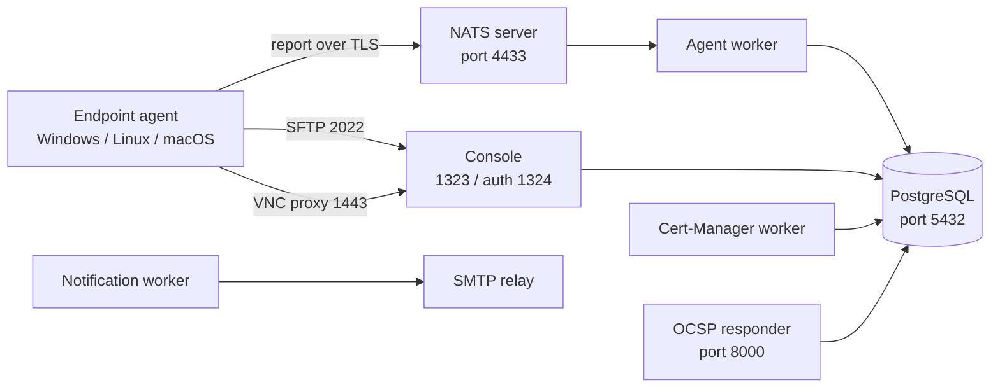
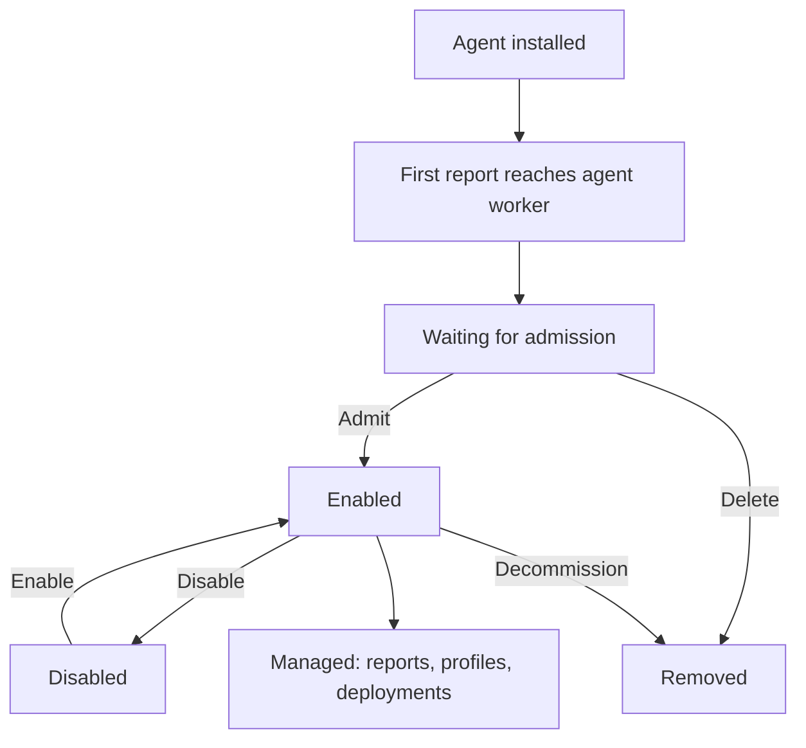

# Module 01 — Introduction to OpenUEM

## The problem — the limits of managing a hundred endpoints by hand

Suppose an organization has more than a hundred computers. Checking machine
by machine to answer which software is installed on which machine, which
machine has its antivirus disabled, and which machine still has a security
update pending is time-consuming and error-prone.

The three main problems of manual management are as follows.

- **No visibility** — the state of a hundred machines cannot be known from one place.
- **Inconsistency** — each machine has different versions of the software.
- **Latency** — weeks after an update ships, it is still unknown which machines
  have not received it.

Endpoint management is the process of solving these problems by installing a
small agent on the machines and collecting, deciding and distributing the
information centrally.

## The five core functions of endpoint management

| Function | Question it answers |
|---|---|
| Inventory | Which machines exist, and what hardware and OS they run |
| Software distribution | Which application is installed on which machines |
| Configuration | Which setting has been enforced |
| Security visibility | What the state of antivirus and updates is |
| Reporting | What evidence can be given to administrators and management |

OpenUEM performs these five functions from a single web console.

## The structure of OpenUEM

OpenUEM is a **self-hosted** system. That means the server components must be
deployed by you on your own network or in your own cloud. The data lives in
your own PostgreSQL database.

The system has four main parts.

1. **Agent** — present on each endpoint. It collects information and
   sends it to the server at a defined interval.
2. **NATS server** — the message broker between agents and server workers.
   Agents connect to this point.
3. **Workers** — receive agent reports and store them in the database.
   Workers also issue certificates and send notifications.
4. **Console** — the web interface used by the administrator.

In addition there is an OCSP responder that checks certificate validity and a
PostgreSQL database that stores all the information.

**Figure 1 — OpenUEM component topology**



Figure walkthrough — this figure shows with arrows which component calls which.
First, the agent on the endpoint connects to port 4433 of the NATS server and
sends its report. Second, NATS passes that report to the agent worker. Third,
the agent worker reads the report and stores it in PostgreSQL. Fourth, the
console reads the same database and shows it to the administrator as a web
page. Fifth, if the administrator needs remote assistance, the console connects
to the agent's SFTP (2022) or VNC proxy (1443). The OCSP responder checks
whether certificates have been revoked.

> The ports in this figure are the default values defined in the OpenUEM
> documentation. They can be changed during installation.

## Self-hosted versus SaaS comparison

| Aspect | Self-hosted (OpenUEM) | SaaS endpoint manager |
|---|---|---|
| Data location | Your own database and network | The provider's cloud |
| Cost | Servers and staff | A fee per number of users |
| Control | Version, backup and policy all your own | Set by the provider |
| Operational duty | You maintain upgrade, backup and certificates | Maintained by the provider |
| Works without internet | Available on an internal network | Internet required |
| Connection control | You define firewall and ports | Defined by the provider |

The key question when choosing is "do you need to control the data yourself,
and do you have the staff to maintain it". A self-hosted system means you
plan backup, upgrade and certificate lifetime yourself.

## Endpoint lifecycle

An agent passes through stages starting from the moment it is installed on a
machine. Understanding what each stage means is the basis for later
troubleshooting.

**Figure 2 — endpoint lifecycle**



Figure walkthrough — first, the agent is installed on the machine. Second, the
agent connects to NATS and sends its first report. Third, the agent worker
receives that report and sets the agent state to "Waiting for admission". At
this stage reports are arriving but the agent cannot be managed yet. Fourth,
if the administrator performs Admit, the state changes to "Enabled" and a new
certificate is issued. Fifth, at the Enabled stage, receiving reports, applying
profiles and deploying software are all possible. Sixth, if you want to pause
it, you can Disable it; it remains in the database and reports stop.

## What each stage allows

| State | Receives reports | Managed | Inventory/charts | Certificate |
|---|---|---|---|---|
| Waiting for admission | Yes | No | Not included | Not issued yet |
| Enabled | Yes | Yes | Included | Issued |
| Disabled | No | No | Included | Still present |

When Admit is performed, the cert-manager worker issues `server.cer` and
`server.key` for the agent's SFTP and VNC proxy. Those two certificates must be
placed in the agent's certificate folder. On Windows that is
`C:\Program Files\OpenUEM Agent\certificates`, on Linux
`/etc/openuem-agent/certificates`.

## Capabilities of OpenUEM

| Capability | How it is used |
|---|---|
| Inventory | Collects hardware, OS, disks, network adapters, printers and applications |
| Software deployment | WinGet on Windows, Flatpak on Linux, HomeBrew on macOS |
| Profiles | Defines the desired state as a set of tasks |
| Security visibility | Antivirus state, Windows updates and Linux security updates |
| Remote assistance | VNC, RDP (Gnome/Wayland) or RustDesk |
| File browsing | Viewing the endpoint's disk over SFTP and transferring files |
| Power management | Wake-on-LAN, scheduled shutdown/reboot |
| Reporting | Exporting PDF/CSV reports |
| Multi-tenancy | Multiple organizations and sites in a single installation |
| Authentication | Certificate or OpenID Connect (Authelia, Authentik, Keycloak, Zitadel) |

## What to plan before building a lab

Before starting a lab, the following points must be defined on paper.

**1. DNS names** — OpenUEM needs a DNS domain to resolve endpoint names to IP
addresses. Three names must be defined: the console host, the NATS host and the
OCSP host. The documentation uses an example domain such as `openuem.example`.

**2. Ports** — the following ports must be free.

```text
1323  console (web UI)
1324  console auth
4433  NATS (agents connect here)
8000  OCSP responder
2022  agent SFTP
1443  agent VNC proxy
5432  PostgreSQL
```

**3. Accounts** — the `openuem` OS user created by the installer, the PostgreSQL
user, and the console administrator account.

**4. JWT key** — a random string of 32 characters. The documentation advises
against using the default value.

**5. Time synchronization** — for certificates and TLS, the clocks of the server
and the endpoints must agree. NTP must be checked in advance.

**6. Backup** — how the PostgreSQL database and the certificate folder will be
backed up must be defined in advance. Without the certificates, agents cannot
reconnect.

## Points to watch in production

- The NATS port (4433) must not be opened directly to the internet. Restrict it
  for agents through a VPN or a reverse proxy.
- Certificate expiry is the most common cause of failure. Record the expiry date.
- For remote endpoints (machines connecting from outside the LAN), SFTP, remote
  assistance and WOL cannot be used. The console indicates this with an
  aeroplane icon.
- The console must only be reached over HTTPS. If a reverse proxy is used, the
  `REVERSE_PROXY_*` values must be set correctly.

## Self-check questions

**1. An agent is sitting in the "Waiting for admission" stage. Can it be managed?**
No. Reports are being received, but until it is admitted you cannot deploy
software or apply profiles. It does not appear in the inventory either.

**2. Which port must be opened for agents to connect?**
Port 4433 of the NATS server. SFTP (2022) and the VNC proxy (1443) are connected
from the console for remote assistance and file browsing.

**3. What must be in place before installing OpenUEM?**
A PostgreSQL database (including the defined user and password) and a DNS domain
that can resolve the console host name.

**4. What is the difference between "Disabled" and "Removed"?**
A Disabled agent remains in the database and its reports stop. It can be enabled
again. Removed is a permanent deletion, and to get the agent back you must
install it again.

## Technical review notes

- The components and ports are taken from openuem.eu/docs (Server installation,
  Docker/Podman). Ports can change depending on the installation type.
- The exact card names and menu labels of the dashboard can change between
  versions — they need to be re-checked per version.
- The agent report interval (default 60 minutes) and the profile check interval
  (default 30 minutes) can be changed in General Settings.
