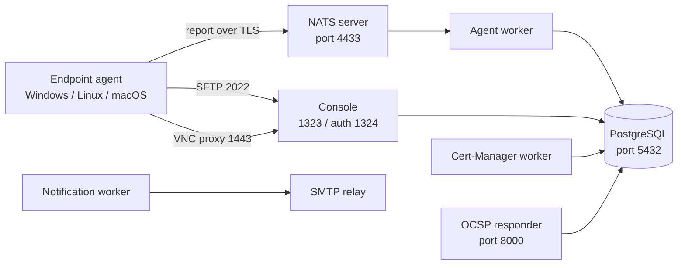
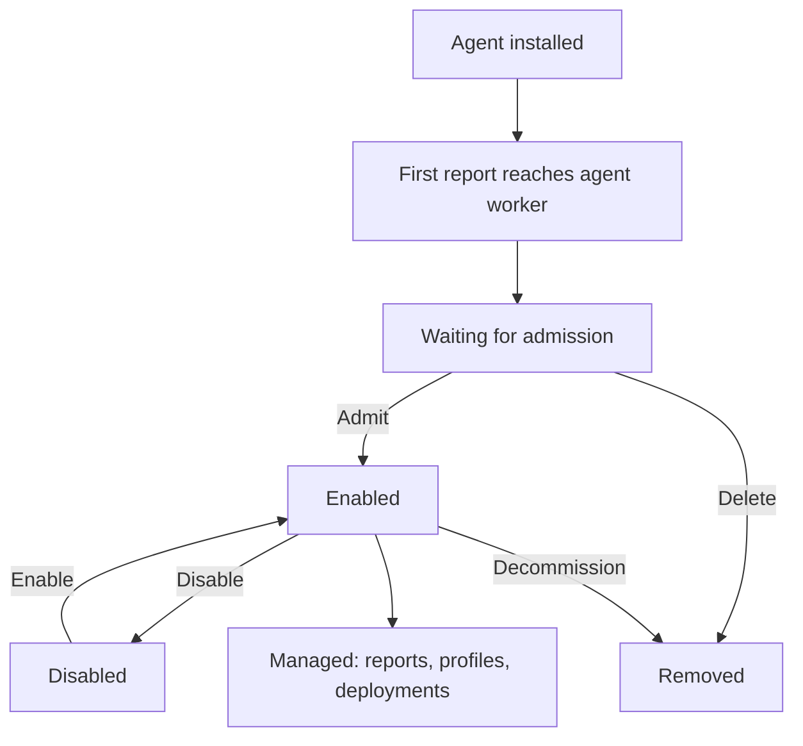

# Module 01 — Introduction to OpenUEM

## ပြဿနာ — endpoint တစ်ရာကို လက်ဖြင့် စီမံခြင်း၏ ကန့်သတ်ချက်

အဖွဲ့အစည်းတစ်ခုတွင် ကွန်ပျူတာ တစ်ရာကျော် ရှိသည်ဆိုပါစို့။ မည်သည့်စက်တွင်
မည်သည့် software ထည့်ထားသည်၊ မည်သည့်စက်၏ antivirus ကို ပိတ်ထားသည်၊
မည်သည့်စက်တွင် security update ကျန်နေသည် ဆိုသည့် မေးခွန်းများကို
တစ်စက်ချင်း ဝင်စစ်ခြင်းသည် အချိန်ကုန်ပြီး မှားယွင်းလွယ်သည်။

လက်ဖြင့် စီမံခြင်း၏ အဓိက ပြဿနာ သုံးခုမှာ ဤသို့ဖြစ်သည်။

- **မမြင်နိုင်ခြင်း** — စက်တစ်ရာ၏ အခြေအနေကို တစ်နေရာတည်းမှ မသိရခြင်း။
- **မတူညီခြင်း** — စက်တစ်ခုစီတွင် version မတူညီသော software များ ရှိနေခြင်း။
- **အချိန်လွန်ခြင်း** — update တစ်ခု ထွက်ပြီး ရက်သတ္တပတ်များကြာသည်အထိ
  မည်သည့်စက်တွင် မထည့်ရသေးသည်ကို မသိရခြင်း။

Endpoint management ဆိုသည်မှာ ဤပြဿနာများကို ဖြေရှင်းရန် စက်များပေါ်တွင်
သေးငယ်သော agent တစ်ခု ထည့်ပြီး အချက်အလက်များကို ဗဟိုမှ စုဆောင်း၊
ဆုံးဖြတ်၊ ဖြန့်ဖြူးသည့် လုပ်ငန်းစဉ် ဖြစ်သည်။

## Endpoint management ၏ အဓိက လုပ်ငန်းငါးရပ်

| လုပ်ငန်း | ဖြေရှင်းသော မေးခွန်း |
|---|---|
| Inventory | ဘယ်စက်တွေ ရှိသလဲ၊ hardware နှင့် OS ဘာလဲ |
| Software distribution | ဘယ် application ကို ဘယ်စက်တွေမှာ ထည့်ထားသလဲ |
| Configuration | ဘယ် setting ကို အတင်းအကြပ် သတ်မှတ်ထားသလဲ |
| Security visibility | antivirus နှင့် update အခြေအနေ ဘယ်လိုရှိသလဲ |
| Reporting | စီမံခန့်ခွဲသူနှင့် အုပ်ချုပ်သူကို ဘယ်လို အထောက်အထား ပေးမလဲ |

OpenUEM သည် ဤလုပ်ငန်းငါးရပ်ကို တစ်ခုတည်းသော web console မှ ဆောင်ရွက်ပေးသည်။

## OpenUEM ၏ ဖွဲ့စည်းပုံ

OpenUEM သည် **self-hosted** စနစ်ဖြစ်သည်။ ဆိုလိုသည်မှာ server component များကို
မိမိ၏ ကွန်ရက် သို့မဟုတ် cloud တွင် ကိုယ်တိုင် တည်ဆောက်ရသည်။ ဒေတာများသည်
မိမိ၏ PostgreSQL database တွင် ရှိသည်။

စနစ်တွင် အဓိက အစိတ်အပိုင်း လေးမျိုး ရှိသည်။

1. **Agent** — endpoint တစ်ခုစီတွင် ရှိသည်။ အချက်အလက် စုဆောင်းပြီး
   သတ်မှတ်ထားသော အချိန်တိုင်း server သို့ ပို့သည်။
2. **NATS server** — agent များနှင့် server worker များ ကြား message ပို့ဆောင်ပေးသော
   broker ဖြစ်သည်။ Agent များက ဤနေရာသို့ ဆက်သွယ်သည်။
3. **Worker များ** — agent report ကို လက်ခံပြီး database တွင် သိမ်းသည်။
   Certificate ထုတ်ပေးခြင်း၊ notification ပို့ခြင်းကိုလည်း worker များက လုပ်သည်။
4. **Console** — စီမံခန့်ခွဲသူ အသုံးပြုသော web interface ဖြစ်သည်။

ထို့အပြင် certificate သက်တမ်း စစ်ဆေးပေးသော OCSP responder နှင့်
အချက်အလက်အားလုံး သိမ်းဆည်းသော PostgreSQL database ရှိသည်။

**Figure 1 — OpenUEM component topology**



ပုံရှင်းလင်းချက် — ဤပုံတွင် ဘယ်အစိတ်အပိုင်းက ဘယ်သူ့ကို ခေါ်သည်ကို မြှားဖြင့်
ပြထားသည်။ ပထမ၊ endpoint ပေါ်ရှိ agent က NATS server ၏ 4433 port သို့
ဆက်သွယ်ပြီး ၎င်း၏ report ကို ပို့သည်။ ဒုတိယ၊ NATS က ထို report ကို
agent worker ထံ ပေးပို့သည်။ တတိယ၊ agent worker က report ကို ဖတ်ပြီး
PostgreSQL ထဲ သိမ်းသည်။ စတုတ္ထ၊ console သည် တူညီသော database ကို
ဖတ်ပြီး စီမံခန့်ခွဲသူအား web page ဖြင့် ပြသည်။ ပဉ္စမ၊ စီမံခန့်ခွဲသူက
remote assistance လိုအပ်ပါက console မှတစ်ဆင့် agent ၏ SFTP (2022) သို့မဟုတ်
VNC proxy (1443) သို့ ချိတ်ဆက်သည်။ OCSP responder က certificate များ
ရုပ်သိမ်းခံရခြင်း ရှိ/မရှိကို စစ်ဆေးပေးသည်။

> ဤပုံပါ port များသည် OpenUEM documentation တွင် သတ်မှတ်ထားသော
> default တန်ဖိုးများ ဖြစ်သည်။ Installation တွင် ပြောင်းလဲနိုင်သည်။

## Self-hosted နှင့် SaaS နှိုင်းယှဉ်ချက်

| အချက် | Self-hosted (OpenUEM) | SaaS endpoint manager |
|---|---|---|
| ဒေတာ တည်ရှိမှု | မိမိ၏ database နှင့် network | ဝန်ဆောင်မှုပေးသူ၏ cloud |
| ကုန်ကျစရိတ် | server နှင့် လုပ်သားအင်အား | အသုံးပြုသူ အရေအတွက်အလိုက် ကြေး |
| ထိန်းချုပ်မှု | version၊ backup၊ policy အားလုံး ကိုယ်တိုင် | ဝန်ဆောင်မှုပေးသူ သတ်မှတ်သည် |
| လုပ်ငန်းတာဝန် | upgrade၊ backup၊ certificate ကို ကိုယ်တိုင်ထိန်း | ဝန်ဆောင်မှုပေးသူ ထိန်းသည် |
| အင်တာနက် မလိုအပ်မှု | အတွင်းကွန်ရက်တွင် ရနိုင်သည် | အင်တာနက် လိုအပ်သည် |
| ချိတ်ဆက်မှု ထိန်းချုပ် | firewall နှင့် port ကို ကိုယ်တိုင် သတ်မှတ် | ဝန်ဆောင်မှုပေးသူ သတ်မှတ် |

ရွေးချယ်ရာတွင် အဓိကမေးခွန်းမှာ "ဒေတာကို မိမိထိန်းချုပ်ရန် လိုသလား၊
ထိန်းသိမ်းရန် လုပ်သားအင်အား ရှိသလား" ဖြစ်သည်။ Self-hosted စနစ်တွင်
backup၊ upgrade နှင့် certificate သက်တမ်းကို ကိုယ်တိုင် စီစဉ်ရသည်။

## Endpoint lifecycle

Agent တစ်ခုသည် စက်ပေါ်တွင် install ပြီးသည့်အချိန်မှ စ၍ အဆင့်များ ဖြတ်သန်းသည်။
အဆင့်တစ်ခုချင်း၏ အဓိပ္ပာယ်ကို နားလည်ခြင်းသည် နောက်ပိုင်း
troubleshooting အတွက် အခြေခံ ဖြစ်သည်။

**Figure 2 — endpoint lifecycle**



ပုံရှင်းလင်းချက် — ပထမ၊ agent ကို စက်ပေါ်တွင် install လုပ်သည်။ ဒုတိယ၊ agent က
NATS သို့ ဆက်သွယ်ပြီး ပထမဆုံး report ပို့သည်။ တတိယ၊ agent worker က ထို
report ကို လက်ခံပြီး agent ၏ အခြေအနေကို "Waiting for admission" ဟု
သတ်မှတ်သည်။ ဤအဆင့်တွင် report များ ဝင်နေသော်လည်း စီမံခန့်ခွဲ၍ မရသေးပါ။
စတုတ္ထ၊ စီမံခန့်ခွဲသူက Admit လုပ်လိုက်ပါက အခြေအနေသည် "Enabled" သို့
ပြောင်းပြီး certificate အသစ် ထုတ်ပေးသည်။ ပဉ္စမ၊ Enabled အဆင့်တွင် report
လက်ခံခြင်း၊ profile ကျင့်သုံးခြင်း၊ software ဖြန့်ခြင်း အားလုံး လုပ်နိုင်သည်။
ဆဋ္ဌမ၊ ခေတ္တ ရပ်ထားလိုပါက Disable လုပ်နိုင်ပြီး database ထဲတွင် ကျန်ရှိကာ
report များ ရပ်သွားသည်။

## အဆင့်တစ်ခုချင်း၏ လုပ်ဆောင်နိုင်ချက်

| အခြေအနေ | Report လက်ခံ | စီမံခန့်ခွဲ | စာရင်းဇယား/Chart | Certificate |
|---|---|---|---|---|
| Waiting for admission | ရသည် | မရ | မပါ | မထုတ်ရသေး |
| Enabled | ရသည် | ရသည် | ပါသည် | ထုတ်ပြီး |
| Disabled | မရ | မရ | ပါသည် | ရှိနေဆဲ |

Admit လုပ်သည့်အခါ cert-manager worker က agent ၏ SFTP နှင့် VNC proxy
အတွက် `server.cer` နှင့် `server.key` ကို ထုတ်ပေးသည်။ ထို certificate နှစ်ခုကို
agent ၏ certificate folder တွင် ထည့်ရသည်။ Windows တွင်
`C:\Program Files\OpenUEM Agent\certificates`၊ Linux တွင်
`/etc/openuem-agent/certificates` ဖြစ်သည်။

## OpenUEM ၏ စွမ်းရည်များ

| စွမ်းရည် | အသုံးပြုပုံ |
|---|---|
| Inventory | hardware၊ OS၊ disk၊ network adapter၊ printer၊ application စုဆောင်းခြင်း |
| Software deployment | Windows တွင် WinGet၊ Linux တွင် Flatpak၊ macOS တွင် HomeBrew |
| Profiles | လိုချင်သော အခြေအနေ (desired state) ကို task များဖြင့် သတ်မှတ်ခြင်း |
| Security visibility | antivirus အခြေအနေ၊ Windows update နှင့် Linux security update |
| Remote assistance | VNC၊ RDP (Gnome/Wayland) သို့မဟုတ် RustDesk |
| File browsing | SFTP ဖြင့် endpoint ၏ disk ကို ကြည့်ခြင်း၊ ဖိုင်လွှဲခြင်း |
| Power management | WOL ဖြင့် နှိုးခြင်း၊ သတ်မှတ်ချိန်တွင် shutdown/reboot |
| Reporting | PDF/CSV report ထုတ်ခြင်း |
| Multi-tenancy | organization နှင့် site အများအပြား တစ်ခုတည်းသော install တွင် |
| Authentication | certificate သို့မဟုတ် OpenID Connect (Authelia, Authentik, Keycloak, Zitadel) |

## Lab မတည်ဆောက်မီ စီစဉ်ရမည့် အချက်များ

Lab တစ်ခု မစမီ အောက်ပါအချက်များကို စာရွက်ပေါ်တွင် သတ်မှတ်ထားရသည်။

**၁။ DNS အမည်များ** — OpenUEM သည် endpoint အမည်များကို IP သို့ ဖြေရှင်းရန်
DNS domain တစ်ခု လိုအပ်သည်။ Console host၊ NATS host နှင့် OCSP host
အတွက် အမည်သုံးခု သတ်မှတ်ရသည်။ Documentation တွင် `openuem.example`
ကဲ့သို့သော နမူနာ domain ကို အသုံးပြုသည်။

**၂။ Port များ** — အောက်ပါ port များ လွတ်နေရမည်။

```text
1323  console (web UI)
1324  console auth
4433  NATS (agents connect here)
8000  OCSP responder
2022  agent SFTP
1443  agent VNC proxy
5432  PostgreSQL
```

**၃။ အကောင့်များ** — installer က ဖန်တီးသော `openuem` OS user၊ PostgreSQL
user၊ နှင့် console administrator အကောင့်။

**၄။ JWT key** — ကျပန်း ၃၂ လုံးသော စာလုံးအစုတစ်ခု။ Documentation တွင်
မူလတန်ဖိုးကို မသုံးရန် တိုက်တွန်းထားသည်။

**၅။ အချိန် ကိုက်ညီမှု** — certificate နှင့် TLS အတွက် server နှင့် endpoint
များ၏ နာရီ ကိုက်ညီရသည်။ NTP ကို ကြိုတင် စစ်ဆေးရသည်။

**၆။ Backup** — PostgreSQL database နှင့် certificate folder ကို မည်သို့
backup လုပ်မည်ကို ကြိုတင် သတ်မှတ်ရသည်။ Certificate မရှိပါက agent များ
ပြန်လည် ချိတ်ဆက်၍ မရနိုင်ပါ။

## လုပ်ငန်းခွင်တွင် သတိပြုရန်

- NATS port (4433) ကို အင်တာနက်ပေါ်သို့ တိုက်ရိုက် ဖွင့်မထားရ။ Agent များ
  အတွက် VPN သို့မဟုတ် reverse proxy ဖြင့် ကန့်သတ်ရသည်။
- Certificate သက်တမ်းကုန်ဆုံးခြင်းသည် အဖြစ်အများဆုံး ပျက်ကွက်မှု အကြောင်းရင်း
  ဖြစ်သည်။ သက်တမ်းကုန်ဆုံးမည့် ရက်ကို မှတ်တမ်းတင်ထားရသည်။
- Remote endpoint များ (LAN အပြင်ဘက်မှ ချိတ်ဆက်နေသော စက်များ) အတွက်
  SFTP၊ remote assistance နှင့် WOL ကို အသုံးမပြုနိုင်ပါ။ Console က
  လေယာဉ်ပုံဖြင့် ပြသည်။
- Console ကို HTTPS ဖြင့်သာ ဖွင့်ရသည်။ Reverse proxy အသုံးပြုပါက
  `REVERSE_PROXY_*` တန်ဖိုးများကို မှန်ကန်စွာ သတ်မှတ်ရသည်။

## ကိုယ်တိုင်စစ်ဆေးရန် မေးခွန်းများ

**၁။ Agent တစ်ခုသည် "Waiting for admission" အဆင့်တွင် ရှိနေသည်။
စီမံခန့်ခွဲ၍ ရသလား။**
မရပါ။ Report များ လက်ခံနေသော်လည်း Admit မလုပ်မချင်း software ဖြန့်ခြင်း၊
profile ကျင့်သုံးခြင်း မလုပ်နိုင်ပါ။ စာရင်းဇယားများတွင်လည်း မပါပါ။

**၂။ Agent များ ချိတ်ဆက်ရန် မည်သည့် port ကို ဖွင့်ရသနည်း။**
NATS server ၏ 4433 port ဖြစ်သည်။ SFTP (2022) နှင့် VNC proxy (1443) ကို
remote assistance နှင့် file browsing အတွက် console မှ ချိတ်ဆက်သည်။

**၃။ OpenUEM ကို install မလုပ်မီ ဘာတွေ အသင့်ရှိရမည်နည်း။**
PostgreSQL database တစ်ခု (သတ်မှတ်ထားသော user နှင့် password အပါအဝင်)
နှင့် console host အမည်ကို ဖြေရှင်းပေးနိုင်သော DNS domain တစ်ခု ဖြစ်သည်။

**၄။ "Disabled" နှင့် "Removed" ကွာခြားချက်က ဘာလဲ။**
Disabled သည် database ထဲတွင် ကျန်ရှိနေပြီး report များ ရပ်သွားသည်။
ပြန်လည် Enable လုပ်နိုင်သည်။ Removed သည် လုံးဝ ဖျက်ပစ်ခြင်း ဖြစ်ပြီး
ပြန်လည် ရယူရန် agent ကို ပြန် install လုပ်ရသည်။

## Technical review notes

- Component နှင့် port များကို openuem.eu/docs (Server installation၊
  Docker/Podman) မှ ရယူထားသည်။ Installation အမျိုးအစားအလိုက် port
  ပြောင်းနိုင်သည်။
- Dashboard ၏ အသေးစိတ် card အမည်များနှင့် menu label များသည် version အလိုက်
  ပြောင်းလဲနိုင်သည် — version အလိုက် ပြန်စစ်ရန် လိုသည်။
- Agent report ကြားကာလ (default မိနစ် ၆၀) နှင့် profile စစ်ဆေးကာလ
  (default မိနစ် ၃၀) ကို General Settings တွင် ပြောင်းနိုင်သည်။
