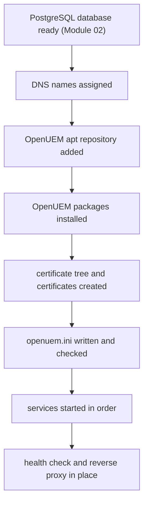
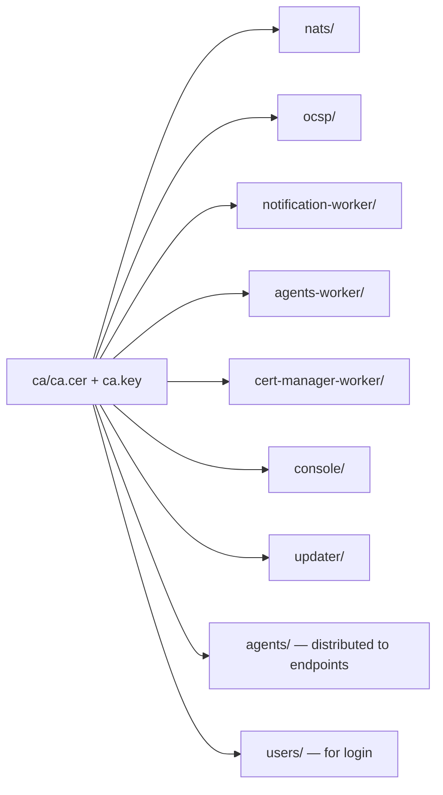
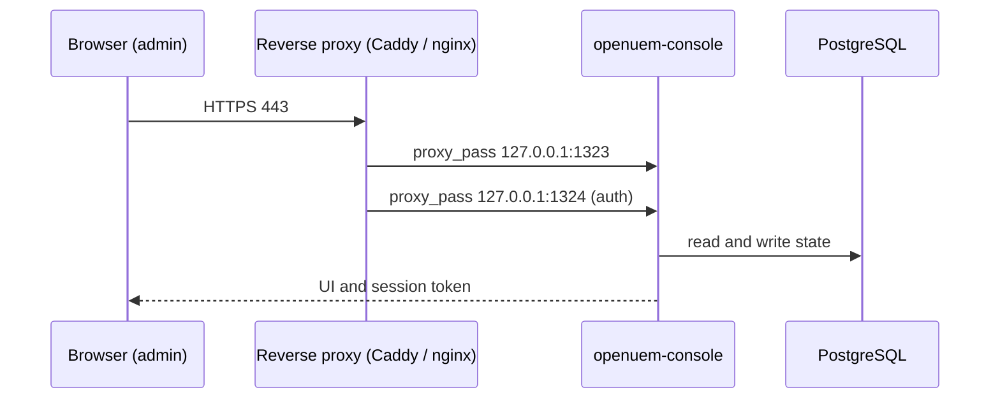

# Module 03 — Installing OpenUEM on Ubuntu 24.04 Server

This module is a guide to building an OpenUEM server end to end on a single Ubuntu 24.04 Server host using native packages. The sequence is simple — add the apt repository, install every component package, create the certificate tree, write `/etc/openuem-server/openuem.ini`, start the services in the documented order, verify with `systemctl status` and the console URL, and finally place the console behind Caddy or nginx and harden it.

OpenUEM can also be deployed with Docker or Podman compose. That path is covered in a separate module of this course. This module does not expand on it further and continues with the native install only.

## 1. Map of the whole process

Building one server has eight stages. Each stage is the foundation for the next. Understanding that sequential dependency reduces the time spent on troubleshooting later.



**Figure 1 — The eight stages of an OpenUEM install on an Ubuntu 24.04 host**

Figure walkthrough — Read Figure 1 from top to bottom. In the first stage PostgreSQL and the `openuem` database must already be prepared. Module 02 owns that work. In the second stage the DNS names for the console, NATS and OCSP are assigned. In the third stage the OpenUEM apt repository is added. In the fourth stage every component package is installed. In the fifth stage the certificate tree is created and the certificates are issued. In the sixth stage the hostname, ports and certificate paths inside `openuem.ini` are checked for correctness. In the seventh stage the services are started in the order given by the documentation. In the eighth stage a health check is run and the console is placed behind a reverse proxy. Each arrow indicates that the next stage cannot begin until the previous stage is complete.

## 2. Prerequisites before installing

In practice the common problem is this: the components start, and a few minutes later the console cannot be reached. The cause is not the install command. It is having skipped the things that must be prepared before installing.

| Requirement | Reason | Command to check |
|---|---|---|
| Ubuntu 24.04 Server | every package and service targets that platform | `lsb_release -ds` |
| PostgreSQL and the `openuem` database | the base data for the console and all workers | `psql "$DATABASE_URL" -c '\dt'` |
| A database URI to connect with | the components connect to the database at start-up | `psql "$DATABASE_URL" -c 'select 1'` |
| DNS names (`openuem.example`) | the certificate subject and agent connectivity | `getent hosts console.openuem.example` |
| An open port path | admin and agent access | `sudo ufw status` |
| `sudo` rights and systemd | package and service management | `systemctl --version` |

### 2.1 PostgreSQL — reference only in this module

PostgreSQL is the most fundamental requirement. Every piece of OpenUEM state — agent records, organizations, sites, profiles, tasks, certificate records — is stored in that database. Without a database the workers cannot start.

Installing PostgreSQL, creating the database and the role, building the connection URI and percent-encoding special characters are all covered in full in Module 02. This module assumes that work is finished and only verifies the result.

```bash
psql "$DATABASE_URL" -c '\dt'
```

This command connects with the connection URI and lists the tables. Before the install there are no tables yet, so it may come back with something like `Did not find any relations`. What matters is that the connection exists. If the connection fails, re-check the database state before going any further with the install.

### 2.2 DNS names

If the plan is to reach the console under a name such as `console.openuem.example`, that name must point at the server's IP. NATS and OCSP should each have a name as well. Agents connect directly to the NATS host and port. The NATS name must therefore resolve from the endpoints.

```bash
getent hosts console.openuem.example
```

This command resolves the name and prints the IP. If nothing comes back, fix DNS or the hosts file. In a lab without DNS, the hosts-file approach from Module 02 can be used. In that case do not use `localhost` or `127.0.0.1`. Each container would interpret those names as pointing at itself.

### 2.3 The four ports

Four ports must be known in advance. They appear repeatedly throughout this module.

| Port | Component | Purpose |
|---|---|---|
| 1323 | `openuem-console` | web console UI |
| 1324 | `openuem-console` | authentication server |
| 4433 | `openuem-nats-service` | the NATS broker agents connect to |
| 8000 | `openuem-ocsp-responder` | certificate revocation checking |

The console having two ports needs explaining. 1323 is the web UI the browser reads. 1324 is the authentication endpoint that handles login and issues tokens. The two ports have to be exposed along different paths. With a reverse proxy that difference becomes visible in the proxy configuration.

Before installing, you can check whether the ports are free.

```bash
sudo ss -ltnp | grep -E ':1323|:1324|:4433|:8000'
```

This command shows whether any process is using the four ports. If the output is empty, all four ports are free. If something shows up, resolve it before installing.

## 3. Adding the OpenUEM apt repository

OpenUEM provides `.deb` packages for Debian 12 and Ubuntu 24.04 from its own
repository. The repository and its contents are signed with a GPG public key.

```bash
sudo apt install -y curl
```

`curl` is needed to fetch the GPG key. It may not be included in a minimal installation.

```bash
curl -fsSL https://apt.openuem.eu/pgp-key.public | sudo gpg --dearmor -o /usr/share/keyrings/openuem.gpg
```

This command fetches the public key and stores it as a binary keyring apt can read at
`/usr/share/keyrings/openuem.gpg`. `--dearmor` converts the ASCII-armored key into
binary form.

```bash
echo "deb [arch=amd64 signed-by=/usr/share/keyrings/openuem.gpg] https://apt.openuem.eu stable main" | sudo tee /etc/apt/sources.list.d/openuem.list
```

`amd64` is for x86_64 servers. On an ARM server, use `arch=arm64`. `signed-by=` declares which key is to be trusted for that repository.

```bash
sudo apt update -y
```

This refreshes the repository index. Without this step apt cannot see the new packages.

```bash
apt policy openuem-server
```

This command shows package availability and the candidate version. If a candidate appears from `https://apt.openuem.eu`, the repository has been added correctly.

## 4. Installing OpenUEM

The simplest path to installing every component on one machine is the `openuem-server` meta-package.

```bash
sudo apt install -y openuem-server
```

During the install it asks configuration questions. The items to answer in order are —

1. which components to install (space bar to select or deselect)
2. PostgreSQL host, port, user, password and database name (the values created in Module 02)
3. the organization's DNS domain
4. the question whether OpenUEM should create the Certificate Authority and the certificates — answer yes if you do not have your own CA
5. the DNS name for the console if a reverse proxy is used
6. organization name, country, province, locality, address — used in certificates and in NATS authentication
7. the NATS server domain and port (4433), and whether a NATS cluster is used (No on a first install)
8. the OCSP responder domain and port (8000)
9. the console DNS name, web port (1323) and auth port (1324)

> If a question is answered wrongly, `/etc/openuem-server/openuem.ini` can be edited.
> That is why each answer should be written down.

```text
# simulated output — illustrative
Reading package lists... Done
Building dependency tree... Done
The following NEW packages will be installed:
  openuem-agent-worker openuem-cert-manager openuem-cert-manager-worker
  openuem-console openuem-nats-service openuem-notification-worker
  openuem-ocsp-responder openuem-server openuem-server-updater
0 upgraded, 9 newly installed, 0 to remove and 0 not upgraded.
```

If the components are to be spread across separate hosts, each package can be installed individually.

```bash
sudo apt install -y openuem-console openuem-nats-service openuem-agent-worker \
    openuem-notification-worker openuem-cert-manager-worker \
    openuem-ocsp-responder openuem-server-updater openuem-cert-manager
```

In that case the questions cover only the part relevant to the component being installed.

### 4.1 What each package is responsible for

Because the package names look alike, the division of responsibility needs to be clear. The table below shows what each installed unit does and whether it opens a TCP port.

| Package | Responsibility | Inbound port |
|---|---|---|
| `openuem-console` | web console and authentication server | 1323 (console), 1324 (auth) |
| `openuem-nats-service` | the NATS broker agents connect to | 4433 |
| `openuem-agent-worker` | reads agent reports and writes them to PostgreSQL | none |
| `openuem-notification-worker` | sends outbound notifications (SMTP) | none |
| `openuem-cert-manager-worker` | issues agent and user certificates | none |
| `openuem-ocsp-responder` | answers certificate revocation checks | 8000 |
| `openuem-server-updater` | runs as a service and creates `openuem.ini` | none |
| `openuem-cert-manager` | the CLI that creates the CA and component certificates | none |

Two important points follow from this table. First, only three components open inbound ports — console, NATS and OCSP. The workers are outbound clients. Second, `openuem-cert-manager` is not a daemon. It is run by hand when needed. That difference matters in the service start order.

```text
              ┌──────────────────────────────┐
   admin ───► │ openuem-console  1323 / 1324 │
              └───────────────┬──────────────┘
                              │
   agent ───► ┌───────────────▼──────────────┐
              │ openuem-nats-service    4433 │
              └───────────────┬──────────────┘
                              │
              ┌───────────────▼──────────────┐
              │ openuem-agent-worker         │──► PostgreSQL 5432
              └──────────────────────────────┘

   agent ───► openuem-ocsp-responder 8000
```

That diagram shows the three port paths — admin to console, agent to NATS, agent to OCSP. The workers' database connection is outbound.

## 5. The certificate tree and creating certificates

In OpenUEM, communication between components is protected by certificates. Without certificates NATS cannot start with TLS, OCSP cannot answer, and the console cannot trust the components. Creating certificates is therefore a step that cannot be skipped between installing and starting the services.

Certificates are stored under `/etc/openuem-server/certificates`, in a folder per component. The folder list is `ca`, `nats`, `ocsp`, `notification-worker`, `agents-worker`, `cert-manager-worker`, `console`, `updater`, `agents` and `users`.

```text
/etc/openuem-server/certificates/
├── ca/                      ca.cer, ca.key        (root of trust)
├── nats/                    nats.cer, nats.key
├── ocsp/                    ocsp.cer, ocsp.key
├── notification-worker/     notification-worker.cer, .key
├── agents-worker/           agents-worker.cer, .key
├── cert-manager-worker/     cert-manager-worker.cer, .key
├── console/                 console.cer, console.key
├── updater/                 updater.cer, updater.key
├── agents/                  agent.cer, agent.key  (distributed to endpoints)
└── users/                   user.cer, user.key    (user login)
```

The purpose of each folder is shown in the figure below.



**Figure 2 — Certificate and trust structure**

Figure walkthrough — Read Figure 2 from left to right. The single box on the left holds the CA certificate and the CA private key. That pair is this server's root of trust. Nine arrows point at the certificate groups that CA issues. The six boxes in the middle are the certificates for one component each. The two boxes at the far right are the certificates distributed outwards — `agents` goes to the endpoints and `users` serves user login. Because of this structure, protecting the single CA private key controls the trust of every component.

The pattern for creating one component certificate is shown below.

```bash
sudo openuem-cert-manager client-cert --name "OpenUEM Agent" --dst ./agents \
  --type="agent" --org "$ORGNAME" --country "$COUNTRY" --province "$ORGPROVINCE" \
  --locality "$ORGLOCALITY" --address "$ORGADDRESS" --years-valid 2 \
  --filename "agent" --ocsp "http://$OCSP_SERVER:$OCSP_PORT" \
  --description "Agent certificate" --cacert ./ca/ca.cer --cakey ./ca/ca.key \
  --dburl "$DATABASE_URL"
```

This command creates `agent.cer` and `agent.key` inside the `./agents` folder and records the certificate in the database. The meaning of each flag is given in the table below.

| Flag | Meaning |
|---|---|
| `--name` | the display name of the certificate |
| `--dst` | the folder the certificate is stored in |
| `--type` | the certificate type (for example `agent`) |
| `--org`, `--country`, `--province`, `--locality`, `--address` | organization details included in the subject |
| `--years-valid` | validity in years |
| `--filename` | the file name base (`agent` gives `agent.cer` and `agent.key`) |
| `--ocsp` | the OCSP responder URL embedded in the certificate |
| `--description` | a description for the record |
| `--cacert`, `--cakey` | the CA certificate and key used for signing |
| `--dburl` | the database URI where the certificate record is stored |

`--years-valid 2` sets the validity from today out to two years. Computing the expiry in advance matters in production, because when a certificate expires new agents cannot enroll and component connections break. That computation is practiced in this module's lab. For a certificate issued on 29 February, the next year has no such day, so it is adjusted to the 28th.

For each component, a certificate is issued into its own folder following that same pattern. The step that creates the CA is not spelled out exactly on this page. The CA command and its options of `openuem-cert-manager` should be taken from the official documentation and run. That step can change between releases — it needs re-checking per version.

After creating certificates, two things must be checked every time. First, whether both the `.cer` and `.key` of the pair exist. Second, whether the file ownership is the `openuem` user. Those two points directly affect whether the services start later.

## 6. Writing `/etc/openuem-server/openuem.ini`

`/etc/openuem-server/openuem.ini` is read by every component together. That single file controls the certificate paths, the console hostname and ports, the reverse proxy details and the JWT key. The file is created by the `openuem-server-updater` service. So when editing it by hand, the habit of restarting that service should not be followed. Care is needed so that an edit does not wipe out the rest of the file.

```ini
CACert = /etc/openuem-server/certificates/ca/ca.cer
CAKey = /etc/openuem-server/certificates/ca/ca.key
NATSCert = /etc/openuem-server/certificates/ca/ca.cer
NATSKey = /etc/openuem-server/certificates/nats/nats.key
OCSPCert = /etc/openuem-server/certificates/ocsp/ocsp.cer
OCSPKey = /etc/openuem-server/certificates/ocsp/ocsp.key
NotificationWorkerCert = /etc/openuem-server/certificates/notification-worker/notification-worker.cer
ConsoleCert = /etc/openuem-server/certificates/console/console.cer

[Console]
hostname = console.openuem.example
port = 1323
authport = 1324
reverseproxyserver = caddy.openuem.example
reverseproxyauthport = 443
domain = openuem.example

[JWT]
Key = 4f1c9a2b7d6e40518c3a9b2f7e6d5c41
```

There are two groups of keys. The first group is the certificate paths — `CACert`, `CAKey`, `NATSCert`, `NATSKey`, `OCSPCert`, `OCSPKey`, `NotificationWorkerCert` and `ConsoleCert`. Those values must be exact file paths. If one path is wrong, only that component fails to start while everything else stays healthy. In that state the problem is hard to find.

The `[Console]` section defines access from the web side.

| Key | Meaning |
|---|---|
| `hostname` | the name the console is opened under |
| `port` | the port of the console UI (1323) |
| `authport` | the port of the authentication server (1324) |
| `reverseproxyserver` | the name of the proxy in front |
| `reverseproxyauthport` | the port through which auth is reached via the proxy |
| `domain` | the base domain for agents and certificates |

If no reverse proxy is used, `reverseproxyserver` and `reverseproxyauthport` are left empty. If values are filled in and there is no proxy, the console points at a path that does not exist.

The `[JWT]` section contains only `Key`. That key signs login session tokens. The documentation recommends a random string of 32 characters. If the key is shared, a single person can create another person's session. The value must therefore be treated as a secret.

Which section holds the certificate path keys can differ between releases. That point needs re-checking per version. What matters is the key names and the values.

After editing the file, readability can be checked.

```bash
sudo -u openuem test -r /etc/openuem-server/openuem.ini && echo readable
```

This command checks whether the `openuem` user can read the file. If `readable` does not appear, the components will raise a file-read error at start-up.

## 7. Starting the services in the documented order

The order shown in the documentation is as follows.

1. `openuem-ocsp-responder`
2. `openuem-nats-service`
3. `openuem-server-updater`
4. `openuem-agent-worker`
5. `openuem-notification-worker`
6. `openuem-cert-manager-worker`
7. `openuem-console`

The reasoning behind the order can be understood. `openuem-server-updater` creates `openuem.ini`. The three workers and the console that read that file must start after the updater. `openuem-nats-service` must come before the agent worker and the notification worker, because those workers read reports from NATS. `openuem-ocsp-responder` must come before the console. The reasoning behind the two leading positions is not described in detail in the documentation — it needs re-checking per version.

Each service is started in the following pattern.

```bash
sudo systemctl enable --now openuem-ocsp-responder
```

`enable --now` registers the service to start at boot and also starts it immediately. That command is run in order for all seven services. The pattern of the remaining commands is the same. The console is started last.

```bash
sudo systemctl enable --now openuem-console
```

After starting, the state of all services can be viewed at once.

```bash
systemctl is-active openuem-ocsp-responder openuem-nats-service \
  openuem-server-updater openuem-agent-worker openuem-notification-worker \
  openuem-cert-manager-worker openuem-console
```

This command prints `active` or `inactive` for each service, one line each. If seven `active` lines come back, the ordered start-up succeeded.

## 8. Verifying — `systemctl status` and the console URL

The detailed state of each service is checked with the following command.

```bash
sudo systemctl status openuem-console --no-pager
```

`--no-pager` shows the output directly without a pager. That is easier to read from a script. The output of that command has the following shape.

```text
# simulated output — illustrative
● openuem-console.service - OpenUEM Console
     Loaded: loaded (/lib/systemd/system/openuem-console.service; enabled)
     Active: active (running) since Thu 2026-03-12 09:14:02 UTC
   Main PID: 1841 (openuem-console)
```

`Active: active (running)` means the unit has started. If that line is absent there may be a configuration or certificate problem. In that state the log is read with `journalctl -u openuem-console -n 50 --no-pager`.

Whether the ports are actually open is checked with the following command.

```bash
sudo ss -ltnp | grep -E '1323|1324|4433|8000'
```

This command filters the listening TCP sockets down to the four ports that matter.

```text
# simulated output — illustrative
LISTEN 0  4096  0.0.0.0:1323  0.0.0.0:*  users:(("openuem-console",pid=1841,fd=9))
LISTEN 0  4096  0.0.0.0:1324  0.0.0.0:*  users:(("openuem-console",pid=1841,fd=10))
LISTEN 0  4096  0.0.0.0:4433  0.0.0.0:*  users:(("openuem-nats",pid=1502,fd=7))
LISTEN 0  4096  0.0.0.0:8000  0.0.0.0:*  users:(("openuem-ocsp",pid=1320,fd=6))
```

The final stage is opening the console URL in a browser. To check from the command line —

```bash
curl -sS -o /dev/null -w '%{http_code}\n' http://console.openuem.example:1323
```

This command prints only the response status code. If `200` or a redirect code comes back, the web layer is working. Opening `http://console.openuem.example:1323` in a browser should show the login page. If the connection is refused, check the service or `ufw`.

A table of health checks is given below.

| Layer | Check | Healthy state |
|---|---|---|
| Service | `systemctl status <name> --no-pager` | `active (running)` |
| Port | `ss -ltnp` | the four ports are listening |
| Database | `psql "$DATABASE_URL" -c '\dt'` | the tables come back |
| Web | `curl -w '%{http_code}'` | 2xx or 3xx |
| Certificate | the `--years-valid` computation | not yet expired |
| Log | `journalctl -u <name> -n 50` | no errors |

## 9. Reverse proxy — Caddy or nginx

If the console is exposed directly on 1323, TLS has to be handled by the console itself. In practice the better pattern is to let a reverse proxy terminate TLS and keep the console on an internal port. In that pattern the proxy holds 443 and forwards to 1323 for the console and 1324 for auth.

The reverse proxy supported in the OpenUEM compose deployment is Caddy. On a native install, Caddy or nginx can be used for this part as well. `reverseproxyserver` and `reverseproxyauthport` in `openuem.ini` point at that proxy.

```text
console.openuem.example {
    reverse_proxy 127.0.0.1:1323
}

auth.openuem.example {
    reverse_proxy 127.0.0.1:1324
}
```

That Caddyfile is only a sample. The two internal ports are split under separate names. If nginx is chosen, this part can be written in the following form.

```text
server {
    listen 443 ssl;
    server_name console.openuem.example;
    ssl_certificate     /etc/ssl/certs/console.openuem.example.pem;
    ssl_certificate_key /etc/ssl/private/console.openuem.example.key;

    location / {
        proxy_pass http://127.0.0.1:1323;
    }
}
```

After enabling the proxy, `openuem.ini` should be given values such as `reverseproxyserver = caddy.openuem.example` and `reverseproxyauthport = 443`. The path from the proxy to the console is shown in the figure below.



**Figure 3 — The path from the reverse proxy to the console**

Figure walkthrough — Figure 3 has four participants. The browser connects to 443 over HTTPS. The proxy accepts that connection and terminates TLS. It then forwards to the internal 127.0.0.1:1323. At login time the auth path is forwarded separately to 1324. The console exchanges state with the database and returns the UI and the session token to the browser. Because of this path, 1323 and 1324 can be left unexposed to the outside.

## 10. Hardening — the `openuem` user, key permissions and backup

The installer creates an unprivileged user named `openuem`. That user owns the configuration, certificate and log files. Running the components as that user is the most important protection. If they run as `root`, a weakness in one component can become loss of control over the whole machine.

```bash
sudo chown -R openuem:openuem /etc/openuem-server
```

This command changes the whole configuration and certificate folder to `openuem` ownership. The services need this in order to read them.

```bash
sudo find /etc/openuem-server/certificates -name '*.key' -exec chmod 600 {} \;
```

This command drops every private key file to owner-only read and write. If another user can read a private key, the trust of every certificate is broken. `ca.key` is especially critical. With that key, any new certificate whatsoever can be issued.

Handling the JWT key works as follows. To generate a new key —

```bash
openssl rand -hex 16
```

This command produces a 32-character hex string. That value is placed in `[JWT] Key` and the components are restarted. Rotating the key invalidates all session tokens. That work should therefore be done when few users are active.

### 10.1 Backup

There are two critical backups — the CA pair and `openuem.ini`. If the CA private key is lost, the moment the current certificates expire none can be issued again.

```bash
sudo tar -czf /root/openuem-ca-backup.tar.gz -C /etc/openuem-server certificates/ca
```

This command packs the CA certificate and key into a single archive. The archive should not be kept on the server. It belongs in a separate secure location.

```bash
sudo cp /etc/openuem-server/openuem.ini /root/openuem.ini.bak
```

This command copies the configuration file. This should be done before any change.

The additional protections are as follows.

| Area | What to do |
|---|---|
| TLS | terminate 443 at the proxy and do not expose 1323/1324 outwards |
| NATS | expose 4433 only to the extent agents can reach it |
| OCSP | expose 8000 only to those who need it |
| Files | every `.key` at `600`, folders owned by `openuem` |
| Backup | keep `ca.key` and `ca.cer` in a separate secure location |
| Log | keep logs only in the log folder owned by `openuem` |

## 11. Differences for RPM-based systems

If Fedora, Alma, Rocky or RHEL is used instead of Ubuntu 24.04, the stages are the same and only the repository differs. The repository file is located at `/etc/yum.repos.d/openuem.repo` and the base URL is `https://rpm.openuem.eu/packages`. The GPG key comes from `https://rpm.openuem.eu/pgp-key.public`.

```text
[openuem]
name=OpenUEM packages
baseurl=https://rpm.openuem.eu/packages
enabled=1
gpgcheck=1
gpgkey=https://rpm.openuem.eu/pgp-key.public
```

`gpgcheck=1` should not be removed. The key is imported with the following command.

```bash
sudo rpm --import https://rpm.openuem.eu/pgp-key.public
```

`openuem-server-updater` needs `crudini` in order to create `openuem.ini`. For Fedora and RHEL, `crudini` is available in the EPEL repository.

```bash
sudo dnf install -y epel-release
sudo dnf install -y crudini
```

After that the package group is installed with `dnf install`. Without `crudini`, `openuem-server-updater` cannot create `openuem.ini` and the other components will try to start without a configuration.

```bash
sudo dnf install -y openuem-console openuem-nats-service openuem-agent-worker \
    openuem-notification-worker openuem-cert-manager-worker \
    openuem-ocsp-responder openuem-server-updater openuem-cert-manager
```

## 12. Production notes

- Services should not be started before the certificates are created. If NATS and OCSP try to start without certificates, repeated errors appear in the log.
- After editing `openuem.ini` by hand, every component that reads the file must be restarted. Restarting a single service may not be enough.
- If the workers start without a database, a connection error appears. In that state the service is not at fault; check the database state first.
- Port conflicts should be checked before installing. If 1323, 1324, 4433 and 8000 are in use by another service, the components cannot start.
- Certificate expiry must be recorded. Replacement should be scheduled two months before the expiry date.
- A copy of `ca.key` should not be kept on the server. Anyone holding that key can replace every certificate.
- Package versions, console menu names, dashboard card names and the identity provider list can change between releases — they need re-checking per version.

## 13. Self-check questions

**1. Why must PostgreSQL be prepared before installing?**
The console and all the workers store every piece of state in the database. Without a database the services cannot start.

**2. Why does the console have two ports?**
1323 is the web UI and 1324 is the authentication server. They are two endpoints with different responsibilities.

**3. Why must `openuem-server-updater` start before the workers?**
That service creates `openuem.ini`. The workers and the console read that file and start from it.

**4. Why are `.key` files set to `600`?**
If another user can read a private key, the entire certificate trust is broken. With `ca.key`, any new certificate whatsoever can be issued.

**5. If no reverse proxy is used, what should `[Console]` contain?**
`reverseproxyserver` and `reverseproxyauthport` are left empty.

**6. What are the first three checks in this module?**
Service state with `systemctl is-active`, the four ports with `ss -ltnp`, and the web layer with the console URL.

## Technical review notes

- The package names (`openuem-console`, `openuem-nats-service`, `openuem-agent-worker`, `openuem-notification-worker`, `openuem-cert-manager-worker`, `openuem-ocsp-responder`, `openuem-server-updater`, `openuem-cert-manager`) are taken from the verified facts of MODULE_SPEC.
- The exact form of the apt repository line for Ubuntu 24.04 (URL, suite name, key installation method) still needs to be taken from the official documentation. This page describes the three steps and shows only `apt update` and `apt install` exactly.
- The command that creates the CA with `openuem-cert-manager` is not described exactly in the documentation, so it is not shown on this page. The `client-cert` example is included as per the verified facts.
- Which section holds the certificate path keys inside `openuem.ini` needs re-checking per release. In this page's example they are placed before any section, while `[Console]` and `[JWT]` follow the verified facts.
- The seven-step service start order is taken from the verified facts. The reasoning behind the two leading positions (OCSP, NATS) is not described in detail in the documentation, so it is noted.
- The Caddyfile and nginx examples are samples. The exact certificate paths and routing need re-checking per version.
- Installing PostgreSQL and creating the database are referenced to Module 02. Those steps are not repeated in this module.
- Package version `0.7.0` is a documentation example. Whether it matches the current release has not been checked.
- The `curl`, `ss` and `systemctl status` outputs are constructed fixtures. They are not real measurements.
