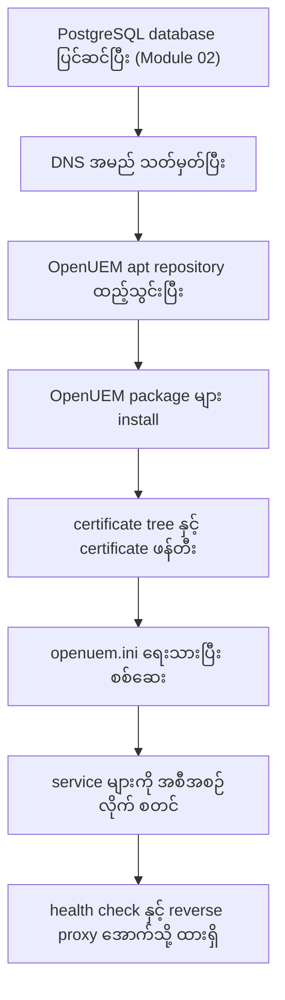
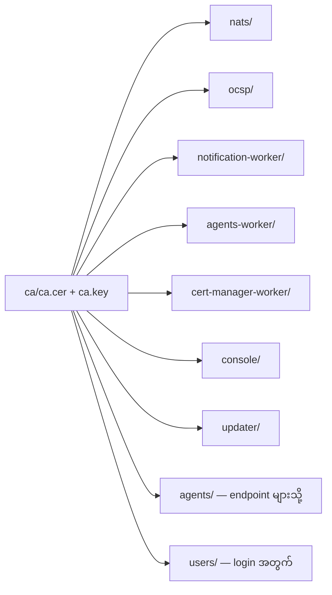
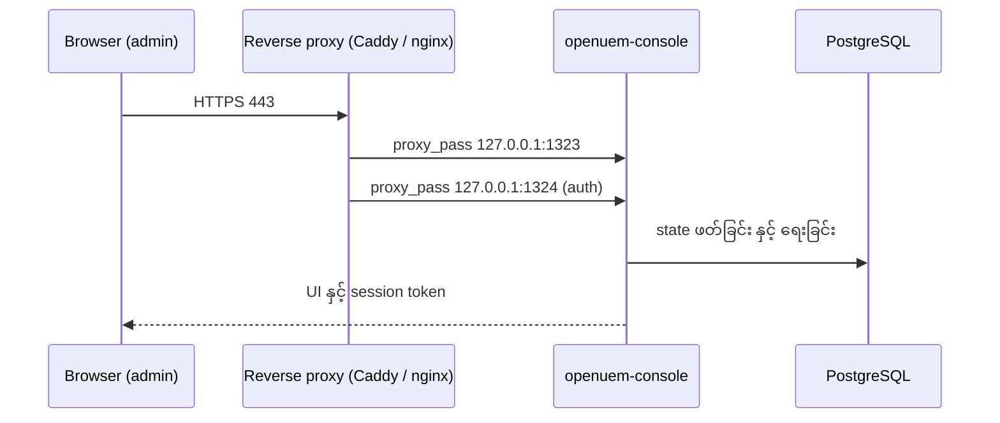

# Module 03 — Installing OpenUEM on Ubuntu 24.04 Server

ဤ module သည် Ubuntu 24.04 Server host တစ်ခုပေါ်တွင် OpenUEM server ကို native package ဖြင့် အစမှ အဆုံး တည်ဆောက်သည့် လမ်းညွှန် ဖြစ်သည်။ အစီအစဉ်မှာ ရှင်းသည် — apt repository ထည့်ခြင်း၊ component package အားလုံး install လုပ်ခြင်း၊ certificate tree ဖန်တီးခြင်း၊ `/etc/openuem-server/openuem.ini` ရေးခြင်း၊ service များကို documentation အစီအစဉ်အတိုင်း စတင်ခြင်း၊ `systemctl status` နှင့် console URL ဖြင့် စစ်ဆေးခြင်း၊ နောက်ဆုံးတွင် Caddy သို့မဟုတ် nginx အောက်သို့ ထားရှိပြီး hardening လုပ်ခြင်း ဖြစ်သည်။

OpenUEM ကို Docker သို့မဟုတ် Podman compose ဖြင့်လည်း တည်ဆောက်နိုင်သည်။ ထို လမ်းကြောင်းကို ဤ course ၏ သီးခြား module တွင် ဖော်ပြထားသည်။ ဤ module တွင် ထို အကြောင်းကို နောက်ထပ် မချဲ့ဘဲ native install ကိုသာ ဆက်လက်လေ့လာမည်။

## 1. လုပ်ငန်းစဉ် တစ်ခုလုံး၏ မြေပုံ

Server တစ်လုံး တည်ဆောက်ရာတွင် အဆင့်ရှစ်ဆင့် ရှိသည်။ အဆင့်တစ်ခုချင်းစီသည် နောက် အဆင့်အတွက် အခြေခံ ဖြစ်သည်။ ထို အစဉ်လိုက် မှီခိုမှုကို နားလည်ထားခြင်းသည် နောက်ပိုင်း troubleshooting တွင် အချိန် ကုန်ကျမှုကို လျှော့ချသည်။



**Figure 1 — Ubuntu 24.04 host ပေါ်တွင် OpenUEM install လုပ်ငန်းစဉ်၏ အဆင့်ရှစ်ဆင့်**

ပုံရှင်းလင်းချက် — Figure 1 ကို အပေါ်မှ အောက်သို့ ဖတ်ပါ။ ပထမဆုံး အဆင့်တွင် PostgreSQL နှင့် `openuem` database ကို အရင် ပြင်ဆင်ပြီးသား ဖြစ်ရသည်။ ထို အလုပ်ကို Module 02 က ပိုင်သည်။ ဒုတိယ အဆင့်တွင် console၊ NATS နှင့် OCSP အတွက် DNS အမည်များ သတ်မှတ်သည်။ တတိယ အဆင့်တွင် OpenUEM apt repository ကို ထည့်သွင်းသည်။ စတုတ္ထ အဆင့်တွင် component package အားလုံးကို install လုပ်သည်။ ပဉ္စမ အဆင့်တွင် certificate tree ကို ဖန်တီးပြီး certificate များ ထုတ်ပေးသည်။ ဆဋ္ဌမ အဆင့်တွင် `openuem.ini` ထဲ၌ hostname၊ port နှင့် certificate လမ်းကြောင်း မှန်ကန်မှုကို စစ်သည်။ သတ္တမ အဆင့်တွင် service များကို documentation ၏ အစီအစဉ်အတိုင်း စတင်သည်။ အဋ္ဌမ အဆင့်တွင် health check လုပ်ပြီး console ကို reverse proxy အောက်သို့ ရောက်စေသည်။ မြှားတစ်ခုချင်းစီသည် ရှေ့ အဆင့် မပြီးပါက နောက် အဆင့် မစတင်နိုင်ကြောင်း ဖော်ပြသည်။

## 2. Install မစမီ လိုအပ်ချက်များ

လက်တွေ့တွင် အဖြစ်များသော ပြဿနာမှာ component များ စတင်ပြီး မိနစ်အနည်းငယ်အကြာတွင် console သို့ ဝင်ရောက်၍ မရခြင်း ဖြစ်သည်။ အကြောင်းရင်းသည် install command မဟုတ်။ Install မတိုင်မီ ပြင်ဆင်ရန် လိုအပ်သည့် အချက်များကို ကျော်လွန်ထားခြင်း ဖြစ်သည်။

| လိုအပ်ချက် | အကြောင်းရင်း | စစ်ဆေးရန် command |
|---|---|---|
| Ubuntu 24.04 Server | package နှင့် service အားလုံး ထို platform အတွက် | `lsb_release -ds` |
| PostgreSQL နှင့် `openuem` database | console၊ worker အားလုံး၏ အခြေခံဒေတာ | `psql "$DATABASE_URL" -c '\dt'` |
| ချိတ်ဆက်ရန် database URI | component များ စတင်ချိန်တွင် database သို့ ချိတ်သည် | `psql "$DATABASE_URL" -c 'select 1'` |
| DNS အမည် (`openuem.example`) | certificate ၏ subject နှင့် agent ချိတ်ဆက်မှု | `getent hosts console.openuem.example` |
| Port လမ်းကြောင်း ဖွင့်ထားမှု | admin နှင့် agent ဝင်ရောက်မှု | `sudo ufw status` |
| `sudo` အာဏာနှင့် systemd | package နှင့် service စီမံခန့်ခွဲမှု | `systemctl --version` |

### 2.1 PostgreSQL — ဤ module တွင် ရည်ညွှန်းချက်သာ

PostgreSQL သည် အခြေခံအကျဆုံး လိုအပ်ချက် ဖြစ်သည်။ OpenUEM ၏ အခြေအနေအားလုံး — agent မှတ်တမ်း၊ organization၊ site၊ profile၊ task၊ certificate မှတ်တမ်း — ကို ထို database တွင် သိမ်းဆည်းသည်။ Database မရှိပါက worker များ စတင်၍ မရ။

PostgreSQL ထည့်သွင်းခြင်း၊ database နှင့် role ဖန်တီးခြင်း၊ connection URI တည်ဆောက်ခြင်း နှင့် special character များကို percent-encode လုပ်ခြင်းတို့ကို Module 02 တွင် အပြည့်အစုံ ဖော်ပြထားသည်။ ဤ module တွင် ထို အလုပ်များ ပြီးစီးပြီးသား ဟု ယူဆပြီး ရလဒ်ကို စစ်ဆေးခြင်းသာ ပြုလုပ်သည်။

```bash
psql "$DATABASE_URL" -c '\dt'
```

ဤ command သည် connection URI ဖြင့် ချိတ်ဆက်ပြီး ဇယားစာရင်းကို ပြသည်။ Install မတိုင်မီ အခြေအနေတွင် ဇယား မရှိသေးသဖြင့် `Did not find any relations` ကဲ့သို့ ပြန်လာနိုင်သည်။ အရေးကြီးသည်မှာ ချိတ်ဆက်မှု တည်ရှိခြင်း ဖြစ်သည်။ ချိတ်ဆက်မှု မရပါက install ကို ဆက်မလုပ်မီ database အခြေအနေကို ပြန်စစ်ရသည်။

### 2.2 DNS အမည်

Console ကို `console.openuem.example` ကဲ့သို့ အမည်ဖြင့် ဝင်ရောက်ရန် စီစဉ်ပါက ထို အမည်ကို server ၏ IP သို့ ညွှန်ထားရသည်။ NATS နှင့် OCSP အတွက်လည်း အမည် တစ်ခုစီ သတ်မှတ်သင့်သည်။ Agent များသည် NATS host နှင့် port သို့ တိုက်ရိုက် ချိတ်ဆက်သည်။ ထို့ကြောင့် NATS အမည်သည် endpoint များမှ ဖြေရှင်းနိုင်ရသည်။

```bash
getent hosts console.openuem.example
```

ဤ command သည် အမည်ကို ဖြေရှင်းပြီး IP ကို ပြသည်။ ရလဒ် မရှိပါက DNS သို့မဟုတ် hosts file ကို ပြင်ရသည်။ DNS မရှိသော lab တွင် Module 02 ၏ hosts file နည်းလမ်းကို အသုံးပြုနိုင်သည်။ ထို အခြေအနေတွင် `localhost` သို့မဟုတ် `127.0.0.1` ကို မသုံးသင့်။ အကြောင်းမှာ container တစ်ခုချင်းစီအတွက် ထို အမည်သည် မိမိကိုယ်ကို ညွှန်ပြမည် ဖြစ်သည်။

### 2.3 Port လေးခု

Port လေးခုကို ကြိုတင် သိထားရသည်။ ၎င်းတို့သည် ဤ module တွင် ထပ်ခါတလဲလဲ ပေါ်လာမည်။

| Port | Component | ရည်ရွယ်ချက် |
|---|---|---|
| 1323 | `openuem-console` | web console UI |
| 1324 | `openuem-console` | authentication server |
| 4433 | `openuem-nats-service` | agent များ ချိတ်ဆက်သည့် NATS broker |
| 8000 | `openuem-ocsp-responder` | certificate ပြန်လည်ရုပ်သိမ်းမှု စစ်ဆေးခြင်း |

Console တစ်ခုတည်းတွင် port နှစ်ခု ရှိခြင်းကို ရှင်းရမည်။ 1323 သည် ဘရောက်ဇာမှ ဖတ်သော web UI ဖြစ်သည်။ 1324 သည် login နှင့် token ထုတ်ပေးသည့် authentication endpoint ဖြစ်သည်။ ထို port နှစ်ခုကို မတူညီသော လမ်းကြောင်းဖြင့် ဖွင့်ထားရသည်။ Reverse proxy အသုံးပြုပါက ထို ကွာခြားချက်သည် proxy configuration တွင် ထင်ရှားလာမည်။

Install မတိုင်မီ port များ အလွတ် ရှိမရှိ စစ်နိုင်သည်။

```bash
sudo ss -ltnp | grep -E ':1323|:1324|:4433|:8000'
```

ဤ command သည် port လေးခုကို အသုံးပြုနေသည့် process ရှိမရှိ ပြသည်။ ရလဒ် အလွတ် ဖြစ်ပါက port များ အားလုံး အလွတ် ဖြစ်သည်။ တစ်ခုခု ပေါ်နေပါက install မတိုင်မီ အရင် ဖြေရှင်းရသည်။

## 3. OpenUEM apt repository ထည့်သွင်းခြင်း

OpenUEM သည် Debian 12 နှင့် Ubuntu 24.04 အတွက် `.deb` package များကို ကိုယ်ပိုင်
repository မှ ပေးသည်။ Repository နှင့် ၎င်း၏ အကြောင်းအရာများကို GPG public key
ဖြင့် လက်မှတ်ထိုးထားသည်။

```bash
sudo apt install -y curl
```

`curl` သည် GPG key ကို ဆွဲယူရန် လိုအပ်သည်။ မူလ installation တွင် မပါဝင်နိုင်ပါ။

```bash
curl -fsSL https://apt.openuem.eu/pgp-key.public | sudo gpg --dearmor -o /usr/share/keyrings/openuem.gpg
```

ဤ command သည် public key ကို ဆွဲယူပြီး apt ဖတ်နိုင်သော binary keyring အဖြစ်
`/usr/share/keyrings/openuem.gpg` တွင် သိမ်းသည်။ `--dearmor` သည် ASCII-armored
key ကို binary အဖြစ် ပြောင်းသည်။

```bash
echo "deb [arch=amd64 signed-by=/usr/share/keyrings/openuem.gpg] https://apt.openuem.eu stable main" | sudo tee /etc/apt/sources.list.d/openuem.list
```

`amd64` သည် x86_64 server အတွက် ဖြစ်သည်။ ARM server ဖြစ်ပါက `arch=arm64` ကို
သုံးရသည်။ `signed-by=` က ထို repository အတွက် မည်သည့် key ကို ယုံကြည်ရမည်ကို
သတ်မှတ်သည်။

```bash
sudo apt update -y
```

Repository index ကို ပြန်လည် ရယူသည်။ ဤအဆင့် မလုပ်ပါက package အသစ်များကို
apt က မမြင်နိုင်ပါ။

```bash
apt policy openuem-server
```

ဤ command သည် package ရရှိနိုင်မှုနှင့် candidate version ကို ပြသည်။
`https://apt.openuem.eu` မှ candidate ပေါ်လာပါက repository မှန်ကန်စွာ
ထည့်ပြီး ဖြစ်သည်။

## 4. OpenUEM install လုပ်ခြင်း

တစ်စက်တည်းတွင် component အားလုံး install လုပ်ရန် အလွယ်ဆုံး လမ်းကြောင်းမှာ
meta-package ဖြစ်သော `openuem-server` ကို သုံးခြင်း ဖြစ်သည်။

```bash
sudo apt install -y openuem-server
```

Install စဉ်အတွင်း configuration မေးခွန်းများ မေးသည်။ အစဉ်အတိုင်း
ဖြေရမည့် အချက်များမှာ —

1. install လုပ်လိုသော component များ (space bar ဖြင့် ရွေး/ဖျက်)
2. PostgreSQL host၊ port၊ user၊ password နှင့် database အမည် (Module 02 တွင် ဖန်တီးထားသော တန်ဖိုးများ)
3. အဖွဲ့အစည်း၏ DNS domain
4. OpenUEM က Certificate Authority နှင့် certificate များ ဖန်တီးပါရန် မေးခွန်း — ကိုယ်ပိုင် CA မရှိပါက yes ဖြေသည်
5. reverse proxy သုံးပါက console အတွက် DNS အမည်
6. organization အမည်၊ နိုင်ငံ၊ province၊ locality၊ လိပ်စာ — certificate နှင့် NATS authentication တွင် သုံးသည်
7. NATS server ၏ domain နှင့် port (4433)၊ NATS cluster သုံး/မသုံး (ပထမဆုံး install တွင် No)
8. OCSP responder ၏ domain နှင့် port (8000)
9. console ၏ DNS အမည်၊ web port (1323) နှင့် auth port (1324)

> မေးခွန်းများကို မှားဖြေမိပါက `/etc/openuem-server/openuem.ini` ကို
> ပြင်နိုင်သည်။ ထို့ကြောင့် ဖြေချက် တစ်ခုချင်းကို မှတ်ထားရသည်။

```text
# simulated output — illustrative
Reading package lists... Done
Building dependency tree... Done
The following NEW packages will be installed:
  openuem-agent-worker openuem-cert-manager openuem-cert-manager-worker
  openuem-console openuem-nats-service openuem-notification-worker
  openuem-ocsp-responder openuem-server openuem-server-updater
0 upgraded, 9 newly installed, 0 to remove and 0 not upgraded.
```

Component များကို သီးခြား host များတွင် ဖြန့်ထားလိုပါက package တစ်ခုချင်းကို
install နိုင်သည်။

```bash
sudo apt install -y openuem-console openuem-nats-service openuem-agent-worker \
    openuem-notification-worker openuem-cert-manager-worker \
    openuem-ocsp-responder openuem-server-updater openuem-cert-manager
```

ထို အခြေအနေတွင် မေးခွန်းများသည် install လုပ်နေသော component နှင့်
သက်ဆိုင်သည့် အပိုင်းသာ ဖြစ်သည်။

### 4.1 Package တစ်ခုချင်းစီ၏ တာဝန်

Package အမည်များ ဆင်တူသောကြောင့် တာဝန်ခွဲခြားမှုကို ရှင်းရသည်။ အောက်ပါ ဇယားသည် install လုပ်သည့် unit တစ်ခုချင်းစီ မည်သည့် အလုပ်ကို လုပ်သည်၊ TCP port ဖွင့်သည် ရှိ/မရှိ ကို ပြသည်။

| Package | တာဝန် | Inbound port |
|---|---|---|
| `openuem-console` | web console နှင့် authentication server | 1323 (console), 1324 (auth) |
| `openuem-nats-service` | agent များ ချိတ်ဆက်သည့် NATS broker | 4433 |
| `openuem-agent-worker` | agent report များကို ဖတ်ပြီး PostgreSQL တွင် ရေးသည် | မရှိ |
| `openuem-notification-worker` | အပြင်သို့ notification (SMTP) ပို့သည် | မရှိ |
| `openuem-cert-manager-worker` | agent နှင့် user certificate များ ထုတ်ပေးသည် | မရှိ |
| `openuem-ocsp-responder` | certificate ရုပ်သိမ်းမှု စစ်ဆေးချက် ဖြေကြားသည် | 8000 |
| `openuem-server-updater` | service အဖြစ် run ပြီး `openuem.ini` ဖန်တီးသည် | မရှိ |
| `openuem-cert-manager` | CA နှင့် component certificate ဖန်တီးသည့် CLI | မရှိ |

ဤ ဇယားမှ အရေးကြီးသည့် အချက်နှစ်ခု ထွက်ပေါ်သည်။ ပထမ၊ inbound port ဖွင့်သည်မှာ component သုံးခုသာ ဖြစ်သည် — console၊ NATS နှင့် OCSP။ ကျ worker များသည် အပြင်သို့ ချိတ်ဆက်သူများ ဖြစ်သည်။ ဒုတိယ၊ `openuem-cert-manager` သည် daemon မဟုတ်။ ၎င်းကို လိုအပ်ချိန်တွင် လက်ဖြင့် run သည်။ ထို ကွာခြားချက်သည် service start order တွင် အရေးပါသည်။

```text
              ┌──────────────────────────────┐
   admin ───► │ openuem-console  1323 / 1324 │
              └───────────────┬──────────────┘
                              │
   agent ───► ┌───────────────▼──────────────┐
              │ openuem-nats-service    4433 │
              └───────────────┬──────────────┘
                              │
              ┌───────────────▼──────────────┐
              │ openuem-agent-worker         │──► PostgreSQL 5432
              └──────────────────────────────┘

   agent ───► openuem-ocsp-responder 8000
```

ထို ပုံသည် port လမ်းကြောင်း သုံးခုကို ပြသည် — admin မှ console သို့၊ agent မှ NATS သို့၊ agent မှ OCSP သို့။ Worker များ၏ database ချိတ်ဆက်မှုသည် အပြင်သို့ ဖြစ်သည်။

## 5. Certificate tree နှင့် certificate ဖန်တီးခြင်း

OpenUEM တွင် component များ အချင်းချင်း ဆက်သွယ်မှုသည် certificate ဖြင့် ကာကွယ်ထားသည်။ Certificate မရှိပါက NATS သည် TLS ဖြင့် မစတင်နိုင်၊ OCSP သည် မဖြေကြားနိုင်၊ console သည် component များကို မယုံကြည်နိုင်။ ထို့ကြောင့် certificate ဖန်တီးခြင်းသည် install နှင့် service စတင်ခြင်း အကြား မဖြစ်မနေ ရှိရသည့် အဆင့် ဖြစ်သည်။

Certificate များကို `/etc/openuem-server/certificates` အောက်တွင် component အလိုက် ဖိုဒါခွဲ၍ သိမ်းသည်။ ဖိုဒါစာရင်းမှာ `ca`၊ `nats`၊ `ocsp`၊ `notification-worker`၊ `agents-worker`၊ `cert-manager-worker`၊ `console`၊ `updater`၊ `agents` နှင့် `users` ဖြစ်သည်။

```text
/etc/openuem-server/certificates/
├── ca/                      ca.cer, ca.key        (root of trust)
├── nats/                    nats.cer, nats.key
├── ocsp/                    ocsp.cer, ocsp.key
├── notification-worker/     notification-worker.cer, .key
├── agents-worker/           agents-worker.cer, .key
├── cert-manager-worker/     cert-manager-worker.cer, .key
├── console/                 console.cer, console.key
├── updater/                 updater.cer, updater.key
├── agents/                  agent.cer, agent.key  (endpoint များသို့ ဖြန့်သည်)
└── users/                   user.cer, user.key    (အသုံးပြုသူ login)
```

ဖိုဒါတစ်ခုချင်းစီ၏ ရည်ရွယ်ချက်ကို အောက်ပါ ပုံတွင် ပြထားသည်။



**Figure 2 — Certificate နှင့် ယုံကြည်မှု ဖွဲ့စည်းပုံ**

ပုံရှင်းလင်းချက် — Figure 2 ကို ဘယ်မှ ညာသို့ ဖတ်ပါ။ ဘယ်ဘက် အကွက်တစ်ခုတည်းတွင် CA certificate နှင့် CA private key ရှိသည်။ ထို အတွဲသည် ဤ server ၏ ယုံကြည်မှု အမြစ် ဖြစ်သည်။ မြှားကိုးခုသည် ထို CA မှ ထုတ်ပေးသည့် certificate အုပ်စုများကို ညွှန်သည်။ အလယ်တန်း အကွက်ခြောက်ခုသည် component တစ်ခုစီအတွက် certificate ဖြစ်သည်။ ညာဘက်စွန်း အကွက်နှစ်ခုသည် အပြင်သို့ ဖြန့်ဝေသည့် certificate များ ဖြစ်သည် — `agents` သည် endpoint များသို့၊ `users` သည် အသုံးပြုသူ login အတွက် ဖြစ်သည်။ ထို ဖွဲ့စည်းပုံကြောင့် CA private key တစ်ခုတည်းကို ကာကွယ်ထားလျှင် component အားလုံး၏ ယုံကြည်မှု ကို ထိန်းချုပ်နိုင်သည်။

Component certificate တစ်ခု ဖန်တီးသည့် ပုံစံကို အောက်တွင် ပြထားသည်။

```bash
sudo openuem-cert-manager client-cert --name "OpenUEM Agent" --dst ./agents \
  --type="agent" --org "$ORGNAME" --country "$COUNTRY" --province "$ORGPROVINCE" \
  --locality "$ORGLOCALITY" --address "$ORGADDRESS" --years-valid 2 \
  --filename "agent" --ocsp "http://$OCSP_SERVER:$OCSP_PORT" \
  --description "Agent certificate" --cacert ./ca/ca.cer --cakey ./ca/ca.key \
  --dburl "$DATABASE_URL"
```

ဤ command သည် `./agents` ဖိုဒါထဲတွင် `agent.cer` နှင့် `agent.key` ကို ဖန်တီးပြီး ထို certificate ကို database တွင် မှတ်တမ်းတင်သည်။ Flag တစ်ခုချင်းစီ၏ အဓိပ္ပာယ်ကို အောက်ပါ ဇယားတွင် ဖော်ပြသည်။

| Flag | အဓိပ္ပာယ် |
|---|---|
| `--name` | certificate ၏ ဖော်ပြချက် အမည် |
| `--dst` | certificate သိမ်းမည့် ဖိုဒါ |
| `--type` | certificate အမျိုးအစား (ဥပမာ `agent`) |
| `--org`, `--country`, `--province`, `--locality`, `--address` | subject ထဲပါ organization အချက်အလက် |
| `--years-valid` | သက်တမ်း (နှစ်) |
| `--filename` | ဖိုင် အမည် အခြေခံ (`agent` ဆိုပါက `agent.cer`၊ `agent.key`) |
| `--ocsp` | certificate ထဲ ထည့်သည့် OCSP responder URL |
| `--description` | မှတ်တမ်းအတွက် ဖော်ပြချက် |
| `--cacert`, `--cakey` | လက်မှတ်ထိုးရန် CA certificate နှင့် key |
| `--dburl` | certificate မှတ်တမ်း သိမ်းသည့် database URI |

`--years-valid 2` သည် ယနေ့မှ နှစ်နှစ် အထိ သက်တမ်း သတ်မှတ်သည်။ သက်တမ်းကုန်ဆုံးချိန်ကို ကြိုတင် တွက်ထားခြင်းသည် လုပ်ငန်းခွင်တွင် အရေးကြီးသည်။ အကြောင်းမှာ certificate သက်တမ်းကုန်ပါက agent အသစ် မပေါင်းနိုင်ခြင်း နှင့် component ချိတ်ဆက်မှု ပြတ်ခြင်း ဖြစ်ပေါ်သည်။ ထို တွက်ချက်မှုကို ဤ module ၏ lab တွင် လေ့ကျင့်သည်။ ဖေဖော်ဝါရီ 29 ရက်နေ့မှ စတင်သည့် certificate အတွက် နောက်နှစ်တွင် ထို ရက်မရှိသောကြောင့် 28 ရက်သို့ ချိန်ညှိရသည်။

Component တစ်ခုချင်းစီအတွက် certificate ကို ထို ပုံစံအတိုင်း ဖိုဒါ တစ်ခုစီသို့ ထုတ်ပေးရသည်။ CA ဖန်တီးခြင်း အဆင့်ကို ဤ စာမျက်နှာတွင် အတိအကျ မဖော်ပြထားပါ။ `openuem-cert-manager` ၏ CA command နှင့် ရွေးချယ်စရာများကို official documentation မှ ရယူပြီး run သင့်သည်။ ထို အဆင့်သည် release အလိုက် ပြောင်းလဲနိုင်သည် — version အလိုက် ပြန်စစ်ရန် လိုသည်။

Certificate ဖန်တီးပြီးတိုင်း အောက်ပါ အချက်နှစ်ခုကို စစ်ရသည်။ ပထမ၊ `.cer` နှင့် `.key` အတွဲ နှစ်ခုလုံး ရှိမရှိ။ ဒုတိယ၊ ဖိုင် ပိုင်ဆိုင်မှုသည် `openuem` user ဖြစ်မဖြစ်။ ထို အချက်နှစ်ခုသည် နောက်ပိုင်း service များ စတင်မှုကို တိုက်ရိုက် သက်ရောက်သည်။

## 6. `/etc/openuem-server/openuem.ini` ရေးသားခြင်း

`/etc/openuem-server/openuem.ini` ကို component အားလုံး အတူတကွ ဖတ်သည်။ ထို ဖိုင်တစ်ခုတည်းသည် certificate လမ်းကြောင်း၊ console hostname နှင့် port၊ reverse proxy အချက်အလက် နှင့် JWT key ကို ချုပ်ကိုင်ထားသည်။ ဖိုင်ကို `openuem-server-updater` service က ဖန်တီးပေးသည်။ ထို့ကြောင့် လက်ဖြင့် ပြင်ဆင်ပါက ထို service ကို ပြန်လည် စတင်သည့် အလေ့အထကို မလုပ်သင့်။ ပြင်ဆင်ချက်ကို ကျန်ဖိုင်များ မဖျက်မိစေရန် သတိထားရသည်။

```ini
CACert = /etc/openuem-server/certificates/ca/ca.cer
CAKey = /etc/openuem-server/certificates/ca/ca.key
NATSCert = /etc/openuem-server/certificates/ca/ca.cer
NATSKey = /etc/openuem-server/certificates/nats/nats.key
OCSPCert = /etc/openuem-server/certificates/ocsp/ocsp.cer
OCSPKey = /etc/openuem-server/certificates/ocsp/ocsp.key
NotificationWorkerCert = /etc/openuem-server/certificates/notification-worker/notification-worker.cer
ConsoleCert = /etc/openuem-server/certificates/console/console.cer

[Console]
hostname = console.openuem.example
port = 1323
authport = 1324
reverseproxyserver = caddy.openuem.example
reverseproxyauthport = 443
domain = openuem.example

[JWT]
Key = 4f1c9a2b7d6e40518c3a9b2f7e6d5c41
```

Key အုပ်စုနှစ်ခု ရှိသည်။ ပထမ အုပ်စုသည် certificate လမ်းကြောင်းများ ဖြစ်သည် — `CACert`၊ `CAKey`၊ `NATSCert`၊ `NATSKey`၊ `OCSPCert`၊ `OCSPKey`၊ `NotificationWorkerCert` နှင့် `ConsoleCert`။ ထို တန်ဖိုးများသည် ဖိုင် လမ်းကြောင်း အတိအကျ ဖြစ်ရသည်။ လမ်းကြောင်း တစ်ခု မှားပါက ထို component သာ မစတင်နိုင်ဘဲ ကျန်အရာ ကောင်းမွန်နေမည်။ ထို အခြေအနေတွင် ပြဿနာ ရှာရခက်သည်။

`[Console]` section သည် web ဘက်မှ ဝင်ရောက်မှုကို သတ်မှတ်သည်။

| Key | အဓိပ္ပာယ် |
|---|---|
| `hostname` | console ကို ဖွင့်သည့် အမည် |
| `port` | console UI ၏ port (1323) |
| `authport` | authentication server ၏ port (1324) |
| `reverseproxyserver` | ရှေ့တွင် ရှိသည့် proxy ၏ အမည် |
| `reverseproxyauthport` | proxy မှ တဆင့် auth သို့ ရောက်သည့် port |
| `domain` | agent နှင့် certificate အတွက် အခြေခံ domain |

Reverse proxy မသုံးပါက `reverseproxyserver` နှင့် `reverseproxyauthport` ကို အလွတ် ထားရသည်။ တန်ဖိုး ထည့်ထားပြီး proxy မရှိပါက console သည် မရှိသော လမ်းကြောင်းသို့ ညွှန်နေမည်။

`[JWT]` section တွင် `Key` တစ်ခုသာ ပါသည်။ ထို key ဖြင့် login session token များကို လက်မှတ်ထိုးသည်။ Documentation တွင် အကြံပြုထားသည်မှာ 32 လုံးရှိသော ကျပန်း စာလုံးတန်း တစ်ခု ထည့်ရန် ဖြစ်သည်။ ထို key ကို မျှဝေထားပါက တစ်ဦးတည်းက အခြားသူ၏ session ကို ဖန်တီးနိုင်သည်။ ထို့ကြောင့် ထို တန်ဖိုးကို လျှို့ဝှက် သတ်မှတ်ရသည်။

Certificate လမ်းကြောင်း key များကို မည်သည့် section အောက်တွင် စုစည်းထားသည် ဆိုသည်မှာ release အလိုက် ကွာခြားနိုင်သည်။ ထို အချက်ကို version အလိုက် ပြန်စစ်ရန် လိုသည်။ အရေးကြီးသည်မှာ key အမည်များ နှင့် တန်ဖိုးများ ဖြစ်သည်။

ဖိုင်ကို ပြင်ပြီးတိုင်း ဖတ်နိုင်မှုကို စစ်နိုင်သည်။

```bash
sudo -u openuem test -r /etc/openuem-server/openuem.ini && echo readable
```

ဤ command သည် `openuem` user အနေဖြင့် ဖိုင်ကို ဖတ်နိုင်မရနိုင်ကို စစ်သည်။ `readable` မထွက်ပါက component များ စတင်ချိန်တွင် ဖိုင် ဖတ်၍ မရသည့် အမှား ထွက်မည်။

## 7. Service များကို documentation အစီအစဉ်အတိုင်း စတင်ခြင်း

Documentation တွင် ပြထားသည့် အစီအစဉ်မှာ အောက်ပါအတိုင်း ဖြစ်သည်။

1. `openuem-ocsp-responder`
2. `openuem-nats-service`
3. `openuem-server-updater`
4. `openuem-agent-worker`
5. `openuem-notification-worker`
6. `openuem-cert-manager-worker`
7. `openuem-console`

အစီအစဉ်၏ နောက်ခံ အကြောင်းရင်းကို နားလည်ရသည်။ `openuem-server-updater` သည် `openuem.ini` ကို ဖန်တီးသည်။ ထို ဖိုင်ကို ဖတ်သည့် worker သုံးခုနှင့် console သည် updater ပြီးနောက်မှ စတင်ရသည်။ `openuem-nats-service` သည် agent worker နှင့် notification worker ၏ ရှေ့တွင် ရှိရသည်။ အကြောင်းမှာ ထို worker များသည် NATS မှ report ကို ဖတ်သည်။ `openuem-ocsp-responder` သည် console ၏ ရှေ့တွင် ရှိရသည်။ ရှေ့ဆုံး နေရာနှစ်ခု၏ အကြောင်းရင်းကို documentation တွင် အသေးစိတ် မဖော်ပြထားပါ — version အလိုက် ပြန်စစ်ရန် လိုသည်။

Service တစ်ခုချင်းစီကို အောက်ပါ ပုံစံဖြင့် စတင်သည်။

```bash
sudo systemctl enable --now openuem-ocsp-responder
```

`enable --now` သည် boot တွင် အလိုအလျောက် စတင်ရန် မှတ်ပုံတင်ပြီး ယခု အချိန်တွင်လည်း ချက်ချင်း စတင်သည်။ ထို command ကို အစီအစဉ်အတိုင်း service ခုနစ်ခုအတွက် အစဉ်လိုက် run ရသည်။ ကျန်သော command များ၏ ပုံစံမှာ တူညီသည်။ နောက်ဆုံးတွင် console ကို စတင်သည်။

```bash
sudo systemctl enable --now openuem-console
```

စတင်ပြီးနောက် service အခြေအနေ အားလုံးကို တစ်ကြိမ်တည်း ကြည့်နိုင်သည်။

```bash
systemctl is-active openuem-ocsp-responder openuem-nats-service \
  openuem-server-updater openuem-agent-worker openuem-notification-worker \
  openuem-cert-manager-worker openuem-console
```

ဤ command သည် service တစ်ခုချင်းစီအတွက် `active` သို့မဟုတ် `inactive` ကို တစ်ကြောင်းစီ ပြသည်။ `active` ခုနစ်ကြောင်း ရရှိပါက အစီအစဉ်အတိုင်း စတင်မှု အောင်မြင်သည်။

## 8. စစ်ဆေးခြင်း — `systemctl status` နှင့် console URL

Service တစ်ခုချင်းစီ၏ အသေးစိတ် အခြေအနေကို အောက်ပါ command ဖြင့် စစ်သည်။

```bash
sudo systemctl status openuem-console --no-pager
```

`--no-pager` သည် output ကို pager မဖြင့် တိုက်ရိုက် ပြသည်။ Script မှ ဖတ်ရန် အဆင်ပြေသည်။ ထို command ၏ output ပုံစံမှာ အောက်ပါအတိုင်း ဖြစ်သည်။

```text
# simulated output — illustrative
● openuem-console.service - OpenUEM Console
     Loaded: loaded (/lib/systemd/system/openuem-console.service; enabled)
     Active: active (running) since Thu 2026-03-12 09:14:02 UTC
   Main PID: 1841 (openuem-console)
```

`Active: active (running)` သည် လုပ်ငန်းဆောင်တာ စတင်ပြီး ဟု ဆိုလိုသည်။ ထို စာကြောင်း မရှိပါက configuration သို့မဟုတ် certificate ပြဿနာ ရှိနိုင်သည်။ ထို အခြေအနေတွင် `journalctl -u openuem-console -n 50 --no-pager` ဖြင့် မှတ်တမ်းကို ဖတ်ရသည်။

Port များ တကယ် ဖွင့်ထားမှုကို အောက်ပါ command ဖြင့် စစ်သည်။

```bash
sudo ss -ltnp | grep -E '1323|1324|4433|8000'
```

ဤ command သည် listening TCP socket များထဲမှ လိုအပ်သည့် port လေးခုကို စစ်ထုတ်သည်။

```text
# simulated output — illustrative
LISTEN 0  4096  0.0.0.0:1323  0.0.0.0:*  users:(("openuem-console",pid=1841,fd=9))
LISTEN 0  4096  0.0.0.0:1324  0.0.0.0:*  users:(("openuem-console",pid=1841,fd=10))
LISTEN 0  4096  0.0.0.0:4433  0.0.0.0:*  users:(("openuem-nats",pid=1502,fd=7))
LISTEN 0  4096  0.0.0.0:8000  0.0.0.0:*  users:(("openuem-ocsp",pid=1320,fd=6))
```

နောက်ဆုံး အဆင့်မှာ console URL ကို ဘရောက်ဇာမှ ဖွင့်ကြည့်ခြင်း ဖြစ်သည်။ Command line မှ စစ်ရန် —

```bash
curl -sS -o /dev/null -w '%{http_code}\n' http://console.openuem.example:1323
```

ဤ command သည် response status code ကို သာ ပြသည်။ `200` သို့မဟုတ် redirect code ရရှိပါက web အလွှာ အလုပ်လုပ်နေသည်။ ဘရောက်ဇာတွင် `http://console.openuem.example:1323` ကို ဖွင့်ပါက login စာမျက်နှာ ပေါ်ရမည်။ ချိတ်ဆက်မှု ငြင်းပယ်ခံရပါက service သို့မဟုတ် `ufw` ကို စစ်ရသည်။

Health check အတွက် စစ်ဆေးချက် ဇယားကို အောက်တွင် ပေးထားသည်။

| အလွှာ | စစ်ဆေးချက် | ကောင်းမွန်သည့် အခြေအနေ |
|---|---|---|
| Service | `systemctl status <name> --no-pager` | `active (running)` |
| Port | `ss -ltnp` | port လေးခု ပေါ်နေသည် |
| Database | `psql "$DATABASE_URL" -c '\dt'` | ဇယားများ ပြန်လာသည် |
| Web | `curl -w '%{http_code}'` | 2xx သို့မဟုတ် 3xx |
| Certificate | `--years-valid` တွက်ချက် | သက်တမ်း မကုန်သေး |
| Log | `journalctl -u <name> -n 50` | အမှား မရှိ |

## 9. Reverse proxy — Caddy သို့မဟုတ် nginx

Console ကို တိုက်ရိုက် 1323 ဖြင့် ဖွင့်ထားပါက TLS ကို console ကိုယ်တိုင် ကိုင်တွယ်ရသည်။ လက်တွေ့တွင် ပိုမို ကောင်းမွန်သည့် ပုံစံမှာ TLS ကို reverse proxy တွင် ပြီးစီးစေပြီး console ကို အတွင်းပိုင်း port တွင် ထားရှိခြင်း ဖြစ်သည်။ ထို ပုံစံတွင် proxy သည် 443 ကို ကိုင်ပြီး console သို့ 1323၊ auth သို့ 1324 သို့ ပို့သည်။

OpenUEM compose deployment တွင် ပံ့ပိုးထားသည့် reverse proxy မှာ Caddy ဖြစ်သည်။ Native install တွင်လည်း Caddy သို့မဟုတ် nginx ကို ထို အခန်းတွင် အသုံးပြုနိုင်သည်။ `openuem.ini` ၏ `reverseproxyserver` နှင့် `reverseproxyauthport` သည် ထို proxy ကို ညွှန်ရသည်။

```text
console.openuem.example {
    reverse_proxy 127.0.0.1:1323
}

auth.openuem.example {
    reverse_proxy 127.0.0.1:1324
}
```

ထို Caddyfile သည် ပုံစံပြသာ ဖြစ်သည်။ အတွင်းပိုင်း port နှစ်ခုကို သီးခြား အမည်ဖြင့် ခွဲထားသည်။ nginx ကို ရွေးပါက ထို အခန်းကို အောက်ပါ ပုံစံဖြင့် ရေးနိုင်သည်။

```text
server {
    listen 443 ssl;
    server_name console.openuem.example;
    ssl_certificate     /etc/ssl/certs/console.openuem.example.pem;
    ssl_certificate_key /etc/ssl/private/console.openuem.example.key;

    location / {
        proxy_pass http://127.0.0.1:1323;
    }
}
```

Proxy ကို ဖွင့်ပြီးနောက် `openuem.ini` တွင် `reverseproxyserver = caddy.openuem.example` နှင့် `reverseproxyauthport = 443` ကဲ့သို့ ထည့်ရသည်။ Proxy မှ console သို့ ရောက်သည့် လမ်းကြောင်း ကို အောက်ပါ ပုံတွင် ပြထားသည်။



**Figure 3 — Reverse proxy မှတဆင့် console သို့ ရောက်သည့် လမ်းကြောင်း**

ပုံရှင်းလင်းချက် — Figure 3 တွင် ပါဝင်သူ လေးဦး ရှိသည်။ ဘရောက်ဇာသည် 443 သို့ HTTPS ဖြင့် ဆက်သွယ်သည်။ Proxy သည် ထို ချိတ်ဆက်မှုကို လက်ခံပြီး TLS ကို ပြီးစီးစေသည်။ ထို့နောက် အတွင်းပိုင်း 127.0.0.1:1323 သို့ ပို့သည်။ Login လုပ်ချိန်တွင် auth လမ်းကြောင်း 1324 သို့ သီးခြား ပို့သည်။ console သည် database နှင့် အခြေအနေ ဖလှယ်ပြီး ဘရောက်ဇာသို့ UI နှင့် session token ကို ပြန်ပေးသည်။ ဤ လမ်းကြောင်းကြောင့် 1323 နှင့် 1324 ကို အပြင်သို့ မဖွင့်ဘဲ ထားနိုင်သည်။

## 10. Hardening — `openuem` user၊ key permission နှင့် backup

Installer သည် `openuem` ဟု အမည်ရသော unprivileged user တစ်ခု ဖန်တီးသည်။ ထို user သည် configuration၊ certificate နှင့် log ဖိုင်များကို ပိုင်ဆိုင်သည်။ Component များကို ထို user အနေဖြင့် run စေခြင်းသည် အရေးကြီးဆုံး ကာကွယ်မှု ဖြစ်သည်။ `root` အနေဖြင့် run ပါက component တစ်ခု၏ အားနည်းချက်သည် တစ်စက်လုံး၏ ထိန်းချုပ်မှု ဆုံးရှုံးမှုသို့ ရောက်နိုင်သည်။

```bash
sudo chown -R openuem:openuem /etc/openuem-server
```

ဤ command သည် configuration နှင့် certificate ဖိုဒါ တစ်ခုလုံးကို `openuem` user ပိုင်ဆိုင်မှုသို့ ပြောင်းသည်။ Service များ ဖတ်နိုင်ရန် လိုအပ်သည်။

```bash
sudo find /etc/openuem-server/certificates -name '*.key' -exec chmod 600 {} \;
```

ဤ command သည် private key ဖိုင်အားလုံးကို ပိုင်ရှင် သာ ဖတ်/ရေး နိုင်သည့် အခွင့်သို့ ချသည်။ Private key ကို အခြား user ဖတ်နိုင်ပါက certificate အားလုံး၏ ယုံကြည်မှု ပျက်သည်။ `ca.key` သည် အထူး အရေးကြီးသည်။ ထို key ဖြင့် certificate အသစ် မည်သည့်အရာမဆို ထုတ်နိုင်သည်။

JWT key ကို ကိုင်တွယ်ပုံမှာ အောက်ပါအတိုင်း ဖြစ်သည်။ Key အသစ် ဖန်တီးရန် —

```bash
openssl rand -hex 16
```

ဤ command သည် 32 လုံးရှိသော hex စာလုံးတန်းကို ထုတ်သည်။ ထို တန်ဖိုးကို `[JWT] Key` တွင် ထည့်ပြီး component များကို ပြန်လည် စတင်ရသည်။ Key လဲလှယ်ခြင်းသည် session token အားလုံးကို ပျက်ပြယ်စေသည်။ ထို့ကြောင့် ထို လုပ်ငန်းကို အသုံးပြုသူ နည်းသည့် အချိန်တွင် ပြုလုပ်သင့်သည်။

### 10.1 Backup

အရေးကြီးဆုံး backup နှစ်ခု ရှိသည် — CA အတွဲ နှင့် `openuem.ini`။ CA private key ပျောက်ပါက လက်ရှိ certificate အားလုံး သက်တမ်းကုန်သည်နှင့် အသစ် ထုတ်၍ မရတော့။

```bash
sudo tar -czf /root/openuem-ca-backup.tar.gz -C /etc/openuem-server certificates/ca
```

ဤ command သည် CA certificate နှင့် key ကို archive တစ်ခုအဖြစ် ချုပ်သည်။ Archive ကို server ပေါ်တွင် မထားသင့်။ သီးခြား လုံခြုံသော နေရာတွင် သိမ်းရသည်။

```bash
sudo cp /etc/openuem-server/openuem.ini /root/openuem.ini.bak
```

ဤ command သည် configuration ဖိုင်ကို မိတ္တူ ကူးသည်။ ပြင်ဆင်မှု တစ်ခု မတိုင်မီ ဤ အလုပ်ကို ပြုလုပ်သင့်သည်။

ထပ်ဆောင်း ကာကွယ်မှုများမှာ အောက်ပါအတိုင်း ဖြစ်သည်။

| နယ်ပယ် | ပြုလုပ်ရန် |
|---|---|
| TLS | 443 ကို proxy တွင် ပြီးစီးစေပြီး 1323/1324 ကို အပြင်သို့ မဖွင့်ခြင်း |
| NATS | 4433 ကို agent များ ရောက်နိုင်သည့် အတိုင်းအတာအထိ သာ ဖွင့်ခြင်း |
| OCSP | 8000 ကို လိုအပ်သူများအတွက်သာ ဖွင့်ခြင်း |
| ဖိုင် | `.key` အားလုံး `600`၊ ဖိုဒါ `openuem` ပိုင်ဆိုင်မှု |
| Backup | `ca.key` နှင့် `ca.cer` ကို သီးခြား လုံခြုံသော နေရာတွင် သိမ်းခြင်း |
| Log | `openuem` user ပိုင်ဆိုင်သည့် log ဖိုဒါတွင်သာ ထားခြင်း |

## 11. RPM-based system များအတွက် ကွာခြားချက်

Ubuntu 24.04 မဟုတ်ဘဲ Fedora၊ Alma၊ Rocky သို့မဟုတ် RHEL ကို အသုံးပြုပါက အဆင့်များ တူညီပြီး repository သာ ကွာသည်။ Repository ဖိုင် တည်နေရာမှာ `/etc/yum.repos.d/openuem.repo` ဖြစ်ပြီး base URL မှာ `https://rpm.openuem.eu/packages` ဖြစ်သည်။ GPG key ကို `https://rpm.openuem.eu/pgp-key.public` မှ ရယူသည်။

```text
[openuem]
name=OpenUEM packages
baseurl=https://rpm.openuem.eu/packages
enabled=1
gpgcheck=1
gpgkey=https://rpm.openuem.eu/pgp-key.public
```

`gpgcheck=1` ကို မဖျက်သင့်။ Key ကို အောက်ပါ command ဖြင့် import လုပ်သည်။

```bash
sudo rpm --import https://rpm.openuem.eu/pgp-key.public
```

`openuem-server-updater` သည် `openuem.ini` ကို ဖန်တီးရန် `crudini` ကို လိုအပ်သည်။ Fedora နှင့် RHEL အတွက် `crudini` သည် EPEL repository တွင် ရှိနိုင်သည်။

```bash
sudo dnf install -y epel-release
sudo dnf install -y crudini
```

ထို နောက် `dnf install` ဖြင့် package အစုကို ထည့်သွင်းသည်။ `crudini` မရှိပါက `openuem-server-updater` သည် `openuem.ini` မဖန်တီးနိုင်ဘဲ ကျန်သော component များ configuration မရှိဘဲ စတင်ရန် ကြိုးစားမည်။

```bash
sudo dnf install -y openuem-console openuem-nats-service openuem-agent-worker \
    openuem-notification-worker openuem-cert-manager-worker \
    openuem-ocsp-responder openuem-server-updater openuem-cert-manager
```

## 12. လုပ်ငန်းခွင် သတိပြုချက်များ

- Certificate မဖန်တီးမီ service များကို မစတင်သင့်။ NATS နှင့် OCSP သည် certificate မရှိဘဲ စတင်ရန် ကြိုးစားပါက မှတ်တမ်းတွင် ထပ်ခါတလဲလဲ အမှား ဖြစ်ပေါ်မည်။
- `openuem.ini` ကို လက်ဖြင့် ပြင်ပြီးတိုင်း ထို ဖိုင်ကို ဖတ်သည့် component များကို ပြန်လည် စတင်ရသည်။ Service တစ်ခုတည်း ပြန်စတင်ခြင်းဖြင့် မလုံလောက်နိုင်။
- Database မရှိဘဲ worker များ စတင်ပါက ချိတ်ဆက်မှု အမှား ထွက်မည်။ ထို အခြေအနေတွင် service အမှား မဟုတ်၊ database အခြေအနေ ကို အရင် စစ်ရသည်။
- Port ထပ်နေမှုကို install မတိုင်မီ စစ်သင့်သည်။ 1323၊ 1324၊ 4433 နှင့် 8000 တို့ကို အခြား service က အသုံးပြုနေပါက component စတင်၍ မရ။
- Certificate သက်တမ်းကို မှတ်တမ်းတင်ထားရသည်။ သက်တမ်းကုန်ဆုံးချိန် နှစ်လမတိုင်မီ အစားထိုးရန် စီစဉ်သင့်သည်။
- `ca.key` ၏ မိတ္တူကို server ပေါ်တွင် မထားသင့်။ ထို key ရရှိသူသည် certificate အားလုံးကို အစားထိုးနိုင်သည်။
- Package version၊ console menu အမည်၊ dashboard card အမည် နှင့် identity provider စာရင်းတို့သည် release အလိုက် ပြောင်းနိုင်သည် — version အလိုက် ပြန်စစ်ရန် လိုသည်။

## 13. ကိုယ်တိုင် စစ်ဆေးမေးခွန်းများ

**၁။ Install မတိုင်မီ PostgreSQL ကို အရင် ပြင်ဆင်ရသည့် အကြောင်းရင်းမှာ အဘယ်နည်း။**
Console နှင့် worker အားလုံးသည် အခြေအနေအားလုံးကို database တွင် သိမ်းသည်။ Database မရှိပါက service များ စတင်၍ မရနိုင်။

**၂။ Console တွင် port နှစ်ခု ရှိခြင်းသည် အဘယ်ကြောင့် နည်း။**
1323 သည် web UI ဖြစ်ပြီး 1324 သည် authentication server ဖြစ်သည်။ ၎င်းတို့သည် တာဝန် မတူညီသော endpoint နှစ်ခု ဖြစ်သည်။

**၃။ `openuem-server-updater` ကို worker များ မတိုင်မီ စတင်ရသည့် အကြောင်းရင်းမှာ အဘယ်နည်း။**
ထို service သည် `openuem.ini` ကို ဖန်တီးသည်။ Worker များနှင့် console သည် ထို ဖိုင်ကို ဖတ်ပြီး စတင်သည်။

**၄။ `.key` ဖိုင်များကို `600` သတ်မှတ်ရသည့် အကြောင်းရင်းမှာ အဘယ်နည်း။**
Private key ကို အခြား user ဖတ်နိုင်ပါက certificate ယုံကြည်မှု တစ်ခုလုံး ပျက်ပြယ်သည်။ `ca.key` ဖြင့် certificate အသစ် မည်သည့်အရာမဆို ထုတ်နိုင်သည်။

**၅။ Reverse proxy အသုံးမပြုပါက `[Console]` တွင် မည်သို့ ထားရသနည်း။**
`reverseproxyserver` နှင့် `reverseproxyauthport` ကို အလွတ် ထားရသည်။

**၆။ ဤ module ၏ ပထမဆုံး စစ်ဆေးချက် သုံးခုမှာ အဘယ်နည်း။**
`systemctl is-active` ဖြင့် service အခြေအနေ၊ `ss -ltnp` ဖြင့် port လေးခု၊ console URL ဖြင့် web အလွှာ ဖြစ်သည်။

## Technical review notes

- Package အမည်များ (`openuem-console`၊ `openuem-nats-service`၊ `openuem-agent-worker`၊ `openuem-notification-worker`၊ `openuem-cert-manager-worker`၊ `openuem-ocsp-responder`၊ `openuem-server-updater`၊ `openuem-cert-manager`) ကို MODULE_SPEC ၏ verified facts မှ ရယူထားသည်။
- Ubuntu 24.04 အတွက် apt repository line ၏ အတိအကျ ပုံစံ (URL၊ suite အမည်၊ key ထည့်သည့် နည်းလမ်း) ကို official documentation မှ ရယူရန် လိုအပ်သည်။ ဤ စာမျက်နှာတွင် အဆင့်သုံးဆင့်ကို ဖော်ပြီး `apt update` နှင့် `apt install` သာ အတိအကျ ပြထားသည်။
- `openuem-cert-manager` ဖြင့် CA ဖန်တီးသည့် command ကို documentation တွင် အတိအကျ မပါဝင်သောကြောင့် ဤ စာမျက်နှာတွင် မဖော်ပြထားပါ။ `client-cert` ဥပမာကို verified facts အတိုင်း ထည့်သွင်းထားသည်။
- `openuem.ini` ထဲတွင် certificate လမ်းကြောင်း key များ မည်သည့် section အောက်တွင် ရှိသည်ကို release အလိုက် ပြန်စစ်ရန် လိုသည်။ ဤ စာမျက်နှာ၏ ဥပမာတွင် ၎င်းတို့ကို section မတိုင်မီ ထားပြီး `[Console]` နှင့် `[JWT]` ကို verified facts အတိုင်း ပြထားသည်။
- Service start order ခုနစ်ဆင့်ကို verified facts အတိုင်း ယူထားသည်။ ရှေ့ဆုံး နေရာနှစ်ခု (OCSP၊ NATS) ၏ နောက်ခံ အကြောင်းရင်းကို documentation တွင် အသေးစိတ် မဖော်ပြထားသဖြင့် မှတ်ချက်ပေးထားသည်။
- Caddyfile နှင့် nginx ဥပမာများသည် ပုံစံပြ ဖြစ်သည်။ Certificate လမ်းကြောင်းနှင့် routing အတိအကျကို version အလိုက် ပြန်စစ်ရန် လိုသည်။
- PostgreSQL ထည့်သွင်းခြင်းနှင့် database ဖန်တီးခြင်းကို Module 02 သို့ ရည်ညွှန်းထားသည်။ ဤ module တွင် ထို အဆင့်များကို ထပ်မံ မဖော်ပြထားပါ။
- Package version `0.7.0` သည် documentation ဥပမာ ဖြစ်သည်။ လက်ရှိ release နှင့် ကိုက်ညီမှုကို မစစ်ဆေးရသေး။
- `curl`၊ `ss` နှင့် `systemctl status` output များသည် ဖန်တီးထားသော fixture ဖြစ်သည်။ တကယ့် တိုင်းတာချက် မဟုတ်။
