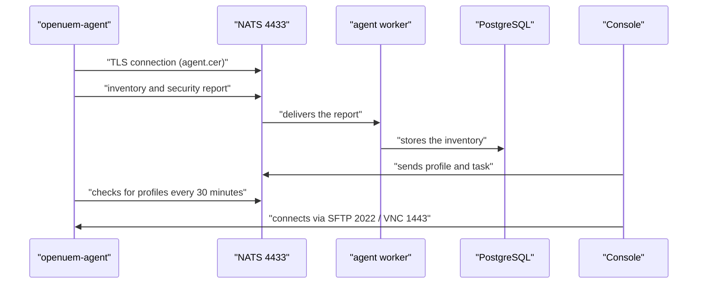
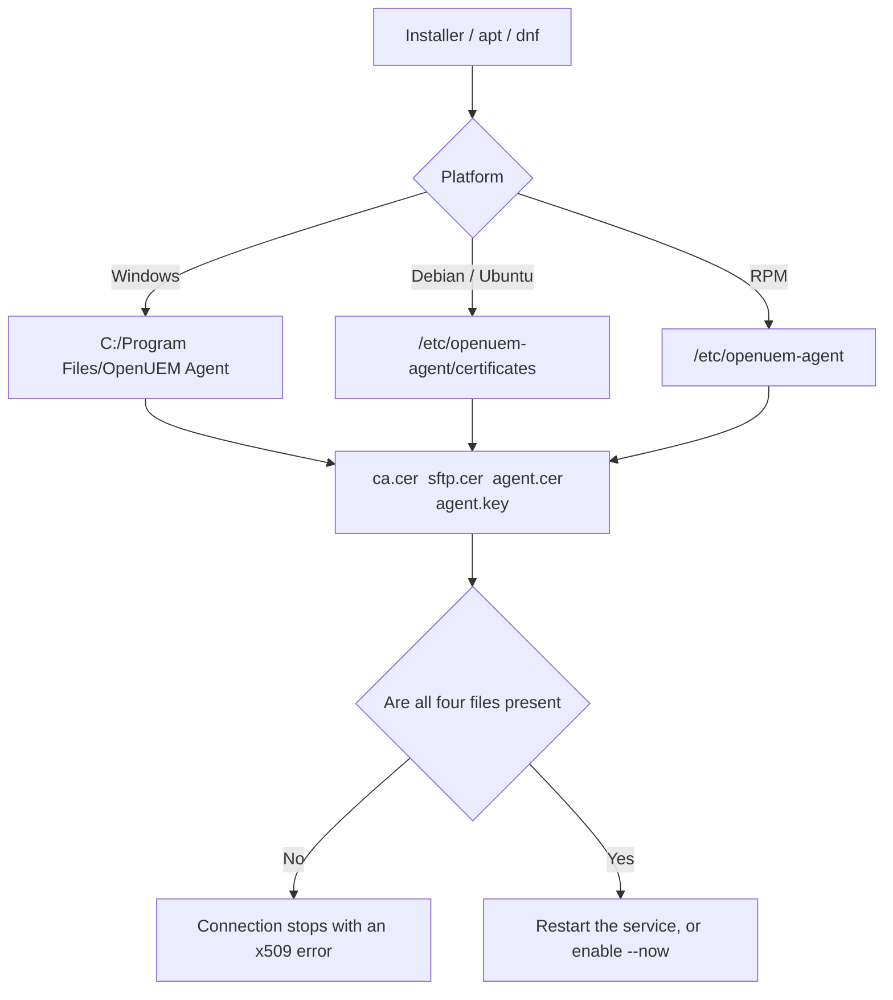
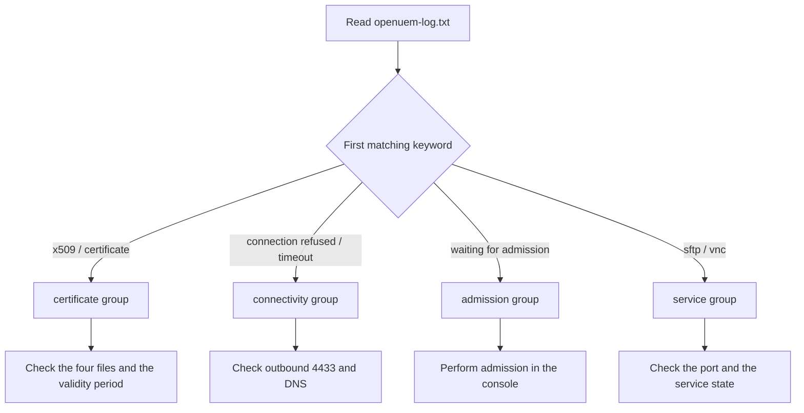

# Module 05 — Agent deployment

The only component that brings an endpoint under OpenUEM's management is the agent. The server side may have the console, the NATS broker and the workers ready, but without an agent on the endpoint, inventory, security state and profiles can never flow. Agent deployment should therefore not be seen as a "last step". It is the foundation of the whole management system.

This module sets out step by step the agent's work cycle, the four certificates it needs, the installation procedure for Windows, Debian, RPM and macOS platforms, the port requirements, how to read the log, and how to manage upgrade risk. The lab for this module needs no OpenUEM; it performs flag building, file checking, endpoint checking and lifetime arithmetic at the text and number level.

## The agent's work cycle

The agent runs permanently on the endpoint as a background service. Its first duty is to connect to the NATS broker. As soon as the connection succeeds the agent sends its inventory and security state as a report. The interval between one report and the next is set in the console under Admin → General Settings → Agents report frequency. The default value is 60 minutes.

Independently of report sending, the agent checks for new profiles once every 30 minutes. This interval can also be changed in General Settings. With the default values there are two profile checks per report. If the report interval is reduced to 30 minutes, the profile check coincides with the report. Shortening the report interval makes response faster but increases the load on NATS and PostgreSQL.

When the SFTP server (port 2022) and the VNC proxy (port 1443) are enabled, the agent runs them on its own side. File browsing and remote assistance from the console go through these two services. The certificate for their TLS is issued as the server.cer/server.key pair at the time admission is performed.

The state before admission has taken place is called Waiting for admission. At that stage reports are arriving, but the endpoint cannot be managed and does not appear in the dashboard charts. It is therefore necessary to perform admission in the console as soon as the agent is installed. This stage is studied in detail in Module 05.

```text
endpoint (openuem-agent service)
   │
   ├─ outbound ──► NATS service  host:4433      (report, profile check)
   ├─ listen   ──► SFTP server   :2022          (file browsing from console)
   ├─ listen   ──► VNC proxy     :1443          (remote assistance)
   └─ write    ──► openuem-log.txt              (agent logs folder)
```

The agent's procedure can be summed up in four stages. The first stage is installation, the second is connecting to NATS with the certificates, the third is sending reports, and the fourth is checking the profiles defined by the console on time and implementing them. If any one of these four stages fails, the endpoint does not appear in the console in real time.

**Figure 1 — Agent bootstrap and report flow**



Figure walkthrough — in this figure each line represents one action that happens in sequence. First the openuem-agent builds a TLS connection to NATS with agent.cer. Once the connection is established it sends the inventory and security report. NATS hands the report to the agent worker and the worker stores it in PostgreSQL. The console sends profiles and tasks along the same route. The agent checks every 30 minutes whether there is a new profile. Finally the admin connects directly to the endpoint from the console through SFTP or the VNC proxy. Reading Figure 1 from top to bottom shows the sequence that takes place after installation, one step at a time.

## The four certificates — the agent's identity

When the agent connects to NATS it does not use a user name and password. It uses certificate-based authentication. Each agent therefore needs four files. These four files are the same on every platform; only the location differs.

| File | Role |
| --- | --- |
| `ca.cer` | The server's Certificate Authority certificate; used as the trusted root in the TLS connection |
| `sftp.cer` | The certificate for the agent's SFTP service |
| `agent.cer` | The client certificate that represents the agent; presents the identity to NATS |
| `agent.key` | The private key paired with `agent.cer` |

If any one of the four files is missing, contact cannot be established. Without `ca.cer` the agent cannot trust the server's certificate, so the connection stops with an x509 error. Without `agent.key` the private key and the certificate do not match, so authentication does not succeed. After copying the files you must therefore always check that all four are present.

The locations per platform are as follows.

| Platform | Location |
| --- | --- |
| Debian / Ubuntu | `/etc/openuem-agent/certificates` |
| RPM family | `/etc/openuem-agent` (the same folder as `openuem.ini`) |
| Windows | The agent installation folder, `C:\Program Files\OpenUEM Agent` |

On Windows the files can be placed next to the installer. In that case there is no need to supply the path with a flag.

**Figure 2 — Where certificates are placed per platform**



Figure walkthrough — this figure shows where the four files must be placed, per platform. At the top there are three installation methods. The installer for Windows, and the package manager for Debian and RPM. The right-hand branch shows the folder for each platform. Lines connect those folders to their four files. Then comes the stage that checks whether all four files are present. If they are not, the figure shows that the connection stops with an x509 error. If they are, the procedure ends by restarting the service or by doing enable --now. Looking at Figure 2 you should note your own platform's folder first.

## Windows: silent installation and the wizard

The Windows agent is installed with `openuem-agent-setup.exe`. When deploying a whole fleet at once, filling in the wizard by hand is not possible. You therefore install silently with the `/VERYSILENT` flag and supply the required values as flags.

| Flag | Meaning |
| --- | --- |
| `/VERYSILENT` | Installs silently without showing the wizard |
| `/cacert=` | The path to `ca.cer` |
| `/cert=` | The path to `agent.cer` |
| `/key=` | The path to `agent.key` |
| `/sftpcert=` | The path to `sftp.cer` |
| `/tenantid=` | The tenant's id |
| `/siteid=` | The site's id |
| `/server=` | The NATS server's `domain:port` |
| `/sftp=` | SFTP port (default 2022) |
| `/vnc=` | VNC proxy port (default 1443) |

All flags are supplied on a single line. The form below uses the flag names given in the documentation.

```powershell
openuem-agent-setup.exe /VERYSILENT /cacert="C:\certs\ca.cer" /cert="C:\certs\agent.cer" /key="C:\certs\agent.key" /sftpcert="C:\certs\sftp.cer" /tenantid=1 /siteid=2 /server=nats.openuem.example:4433 /sftp=2022 /vnc=1443
```

```text
# simulated output — illustrative
Installing OpenUEM Agent ...
Extracting files to C:\Program Files\OpenUEM Agent
Creating service openuem-agent
Creating service openuem-agent-updater
NATS server : nats.openuem.example:4433
SFTP port   : 2022
VNC port    : 1443
Installation completed successfully.
```

`/tenantid` and `/siteid` must be supplied together. If only one is supplied, the agent cannot decide which organization and site it falls under. A deployment script therefore checks these two values as a pair. This rule is tested in the first exercise of the lab.

The wizard route is used for cases where you install by hand. Double click `openuem-agent-setup.exe` and fill it in step by step. The wizard asks for the same values: NATS server, SFTP port, VNC proxy port and the certificate paths. The wizard's page names and their order can change from version to version, so you need to consult the documentation for the version concerned before actually installing.

## Debian and Ubuntu

On the Debian family (Debian, Ubuntu, Mint) the agent is installed from the apt repository. If the repository is ready, it can be installed in one line with the command below.

```bash
sudo apt install openuem-agent
```

If there is no repository and you have the `.deb` file in hand, you can install by giving the file path directly. In the form below, `0.7.0` is an example version used in the documentation and does not represent the current release.

```bash
sudo apt install ./openuem-agent_0.7.0_amd64.deb
```

During installation the package asks three questions. The NATS server address, the SFTP port and the VNC proxy port. As soon as these values are answered, the configuration file is written automatically.

```text
# simulated output — illustrative
Configuring openuem-agent
NATS server address: nats.openuem.example:4433
SFTP port [2022]: 2022
VNC proxy port [1443]: 1443
Setting up openuem-agent ...
```

After installation the most important stage is placing the certificate files. The four files are copied into `/etc/openuem-agent/certificates`. The command below is an ordinary file copy and is not an OpenUEM command.

```bash
sudo cp ca.cer sftp.cer agent.cer agent.key /etc/openuem-agent/certificates/
sudo ls -l /etc/openuem-agent/certificates/
```

```text
# simulated output — illustrative
-rw-r----- 1 root root 1846 Oct 12 09:02 ca.cer
-rw-r----- 1 root root 1902 Oct 12 09:02 sftp.cer
-rw-r----- 1 root root 1888 Oct 12 09:02 agent.cer
-rw------- 1 root root 3272 Oct 12 09:02 agent.key
```

After copying the files, both services must be restarted. `openuem-agent` is the service that sends reports, and `openuem-agent-updater` is the service that watches the agent's version. Restarting both makes them read the new certificates and the new configuration.

```bash
sudo systemctl restart openuem-agent
sudo systemctl restart openuem-agent-updater
sudo systemctl status openuem-agent --no-pager
```

```text
# simulated output — illustrative
● openuem-agent.service - OpenUEM Agent
     Loaded: loaded (/lib/systemd/system/openuem-agent.service; enabled)
     Active: active (running) since Mon 2026-10-12 09:05:11 +08
```

Restarting only one service and forgetting the other is a frequently made mistake. When that happens the agent is sending reports while the updater keeps running with the old version.

## The RPM family

On Fedora, Alma, Rocky and RHEL the agent is installed with `dnf`.

```bash
sudo dnf install -y openuem-agent
```

The RPM package does not ask questions the way the Debian package does. The configuration must therefore be edited by hand in `/etc/openuem-agent/openuem.ini`. The section below is the part that defines the NATS server and the ports.

```ini
[NATS]
NATSServers=nats.openuem.example:4433
SFTPPort=2022
VNCPort=1443
```

In the `NATSServers` value the host and port are joined with a colon. If a cluster contains several servers, they can be written separated by commas. Failures to connect are often caused by writing only a single server.

After editing, the file's owner must be changed. The agent service runs as an unprivileged user, so it needs to be able to read the file.

```bash
sudo chown openuem-agent:openuem-agent /etc/openuem-agent/openuem.ini
sudo chown openuem-agent:openuem-agent /etc/openuem-agent/*.cer /etc/openuem-agent/*.key
```

Then both services are enabled and started in one line. `--now` combines enabling with starting immediately.

```bash
sudo systemctl enable --now openuem-agent
sudo systemctl enable --now openuem-agent-updater
```

```text
# simulated output — illustrative
Created symlink /etc/systemd/system/multi-user.target.wants/openuem-agent.service → /usr/lib/systemd/system/openuem-agent.service
Created symlink /etc/systemd/system/multi-user.target.wants/openuem-agent-updater.service → /usr/lib/systemd/system/openuem-agent-updater.service
```

## macOS

The macOS agent is available for both Intel and Apple Silicon. After installation, the place where the certificate files must be placed and the name of the configuration file need to be checked precisely in the documentation for the version concerned. On macOS HomeBrew must be installed by hand for package deployment. Without HomeBrew, no package source such as WinGet or Flatpak will work.

## Ports and firewall

The problem most often met in agent deployment is ports. The outbound route from the endpoint to the server must be open. If the NATS port cannot be reached, the agent cannot send reports.

| Port | Component | Direction |
| --- | --- | --- |
| 4433 | NATS service | endpoint → server (outbound, mandatory) |
| 2022 | agent SFTP server | console → endpoint |
| 1443 | agent VNC proxy | console → endpoint |
| 1323 | console | admin browser → server |
| 1324 | console auth | admin browser → server |
| 8000 | OCSP responder | component → server |

```text
                 ┌──────────────── server ────────────────┐
   endpoint      │  console 1323 / auth 1324              │
   ┌────────┐    │  NATS 4433    OCSP 8000                │
   │ agent  │────┼──► outbound 4433                       │
   │ SFTP   │◄───┼──── console → 2022                    │
   │ VNC    │◄───┼──── console → 1443                    │
   └────────┘    └────────────────────────────────────────┘
```

When drawing up firewall rules, outbound comes first. If the endpoint cannot reach the NATS host and port, opening the other ports is of no use. An endpoint that is distinguished by DNS and whose IP is obtained from a report is called a remote endpoint. File browsing, remote assistance and Wake-on-LAN cannot be used on those endpoints.

## Reading the log

The agent's log file is `openuem-log.txt` and it lives in the agent's `logs` folder. On Windows the agent folder is `C:\Program Files\OpenUEM Agent`. The log of an enabled agent can also be viewed from the console through SFTP. When the endpoint cannot be reached directly, this route is very useful.

When reading the log, grouping by keyword is faster than reading line by line. The table below shows the keywords met most often and what they mean.

| Keyword | Group | Action |
| --- | --- | --- |
| `x509`, `certificate` | certificate | Check the four files, the validity period and the CA |
| `connection refused` | connectivity | Check whether the NATS service is running |
| `i/o timeout` | connectivity | Check outbound 4433 and the firewall |
| `no such host` | connectivity | Check DNS resolution |
| `waiting for admission` | admission | Perform admission in the console |
| `sftp` | service | The 2022 port and whether SFTP is enabled |
| `vnc` | service | The 1443 port and the state of remote assistance |
| `openuem.ini` | configuration | The file owner and the values |

**Figure 3 — The path from openuem-log.txt to a classified problem**



Figure walkthrough — this figure shows the sequence for reading the log. First you open the log file. Then you look for the keyword contained in the line. If x509 or certificate is present you arrive at the certificate group and check the four files and the validity period. If connection refused or timeout is present you arrive at the connectivity group and check outbound 4433 and DNS. If waiting for admission is present you learn that admission has to be performed in the console. If sftp or vnc is present you check the port and the service state. The path in Figure 3 is the same as the rule used in the fifth exercise of the lab.

## Upgrade risk

Because the agent includes the `openuem-agent-updater` service, it can watch for the availability of a new version. An upgrade should not, however, be done across a whole fleet at once. The risk can be split into three levels.

| Level | Situation | Effect |
| --- | --- | --- |
| Low | Patch version bump, no configuration change | Minor |
| Medium | Version jump, some endpoints currently offline | Report gaps are possible |
| High | Major version jump, a hand-edited `openuem.ini`, expired certificates | Service does not start, connection breaks |

The points to check before upgrading are as follows.

- Check how much of the certificate validity period remains. If it has already expired, the connection will not work at all after the upgrade.
- If `openuem.ini` has been edited by hand, the upgrade may replace the file. The original file must therefore be backed up.
- Record the number of endpoints that are offline. When those endpoints come back after the upgrade, a version mismatch may arise.
- The recovery route (rollback) must be tested in advance.

Version-related points (package version, key names inside the ini, the updater's behaviour) can change from release to release, so they need to be rechecked per version.

## Self-check questions

1. How often does the agent check for new profiles? — By default it checks once every 30 minutes. This interval can be changed in General Settings.
2. How many certificate files does one agent need? — Four files: `ca.cer`, `sftp.cer`, `agent.cer`, `agent.key`.
3. In a Windows silent install, what happens if `/tenantid` is supplied alone? — It must be supplied together with `/siteid`. Supplying it alone is not accepted.
4. On Debian, which services must be restarted after copying the certificates? — Both `openuem-agent` and `openuem-agent-updater` must be restarted.
5. If the agent is sending reports but does not appear in the console, which state should be checked first? — Check whether it is in the Waiting for admission state. At that stage the endpoint cannot yet be managed.

## Technical review notes

- The names and order of the Windows silent install flags are taken from `MODULE_SPEC.md` §Verified facts. The flag order has no effect on the installer, but the lab fixes one order.
- `/server=` is described as the `domain:port` of the NATS endpoint. The documentation writes `domain:port` explicitly and shows the port as 4433 only by way of example.
- In the RPM `openuem.ini` the key name for the VNC port is used as `VNCPort`. The documentation only says "VNC port", so the exact key name needs to be rechecked per version.
- The precise use of `sftp.cer` (the TLS certificate of the SFTP service, or something else) is not described in detail in the documentation. Only the file name and location can be confirmed.
- The macOS agent's certificate location and configuration file name are not given precisely in this module. They need to be checked in the documentation for the version concerned.
- The wizard install's page names and their order are not described. Only the nature of the procedure is written.
- The package version `0.7.0` is a documentation example and does not represent the current release.
