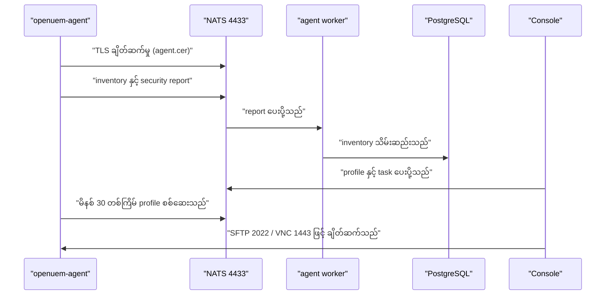
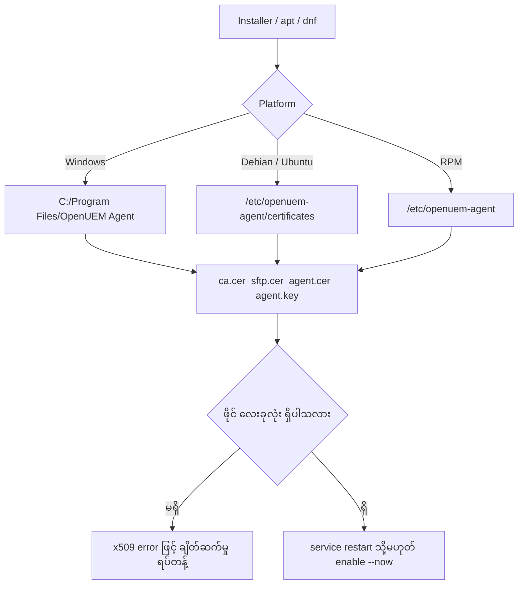
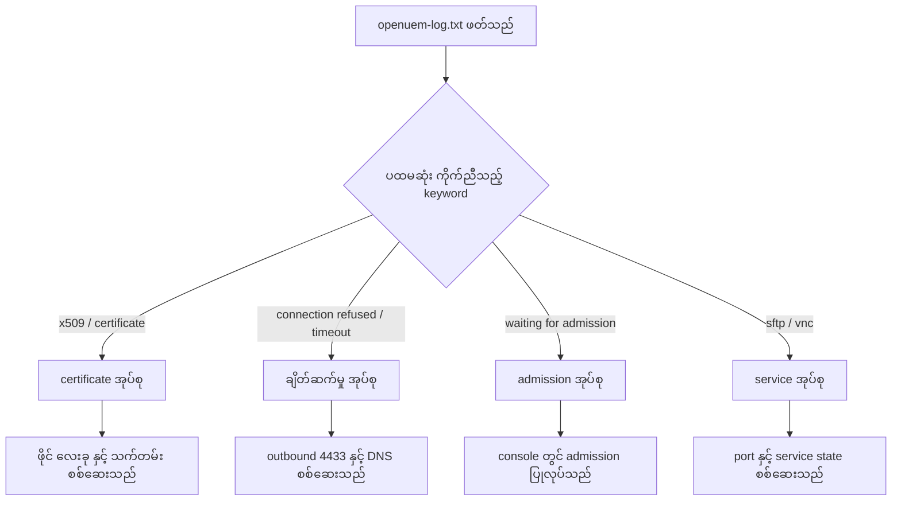

# Module 05 — Agent deployment

Endpoint တစ်ခုကို OpenUEM ၏ စီမံခန့်ခွဲမှုအောက်သို့ ရောက်ရှိစေသည့် တစ်ခုတည်းသော အစိတ်အပိုင်းမှာ agent ဖြစ်သည်။ Server ဘက်တွင် console, NATS broker နှင့် worker များ အဆင်သင့် ရှိနေသော်လည်း endpoint ပေါ်တွင် agent မရှိပါက inventory, security state နှင့် profile များ ဘယ်သောအခါမျှ မစီးဆင်းနိုင်ပါ။ ထို့ကြောင့် agent deployment ကို "နောက်ဆုံးအဆင့်" အဖြစ် မမြင်သင့်ပါ။ ၎င်းသည် စီမံခန့်ခွဲမှု တစ်ခုလုံး၏ အခြေခံအုတ်မြစ် ဖြစ်သည်။

ဤ module တွင် agent ၏ အလုပ်သံသရာ, လိုအပ်သည့် certificate လေးခု, Windows, Debian, RPM နှင့် macOS platform အလိုက် installation လုပ်ငန်းစဉ်, port လိုအပ်ချက်, log ဖတ်ရှုနည်းနှင့် upgrade အန္တရာယ် စီမံနည်းကို အဆင့်လိုက် ဖော်ပြမည်။ ဤ module ၏ lab သည် OpenUEM မလိုအပ်ဘဲ flag တည်ဆောက်ခြင်း, ဖိုင်စစ်ဆေးခြင်း, endpoint စစ်ဆေးခြင်း နှင့် သက်တမ်းတွက်ချက်ခြင်းကို စာသားနှင့် ကိန်းဂဏန်းအဆင့်တွင် ပြုလုပ်သည်။

## Agent ၏ အလုပ်သံသရာ

Agent သည် endpoint ပေါ်တွင် background service အဖြစ် အမြဲ လည်ပတ်သည်။ ၎င်း၏ ပထမဆုံး တာဝန်မှာ NATS broker သို့ ချိတ်ဆက်ခြင်း ဖြစ်သည်။ ချိတ်ဆက်မှု အောင်မြင်သည်နှင့် agent သည် မိမိ၏ inventory နှင့် security state ကို report အဖြစ် ပေးပို့သည်။ Report တစ်ခုနှင့် တစ်ခုအကြား ကာလကို console ၏ Admin → General Settings → Agents report frequency တွင် သတ်မှတ်သည်။ မူလတန်ဖိုးမှာ မိနစ် 60 ဖြစ်သည်။

Report ပေးပို့ခြင်းနှင့် သီးခြားလွတ်လပ်စွာ agent သည် profile အသစ်များကို မိနစ် 30 တစ်ကြိမ် စစ်ဆေးသည်။ ဤကာလကိုလည်း General Settings တွင် ပြောင်းလဲနိုင်သည်။ မူလတန်ဖိုးများအတွက် report တစ်ကြိမ်လျှင် profile စစ်ဆေးမှု နှစ်ကြိမ် ရှိသည်။ Report ကာလကို မိနစ် 30 သို့ လျှော့ချပါက profile စစ်ဆေးမှုနှင့် တစ်ပြိုင်နက် ဖြစ်ပေါ်သည်။ Report ကာလကို တိုစေခြင်းသည် တုံ့ပြန်မှု မြန်စေသော်လည်း NATS နှင့် PostgreSQL ပေါ်တွင် ဝန် တိုးစေသည်။

Agent သည် SFTP server (port 2022) နှင့် VNC proxy (port 1443) ကို enable လုပ်ထားသည့်အခါ မိမိဘက်မှ လည်ပတ်စေသည်။ Console မှ file browsing နှင့် remote assistance ကို ဤ service နှစ်ခုမှတစ်ဆင့် အသုံးပြုသည်။ ဤ service များ၏ TLS အတွက် certificate ကို admission ပြုလုပ်သည့်အခါ server.cer/server.key အတွဲအဖြစ် ထုတ်ပေးသည်။

Admission မဖြစ်သေးမီ အခြေအနေကို Waiting for admission ဟု ခေါ်သည်။ ထိုအဆင့်တွင် report များ ရောက်ရှိနေသော်လည်း endpoint ကို စီမံခန့်ခွဲနိုင်ခြင်း မရှိသေးသလို dashboard chart များတွင်လည်း မပါဝင်ပါ။ ထို့ကြောင့် agent install ပြီးသည်နှင့် console တွင် admission ပြုလုပ်ရန် လိုအပ်သည်။ ဤအဆင့်ကို Module 05 တွင် အသေးစိတ် လေ့လာမည်။

```text
endpoint (openuem-agent service)
   │
   ├─ outbound ──► NATS service  host:4433      (report, profile check)
   ├─ listen   ──► SFTP server   :2022          (file browsing from console)
   ├─ listen   ──► VNC proxy     :1443          (remote assistance)
   └─ write    ──► openuem-log.txt              (agent logs folder)
```

Agent ၏ လုပ်ငန်းစဉ်ကို အဆင့်လေးဆင့်ဖြင့် အနှစ်ချုပ်နိုင်သည်။ ပထမ အဆင့်မှာ install လုပ်ခြင်း, ဒုတိယ အဆင့်မှာ certificate ဖြင့် NATS သို့ ချိတ်ဆက်ခြင်း, တတိယ အဆင့်မှာ report ပေးပို့ခြင်း, စတုတ္ထ အဆင့်မှာ console မှ သတ်မှတ်ထားသည့် profile များကို အချိန်မှန် စစ်ဆေးပြီး အကောင်အထည်ဖော်ခြင်း ဖြစ်သည်။ ဤအဆင့်လေးဆင့်ထဲမှ တစ်ဆင့် ပျက်ကွက်ပါက endpoint သည် console တွင် အချိန်နှင့်တစ်ပြေးညီ မပေါ်ပါ။

**Figure 1 — Agent bootstrap နှင့် report စီးဆင်းမှု**



ပုံရှင်းလင်းချက် — ဤပုံတွင် မျဉ်းကြောင်းတစ်ခုစီသည် အစီအစဉ်တကျ ဖြစ်ပေါ်သည့် လုပ်ဆောင်ချက် တစ်ခုကို ကိုယ်စားပြုသည်။ ပထမဆုံး openuem-agent သည် NATS သို့ agent.cer ဖြင့် TLS ချိတ်ဆက်မှု တည်ဆောက်သည်။ ချိတ်ဆက်မှု ရရှိပြီးနောက် inventory နှင့် security report ကို ပေးပို့သည်။ NATS သည် report ကို agent worker သို့ လွှဲပေးပြီး worker က PostgreSQL တွင် သိမ်းဆည်းသည်။ Console သည် profile နှင့် task များကို လမ်းကြောင်းတူညီစွာ ပေးပို့သည်။ Agent သည် မိနစ် 30 တစ်ကြိမ် profile အသစ် ရှိ မရှိ စစ်ဆေးသည်။ နောက်ဆုံးတွင် admin သည် console မှ SFTP သို့မဟုတ် VNC proxy ဖြင့် endpoint သို့ တိုက်ရိုက် ချိတ်ဆက်သည်။ Figure 1 ကို အပေါ်မှ အောက်သို့ ဖတ်ပါက install ပြီးနောက် ဖြစ်ပေါ်သည့် အစီအစဉ်ကို တစ်ဆင့်ချင်း မြင်နိုင်သည်။

## Certificate လေးခု — agent ၏ identity

Agent သည် NATS သို့ ချိတ်ဆက်သည့်အခါ user name နှင့် password ကို မသုံးပါ။ Certificate အခြေခံ authentication ကို အသုံးပြုသည်။ ထို့ကြောင့် agent တစ်ခုစီတွင် ဖိုင် လေးခု လိုအပ်သည်။ ဤဖိုင်လေးခုသည် platform အားလုံးတွင် အတူတူ ဖြစ်ပြီး တည်နေရာသာ ကွာခြားသည်။

| ဖိုင် | အခန်းကဏ္ဍ |
| --- | --- |
| `ca.cer` | Server ၏ Certificate Authority certificate; TLS ချိတ်ဆက်မှုတွင် ယုံကြည်ရသည့် root အဖြစ် အသုံးပြုသည် |
| `sftp.cer` | Agent ၏ SFTP service အတွက် certificate |
| `agent.cer` | Agent ကို ကိုယ်စားပြုသည့် client certificate; NATS သို့ identity တင်ပြရန် |
| `agent.key` | `agent.cer` နှင့် တွဲဖက်သည့် private key |

ဖိုင် လေးခုထဲမှ တစ်ခု ပျက်ကွက်ပါက အဆက်အသွယ် မဖြစ်နိုင်ပါ။ `ca.cer` မရှိပါက agent သည် server ၏ certificate ကို မယုံကြည်နိုင်သဖြင့် x509 error ဖြင့် ချိတ်ဆက်မှု ရပ်တန့်သည်။ `agent.key` မရှိပါက private key နှင့် certificate မကိုက်ညီသဖြင့် authentication မအောင်မြင်ပါ။ ထို့ကြောင့် ဖိုင်ကူးယူပြီးနောက် အမြဲတမ်း ဖိုင်လေးခုလုံး ရှိ မရှိ စစ်ဆေးရသည်။

Platform အလိုက် တည်နေရာများမှာ အောက်ပါအတိုင်း ဖြစ်သည်။

| Platform | တည်နေရာ |
| --- | --- |
| Debian / Ubuntu | `/etc/openuem-agent/certificates` |
| RPM မိသားစု | `/etc/openuem-agent` (`openuem.ini` နှင့် တူညီသည့် folder) |
| Windows | Agent installation folder ဖြစ်သည့် `C:\Program Files\OpenUEM Agent` |

Windows တွင် ဖိုင်များကို installer အနားတွင် ထားရှိနိုင်သည်။ ထိုအခါ flag ဖြင့် လမ်းကြောင်း ပေးပို့ရန် မလိုအပ်ပါ။

**Figure 2 — Platform အလိုက် certificate ထားရှိသည့် နေရာ**



ပုံရှင်းလင်းချက် — ဤပုံသည် ဖိုင် လေးခုကို ဘယ်နေရာတွင် ထားရမည်ကို platform အလိုက် ပြသည်။ ထိပ်တွင် installation နည်းလမ်း သုံးမျိုး ရှိသည်။ Windows အတွက် installer ဖြစ်ပြီး Debian နှင့် RPM အတွက် package manager ဖြစ်သည်။ ညာဘက်ခွဲတွင် platform တစ်ခုစီ၏ folder ကို ပြသည်။ ထို folder များမှ ဖိုင် လေးခုစီသို့ မျဉ်းဆက်ထားသည်။ ထို့နောက် ဖိုင် လေးခုလုံး ရှိ မရှိ စစ်ဆေးသည့် အဆင့် ရောက်သည်။ မရှိပါက x509 error ဖြင့် ချိတ်ဆက်မှု ရပ်တန့်မည်ကို ပြသည်။ ရှိပါက service ကို restart လုပ်ခြင်း သို့မဟုတ် enable --now လုပ်ခြင်းဖြင့် အဆုံးသတ်သည်။ Figure 2 ကို ကြည့်ပြီး မိမိ platform ၏ folder ကို ဦးစွာ မှတ်သားထားသင့်သည်။

## Windows: silent installation နှင့် wizard

Windows agent ကို `openuem-agent-setup.exe` ဖြင့် install လုပ်သည်။ Fleet တစ်ခုလုံးကို တစ်ပြိုင်နက် deploy လုပ်ရာတွင် wizard ကို လူကိုယ်တိုင် ဖြည့်ခြင်းသည် မဖြစ်နိုင်ပါ။ ထို့ကြောင့် `/VERYSILENT` flag ဖြင့် တိတ်ဆိတ်စွာ install လုပ်ပြီး လိုအပ်သည့် တန်ဖိုးများကို flag များဖြင့် ပေးပို့သည်။

| Flag | အဓိပ္ပာယ် |
| --- | --- |
| `/VERYSILENT` | wizard မပြဘဲ တိတ်ဆိတ်စွာ install လုပ်သည် |
| `/cacert=` | `ca.cer` ၏ လမ်းကြောင်း |
| `/cert=` | `agent.cer` ၏ လမ်းကြောင်း |
| `/key=` | `agent.key` ၏ လမ်းကြောင်း |
| `/sftpcert=` | `sftp.cer` ၏ လမ်းကြောင်း |
| `/tenantid=` | tenant ၏ id |
| `/siteid=` | site ၏ id |
| `/server=` | NATS server ၏ `domain:port` |
| `/sftp=` | SFTP port (မူလတန်ဖိုး 2022) |
| `/vnc=` | VNC proxy port (မူလတန်ဖိုး 1443) |

Flag အားလုံးကို တစ်ကြောင်းတည်းတွင် ပေးပို့သည်။ အောက်ပါပုံစံသည် documentation တွင် ဖော်ပြထားသည့် flag အမည်များကို အသုံးပြုထားသည်။

```powershell
openuem-agent-setup.exe /VERYSILENT /cacert="C:\certs\ca.cer" /cert="C:\certs\agent.cer" /key="C:\certs\agent.key" /sftpcert="C:\certs\sftp.cer" /tenantid=1 /siteid=2 /server=nats.openuem.example:4433 /sftp=2022 /vnc=1443
```

```text
# simulated output — illustrative
Installing OpenUEM Agent ...
Extracting files to C:\Program Files\OpenUEM Agent
Creating service openuem-agent
Creating service openuem-agent-updater
NATS server : nats.openuem.example:4433
SFTP port   : 2022
VNC port    : 1443
Installation completed successfully.
```

`/tenantid` နှင့် `/siteid` ကို အတူတကွ ပေးပို့ရသည်။ တစ်ခုတည်း ပေးပို့ပါက agent သည် မည်သည့် organization နှင့် site အောက်တွင် ရောက်ရှိမည်ကို ဆုံးဖြတ်နိုင်ခြင်း မရှိပါ။ ထို့ကြောင့် deployment script တွင် ဤတန်ဖိုးနှစ်ခုကို တွဲဖက် စစ်ဆေးရသည်။ ဤစည်းမျဉ်းကို lab ၏ ပထမ exercise တွင် စမ်းသပ်မည်။

Wizard လမ်းကြောင်းကို ကိုယ်တိုင် install လုပ်သည့် ကိစ္စများတွင် အသုံးပြုသည်။ `openuem-agent-setup.exe` ကို double click လုပ်ပြီး အဆင့်လိုက် ဖြည့်သွင်းရသည်။ Wizard တွင် အလားတူ တန်ဖိုးများ ဖြစ်သည့် NATS server, SFTP port, VNC proxy port နှင့် certificate လမ်းကြောင်းများ မေးမြန်းသည်။ Wizard ၏ စာမျက်နှာ အမည်များနှင့် အစီအစဉ်သည် version အလိုက် ပြောင်းလဲနိုင်သဖြင့် အမှန်တကယ် install မလုပ်မီ သက်ဆိုင်ရာ version ၏ documentation ကို ကြည့်ရှုရန် လိုအပ်သည်။

## Debian နှင့် Ubuntu

Debian မိသားစု (Debian, Ubuntu, Mint) တွင် agent ကို apt repository မှ install လုပ်သည်။ Repository အဆင်သင့် ဖြစ်ပါက အောက်ပါ command ဖြင့် တစ်ကြောင်းတည်း install နိုင်သည်။

```bash
sudo apt install openuem-agent
```

Repository မရှိဘဲ `.deb` ဖိုင်ကို လက်ထဲ ရရှိထားပါက ဖိုင်လမ်းကြောင်းကို တိုက်ရိုက် ပေး၍ install နိုင်သည်။ အောက်ပါပုံစံတွင် `0.7.0` သည် documentation တွင် သုံးထားသည့် ဥပမာ version ဖြစ်ပြီး လက်ရှိ release ကို ကိုယ်စားမပြုပါ။

```bash
sudo apt install ./openuem-agent_0.7.0_amd64.deb
```

Install လုပ်စဉ်အတွင်း package သည် မေးခွန်း သုံးခု မေးသည်။ NATS server ၏ လိပ်စာ, SFTP port နှင့် VNC proxy port ဖြစ်သည်။ ဤတန်ဖိုးများကို ဖြေဆိုပြီးသည်နှင့် configuration ဖိုင် အလိုအလျောက် ရေးသားခံရသည်။

```text
# simulated output — illustrative
Configuring openuem-agent
NATS server address: nats.openuem.example:4433
SFTP port [2022]: 2022
VNC proxy port [1443]: 1443
Setting up openuem-agent ...
```

Install ပြီးနောက် အရေးအကြီးဆုံး အဆင့်မှာ certificate ဖိုင်များ ထားရှိခြင်း ဖြစ်သည်။ ဖိုင် လေးခုကို `/etc/openuem-agent/certificates` ထဲသို့ ကူးယူသည်။ အောက်ပါ command သည် ယေဘုယျ ဖိုင်ကူးယူခြင်း ဖြစ်ပြီး OpenUEM ၏ command မဟုတ်ပါ။

```bash
sudo cp ca.cer sftp.cer agent.cer agent.key /etc/openuem-agent/certificates/
sudo ls -l /etc/openuem-agent/certificates/
```

```text
# simulated output — illustrative
-rw-r----- 1 root root 1846 Oct 12 09:02 ca.cer
-rw-r----- 1 root root 1902 Oct 12 09:02 sftp.cer
-rw-r----- 1 root root 1888 Oct 12 09:02 agent.cer
-rw------- 1 root root 3272 Oct 12 09:02 agent.key
```

ဖိုင်ကူးယူပြီးနောက် service နှစ်ခုကို restart လုပ်ရသည်။ `openuem-agent` သည် report ပေးပို့သည့် service ဖြစ်ပြီး `openuem-agent-updater` သည် agent ၏ version ကို စောင့်ကြည့်သည့် service ဖြစ်သည်။ နှစ်ခုလုံးကို restart လုပ်ခြင်းဖြင့် certificate အသစ် နှင့် configuration အသစ်ကို ဖတ်ရှုစေသည်။

```bash
sudo systemctl restart openuem-agent
sudo systemctl restart openuem-agent-updater
sudo systemctl status openuem-agent --no-pager
```

```text
# simulated output — illustrative
● openuem-agent.service - OpenUEM Agent
     Loaded: loaded (/lib/systemd/system/openuem-agent.service; enabled)
     Active: active (running) since Mon 2026-10-12 09:05:11 +08
```

Service တစ်ခုသာ restart လုပ်ပြီး ကျန်တစ်ခုကို မေ့ကျန်ခြင်းသည် မကြာခဏ ဖြစ်ပေါ်သည့် အမှား ဖြစ်သည်။ ထိုအခါ agent သည် report ပေးပို့နေသော်လည်း updater သည် version အဟောင်းဖြင့် ဆက်လက် လည်ပတ်နေသည်။

## RPM မိသားစု

Fedora, Alma, Rocky နှင့် RHEL တွင် `dnf` ဖြင့် install လုပ်သည်။

```bash
sudo dnf install -y openuem-agent
```

RPM package သည် Debian package ကဲ့သို့ မေးခွန်းများ မမေးပါ။ ထို့ကြောင့် configuration ကို `/etc/openuem-agent/openuem.ini` တွင် ကိုယ်တိုင် ပြင်ဆင်ရသည်။ အောက်ပါအပိုင်းသည် NATS server နှင့် port များကို သတ်မှတ်သည့် ကဏ္ဍ ဖြစ်သည်။

```ini
[NATS]
NATSServers=nats.openuem.example:4433
SFTPPort=2022
VNCPort=1443
```

`NATSServers` တန်ဖိုးတွင် host နှင့် port ကို colon ဖြင့် တွဲရသည်။ Cluster တစ်ခုတွင် server များ များပါက comma ဖြင့် ခွဲ၍ ရေးနိုင်သည်။ ချိတ်ဆက်မှု မအောင်မြင်သည့် အခါများတွင် server တစ်ခုတည်း ရေးထားခြင်းကြောင့် ဖြစ်တတ်သည်။

ပြင်ဆင်ပြီးနောက် ဖိုင်၏ ပိုင်ရှင်ကို ပြောင်းရသည်။ Agent service သည် unprivileged user အနေဖြင့် လည်ပတ်သဖြင့် ဖိုင်ကို ဖတ်နိုင်ရန် လိုအပ်သည်။

```bash
sudo chown openuem-agent:openuem-agent /etc/openuem-agent/openuem.ini
sudo chown openuem-agent:openuem-agent /etc/openuem-agent/*.cer /etc/openuem-agent/*.key
```

ထို့နောက် service နှစ်ခုကို enable နှင့် start ကို တစ်ကြောင်းတည်း လုပ်သည်။ `--now` သည် enable လုပ်ခြင်းနှင့် ချက်ချင်း start လုပ်ခြင်းကို ပေါင်းစပ်ပေးသည်။

```bash
sudo systemctl enable --now openuem-agent
sudo systemctl enable --now openuem-agent-updater
```

```text
# simulated output — illustrative
Created symlink /etc/systemd/system/multi-user.target.wants/openuem-agent.service → /usr/lib/systemd/system/openuem-agent.service
Created symlink /etc/systemd/system/multi-user.target.wants/openuem-agent-updater.service → /usr/lib/systemd/system/openuem-agent-updater.service
```

## macOS

macOS agent ကို Intel နှင့် Apple Silicon နှစ်မျိုးလုံးအတွက် ရရှိနိုင်သည်။ Install လုပ်ပြီးနောက် certificate ဖိုင်များကို ထားရှိရမည့် နေရာနှင့် configuration ဖိုင်၏ အမည်ကို သက်ဆိုင်ရာ version ၏ documentation တွင် အတိအကျ စစ်ဆေးရန် လိုအပ်သည်။ macOS တွင် package deployment အတွက် HomeBrew ကို ကိုယ်တိုင် install လုပ်ထားရသည်။ HomeBrew မရှိပါက WinGet သို့မဟုတ် Flatpak ကဲ့သို့သော package source တစ်ခုမျှ အလုပ်မလုပ်ပါ။

## Port နှင့် firewall

Agent deployment တွင် အများဆုံး ကြုံတွေ့ရသည့် ပြဿနာမှာ port ဖြစ်သည်။ Endpoint မှ server သို့ အပြင်သို့ ထွက်သည့် လမ်းကြောင်း (outbound) ကို ဖွင့်ထားရသည်။ NATS port ကို မချိတ်ဆက်နိုင်ပါက agent သည် report ပေးပို့နိုင်ခြင်း မရှိပါ။

| Port | Component | လမ်းကြောင်း |
| --- | --- | --- |
| 4433 | NATS service | endpoint → server (outbound, မဖြစ်မနေ) |
| 2022 | agent SFTP server | console → endpoint |
| 1443 | agent VNC proxy | console → endpoint |
| 1323 | console | admin browser → server |
| 1324 | console auth | admin browser → server |
| 8000 | OCSP responder | component → server |

```text
                 ┌──────────────── server ────────────────┐
   endpoint      │  console 1323 / auth 1324              │
   ┌────────┐    │  NATS 4433    OCSP 8000                │
   │ agent  │────┼──► outbound 4433                       │
   │ SFTP   │◄───┼──── console → 2022                    │
   │ VNC    │◄───┼──── console → 1443                    │
   └────────┘    └────────────────────────────────────────┘
```

Firewall စည်းမျဉ်း ရေးဆွဲသည့်အခါ outbound ကို ဦးစားပေးရသည်။ Endpoint မှ NATS host နှင့် port သို့ ရောက်ရှိနိုင်ခြင်း မရှိပါက အခြား port များ ဖွင့်ထားခြင်းသည် အကျိုးမရှိပါ။ Endpoint တစ်ခုကို DNS ဖြင့် ခွဲခြားပြီး ၎င်း၏ IP ကို report မှ ရရှိသည့် အခြေအနေကို remote endpoint ဟု ခေါ်သည်။ ထို endpoint များတွင် file browsing, remote assistance နှင့် Wake-on-LAN ကို အသုံးမပြုနိုင်ပါ။

## Log ဖတ်ရှုခြင်း

Agent ၏ log ဖိုင်မှာ `openuem-log.txt` ဖြစ်ပြီး agent ၏ `logs` folder ထဲတွင် တည်ရှိသည်။ Windows တွင် agent folder မှာ `C:\Program Files\OpenUEM Agent` ဖြစ်သည်။ Console မှလည်း enabled agent တစ်ခု၏ log ကို SFTP မှတစ်ဆင့် ကြည့်ရှုနိုင်သည်။ Endpoint သို့ တိုက်ရိုက် မရောက်နိုင်သည့် အခါ ဤလမ်းကြောင်းသည် အလွန် အသုံးဝင်သည်။

Log ကို ဖတ်သည့်အခါ စာကြောင်း တစ်ခုချင်း ဖတ်ခြင်းထက် keyword အလိုက် အုပ်စုဖွဲ့ခြင်းက ပိုမြန်သည်။ အောက်ပါဇယားသည် မကြာခဏ တွေ့ရသည့် keyword များနှင့် ၎င်းတို့၏ အဓိပ္ပာယ်ကို ပြသည်။

| Keyword | အုပ်စု | လုပ်ဆောင်ရန် |
| --- | --- | --- |
| `x509`, `certificate` | certificate | ဖိုင် လေးခု, သက်တမ်း နှင့် CA ကို စစ်ဆေးသည် |
| `connection refused` | ချိတ်ဆက်မှု | NATS service လည်ပတ်နေခြင်း ရှိ မရှိ စစ်ဆေးသည် |
| `i/o timeout` | ချိတ်ဆက်မှု | outbound 4433 နှင့် firewall ကို စစ်ဆေးသည် |
| `no such host` | ချိတ်ဆက်မှု | DNS resolution ကို စစ်ဆေးသည် |
| `waiting for admission` | admission | console တွင် admission ပြုလုပ်သည် |
| `sftp` | service | 2022 port နှင့် SFTP enable အခြေအနေ |
| `vnc` | service | 1443 port နှင့် remote assistance အခြေအနေ |
| `openuem.ini` | configuration | ဖိုင် ပိုင်ရှင် နှင့် တန်ဖိုးများ |

**Figure 3 — openuem-log.txt မှ ပြဿနာ ခွဲခြားသည့် လမ်းကြောင်း**



ပုံရှင်းလင်းချက် — ဤပုံသည် log ဖတ်ရှုသည့် အစီအစဉ်ကို ပြသည်။ ပထမဆုံး log ဖိုင်ကို ဖွင့်သည်။ ထို့နောက် စာကြောင်းတွင် ပါဝင်သည့် keyword ကို ရှာသည်။ x509 သို့မဟုတ် certificate ပါဝင်ပါက certificate အုပ်စုသို့ ရောက်ပြီး ဖိုင် လေးခု နှင့် သက်တမ်းကို စစ်ဆေးသည်။ connection refused သို့မဟုတ် timeout ပါဝင်ပါက ချိတ်ဆက်မှု အုပ်စုသို့ ရောက်ပြီး outbound 4433 နှင့် DNS ကို စစ်ဆေးသည်။ waiting for admission ပါဝင်ပါက console တွင် admission ပြုလုပ်ရန် လိုအပ်ကြောင်း သိရသည်။ sftp သို့မဟုတ် vnc ပါဝင်ပါက port နှင့် service state ကို စစ်ဆေးသည်။ Figure 3 ၏ လမ်းကြောင်းသည် lab ၏ ငါးခုမြောက် exercise တွင် အသုံးပြုသည့် စည်းမျဉ်းနှင့် တူညီသည်။

## Upgrade အန္တရာယ်

Agent တွင် `openuem-agent-updater` service ပါဝင်သဖြင့် version အသစ် ရရှိနိုင်သည့် အခြေအနေကို စောင့်ကြည့်နိုင်သည်။ သို့သော် upgrade တစ်ခုကို fleet တစ်ခုလုံးတွင် တစ်ပြိုင်နက် မလုပ်သင့်ပါ။ အန္တရာယ်ကို အဆင့်သုံးဆင့်ဖြင့် ခွဲခြားနိုင်သည်။

| အဆင့် | အခြေအနေ | သက်ရောက်မှု |
| --- | --- | --- |
| နိမ့် | patch version တိုးခြင်း, configuration မပြောင်းခြင်း | အနည်းငယ် |
| အလယ် | version ခုန်ခြင်း, endpoint အချို့ offline ဖြစ်နေခြင်း | report ကွက်လပ်ဖြစ်နိုင်သည် |
| မြင့် | major version ခုန်ခြင်း, `openuem.ini` ကို ကိုယ်တိုင် ပြင်ထားခြင်း, certificate သက်တမ်း ကုန်ဆုံးခြင်း | service မတက်, ချိတ်ဆက်မှု ပြတ်တောက် |

Upgrade မလုပ်မီ စစ်ဆေးရမည့် အချက်များမှာ အောက်ပါအတိုင်း ဖြစ်သည်။

- Certificate သက်တမ်း ကျန်ရှိသည့် ကာလကို စစ်ဆေးရသည်။ သက်တမ်း ကုန်ဆုံးထားပါက upgrade ပြီးနောက် ချိတ်ဆက်မှု လုံးဝ မရနိုင်ပါ။
- `openuem.ini` ကို ကိုယ်တိုင် ပြင်ထားပါက upgrade သည် ဖိုင်ကို အစားထိုးနိုင်သည်။ ထို့ကြောင့် မူရင်း ဖိုင်ကို ကူးယူထားရသည်။
- Offline ဖြစ်နေသည့် endpoint အရေအတွက်ကို မှတ်တမ်းတင်ရသည်။ Upgrade ပြီးနောက် ထို endpoint များ ပြန်လာသည့်အခါ version မတူညီမှု ဖြစ်ပေါ်နိုင်သည်။
- ပြန်လည် ရုန်းထူနိုင်သည့် လမ်းကြောင်း (rollback) ကို ကြိုတင် စမ်းသပ်ထားရသည်။

Version နှင့် သက်ဆိုင်သည့် အချက်များ (package version, ini ထဲရှိ key အမည်များ, updater ၏ အပြုအမူ) သည် release အလိုက် ပြောင်းလဲနိုင်သဖြင့် version အလိုက် ပြန်စစ်ရန် လိုသည်။

## ကိုယ်တိုင် စစ်ဆေးရန် မေးခွန်းများ

1. Agent သည် profile အသစ်များကို မည်မျှ ကြာလျှင် တစ်ကြိမ် စစ်ဆေးသနည်း။ — မူလတန်ဖိုးအားဖြင့် မိနစ် 30 တစ်ကြိမ် စစ်ဆေးသည်။ ဤကာလကို General Settings တွင် ပြောင်းနိုင်သည်။
2. Agent တစ်ခုတွင် လိုအပ်သည့် certificate ဖိုင် မည်မျှ ရှိသနည်း။ — ဖိုင် လေးခု ဖြစ်သည့် `ca.cer`, `sftp.cer`, `agent.cer`, `agent.key` ဖြစ်သည်။
3. Windows silent install တွင် `/tenantid` ကို တစ်ခုတည်း ပေးပို့ပါက မည်သို့ ဖြစ်သနည်း။ — `/siteid` နှင့် အတူတကွ ပေးပို့ရသည်။ တစ်ခုတည်း ပေးပို့ခြင်းကို လက်မခံပါ။
4. Debian တွင် certificate ကူးယူပြီးနောက် မည်သည့် service များကို restart လုပ်ရသနည်း။ — `openuem-agent` နှင့် `openuem-agent-updater` နှစ်ခုလုံးကို restart လုပ်ရသည်။
5. Agent သည် report ပေးပို့နေသော်လည်း console တွင် မပေါ်ပါက မည်သည့် အခြေအနေကို ဦးစွာ စစ်ဆေးရသနည်း။ — Waiting for admission အခြေအနေ ဟုတ် မဟုတ် စစ်ဆေးရသည်။ ထိုအဆင့်တွင် endpoint ကို စီမံခန့်ခွဲနိုင်ခြင်း မရှိသေးပါ။

## Technical review notes

- Windows silent install flag များ၏ အမည်နှင့် အစီအစဉ်ကို `MODULE_SPEC.md` §Verified facts မှ ယူထားသည်။ Flag အစီအစဉ်သည် installer အတွက် အဓိပ္ပာယ် မသက်ရောက်သော်လည်း lab တွင် ပုံသေ အစီအစဉ် တစ်ခု သတ်မှတ်ထားသည်။
- `/server=` သည် NATS endpoint ၏ `domain:port` ဖြစ်သည်ဟု ဖော်ပြထားသည်။ Documentation တွင် `domain:port` ဟု အတိအကျ ရေးထားပြီး port ကို 4433 အဖြစ် ဥပမာ ပြထားခြင်း ဖြစ်သည်။
- RPM ၏ `openuem.ini` တွင် VNC port အတွက် key အမည်ကို `VNCPort` ဟု သုံးထားသည်။ Documentation တွင် "VNC port" ဟု သာ ဖော်ပြထားသဖြင့် key အမည် အတိအကျကို version အလိုက် ပြန်စစ်ရန် လိုသည်။
- `sftp.cer` ၏ တိကျသော အသုံးပြုပုံ (SFTP service ၏ TLS certificate သို့မဟုတ် အခြား) ကို documentation တွင် အသေးစိတ် မဖော်ပြထားပါ။ ဖိုင် အမည်နှင့် တည်နေရာကို သာ အတည်ပြုနိုင်သည်။
- macOS agent ၏ certificate တည်နေရာနှင့် configuration ဖိုင် အမည်ကို ဤ module တွင် အတိအကျ မဖော်ပြထားပါ။ သက်ဆိုင်ရာ version ၏ documentation မှ စစ်ဆေးရန် လိုအပ်သည်။
- Wizard install ၏ စာမျက်နှာ အမည်များနှင့် အစီအစဉ်ကို ဖော်ပြထားခြင်း မရှိပါ။ လုပ်ငန်းစဉ် သဘောသဘာဝကို သာ ရေးသားထားသည်။
- Package version `0.7.0` သည် documentation ဥပမာ ဖြစ်ပြီး လက်ရှိ release ကို ကိုယ်စားမပြုပါ။
