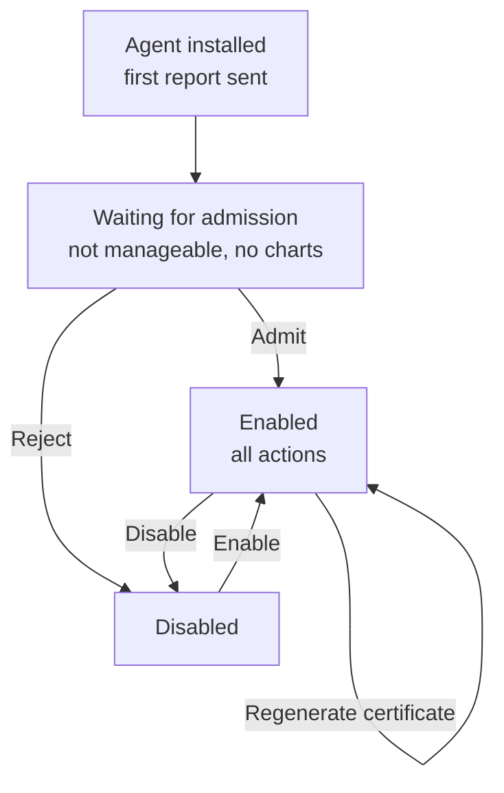
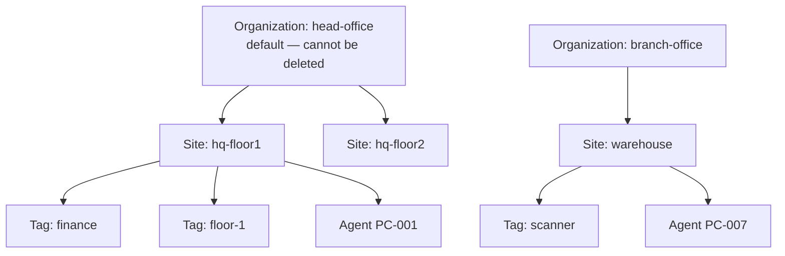

# Module 06 — Enrollment and organization

After an agent has been installed on an endpoint, reports begin to arrive over
NATS. A report arriving, however, is not management authority. In OpenUEM an
agent rests in the **Waiting for admission** state from the moment it sends its
first report until an administrator makes a decision. In that state inventory
data is already arriving, but software deployment, profiles and tasks cannot yet
be sent.

The work of this part of the module is to make clear when that decision is taken
and by whom. Enrollment is not a person joining but **the formal admission of an
endpoint into management**. After admission the questions continue: which
organization the endpoint is placed in, which site, which tag groups it, and who
is allowed to perform which action. This module answers those questions in order.

## 6.1 The difference between receiving a report and being able to manage

In the OpenUEM architecture, receiving data and governing the receiver of that
data are separated. `openuem-agent-worker` accepts agent reports and writes them
into PostgreSQL. That work happens automatically. The endpoint is not yet
permitted to receive actions such as installing software or configuring by
script. That privilege is granted only once an administrator confirms admission
in the console.

The reason for this separation is security. Anyone inside a network can install
the agent binary and send a report. If management authority were granted
automatically without admission, an unexpected endpoint would receive profiles
and packages. The admission step was added to prevent that situation.

## 6.2 How the three states divide responsibility

In the console an agent sits in one of three states. Each state permits or
refuses one set of actions.

| State | Report acceptance | Inventory view | Management actions | Dashboard and charts |
|---|---|---|---|---|
| **Waiting for admission** | accepts | visible | none | not included |
| **Enabled** | accepts | visible | full | included |
| **Disabled** | unspecified | visible | none | not included |

Two main points emerge from the table. The first is that in the Waiting for
admission state reports have already arrived. The inventory data of an endpoint
that has not been admitted can therefore be viewed before admission is given.
The second is that **management** and **visibility** are separated. In both the
Waiting for admission and Disabled states the endpoint is not deleted from the
list; only the sending of actions is suspended.

The actions available on an Enabled agent are as follows —

- **Force report** — requests a report immediately without waiting for the
  configured interval.
- **Disable** — removes the agent from management.
- **Regenerate certificate** — issues a new certificate for the agent.
- **Force restart** — forces the agent service to restart.
- **Show agent log** — reads `openuem-log.txt` over SFTP.
- **Settings** — toggles SFTP, remote assistance, the port and debug mode.

Those actions are not available in the Waiting for admission and Disabled states.
That point matters in practice. If a helpdesk person can see an endpoint but
cannot read the log or restart it, the cause is the state.



**Figure 1 — Agent admission state machine**

Figure walkthrough — Read Figure 1 from top to bottom. The first box shows the
agent installed and sending its first report. The second box is Waiting for
admission; at that stage the endpoint does not yet appear in the dashboards and
charts. Two arrows leave that box. The left arrow is the Admit action and reaches
Enabled. The right arrow is Reject and reaches Disabled. Between the Enabled and
Disabled boxes there are two arrows, Disable and Enable. The bottom arrow
re-enters the Enabled box and shows that the state does not change when a new
certificate is issued. Note that the figure has no arrow returning to the
admission queue.

## 6.3 The admission procedure

When a new agent sends its first report, the number of endpoints waiting for
admission appears on the console dashboard. If that number is greater than zero,
it signals that an administrator needs to make a decision. The procedure is as
follows —

1. The agent connects to NATS and sends a report with its certificate.
2. The server accepts the report and records it as a new endpoint. The state is
   Waiting for admission.
3. A waiting-for-admission box appears on the dashboard.
4. The administrator opens the agent list and selects the endpoint.
5. The **Admit** button is pressed. The server issues the `server.cer`/`server.key`
   pair and changes the state to Enabled.
6. At its next report the agent receives that pair and can open SFTP and the VNC
   proxy over TLS.

Admin → General Settings contains an **automatic admission** option. If that
option is on, agents sending their first report reach Enabled directly without
waiting for admission. The option is convenient for a lab or a controlled
network. It does, however, skip the admission step, so any endpoint can receive
profiles and packages. In production it is recommended to keep the option off.

If admission is to be refused, that endpoint can be moved to Disabled. In the
Disabled state the endpoint remains in the list, so it is still possible to check
who came from which machine. To remove it completely the agent has to be
uninstalled from the endpoint.

## 6.4 Certificate issuance at admission

An agent needs two kinds of certificate in order to communicate with the server.
The first is the agent certificate installed before installation, used to connect
to NATS. The second is the **`server.cer`/`server.key`** pair issued by the server
at admission. That pair protects TLS for the agent's SFTP server (port 2022) and
VNC proxy (port 1443).

Because of this separation the agent's own identity and the TLS identity of its
services can be managed separately. When a new certificate is issued (Regenerate
certificate) the old pair is revoked and a fresh pair is issued. That action can
be prepared in advance with the following command.

```bash
sudo openuem-cert-manager client-cert --name "OpenUEM Agent" --dst ./agents \
  --type="agent" --org "$ORGNAME" --country "$COUNTRY" --province "$ORGPROVINCE" \
  --locality "$ORGLOCALITY" --address "$ORGADDRESS" --years-valid 2 \
  --filename "agent" --ocsp "http://$OCSP_SERVER:$OCSP_PORT" \
  --description "Agent certificate" --cacert ./ca/ca.cer --cakey ./ca/ca.key \
  --dburl "$DATABASE_URL"
```

The meaning of each command line is as follows —

- `--name "OpenUEM Agent"` — the descriptive name of the certificate.
- `--dst ./agents` — the folder where the certificate file is stored.
- `--type="agent"` — the type of certificate to issue.
- `--org`, `--country`, `--province`, `--locality`, `--address` — the address
  details of the organization.
- `--years-valid 2` — the validity in years.
- `--filename "agent"` — the base name of the file produced.
- `--ocsp` — the URL of the OCSP responder that checks the certificate.
- `--cacert`, `--cakey` — the CA certificate and key used to sign.
- `--dburl` — the PostgreSQL URL where the certificate record is written.

```text
# simulated output — illustrative
[INFO] Generating agent certificate for organization openuem.example
[INFO] Subject: CN=OpenUEM Agent, O=openuem.example
[INFO] Valid for 2 year(s) from issue date
[INFO] OCSP responder: http://ocsp.openuem.example:8000
[INFO] Written: ./agents/agent.cer
[INFO] Written: ./agents/agent.key
[INFO] Certificate recorded in database
```

After those files have been placed in the appropriate folder on the endpoint the
agent service must be restarted. On Debian-based systems use
`sudo systemctl restart openuem-agent`.

## 6.5 Report frequency and force report

Agents send a report at a fixed interval. The default value is **60 minutes** and
it can be changed in Admin → General Settings → Agents report frequency. That
value is the single source of truth. Anyone reading the dashboard has to
calculate how old the data is from that value.

Lowering the report frequency makes the data fresher. Load on NATS and PostgreSQL
rises accordingly. In an environment with many endpoints that adjustment should
not be made abruptly; it needs to be tested in steps.

**Force report** requests a report without waiting for that interval. There are
three useful situations. First, when the result of a software installation is to
be checked immediately. Second, when an endpoint has come back onto the network
and stale data is to be refreshed. Third, when a state is to be seen immediately
during troubleshooting.

Force report does not work instantly. The server sends the request to the agent
over NATS. If the agent is offline the request may sit queued. So if pressing
force report produces no immediate result, the cause may be the agent's
connectivity.

## 6.6 Organization and site

OpenUEM supports multi-tenancy. Each **organization** owns its own agent list,
its own user list, its own policies and its own reports. When an organization is
created, a name and a first site name are supplied together. An organization
without a site cannot be created.

There is always one default organization and that organization cannot be
deleted. The reason for that restriction is that server configuration and default
assignments are based on an organization. If all organizations were removed, the
system would no longer know where to place new agents.

A site represents a location or a network segment inside an organization. For
example, a head office building may have two sites, `hq-floor1` and `hq-floor2`.
The site is the basis for viewing reports separately. An agent can be assigned to
only one site.



**Figure 2 — Organization, site and tag hierarchy**

Figure walkthrough — Figure 2 shows three layers. The top layer is the
organization, and `head-office` carries a marker saying that it is the default
organization and cannot be deleted. The second layer is the site. Under
`head-office` there are two sites, `hq-floor1` and `hq-floor2`, and under
`branch-office` there is one, `warehouse`. The third layer holds the tags. A tag
is a grouping inside a site and carries names such as `finance`. The bottom boxes
are agents, each of which exists in only one site. The figure makes it plain that
no agent sits in two organizations at the same time.

## 6.7 Tag, metadata and note

A tag is used to group endpoints by subject. The difference between a site and a
tag is that a site expresses a location and a tag expresses a business use. An
endpoint can carry several tags. For example, it can carry the three tags
`finance`, `laptop` and `loaner`.

Tags are seen in the dashboard as counts. Reports can be filtered by tag. The way
tag names are defined therefore has to be agreed at the level of the
organization. If the three tags `Finance`, `finance` and `fin` are mixed
together, reports will give wrong results.

Metadata and note are information for people to read. The person responsible for
an endpoint, the purchase date, the repair record and similar facts can be
recorded there. The system does not check that information automatically. It has
value only when it is defined as part of a procedure. For example, when an
endpoint is handed over to another employee, a note can be made mandatory with
the date and the name of the recipient.

## 6.8 User accounts — certificate and OpenID Connect

People who sign in to the console are defined as user accounts. There are two
ways to authenticate. The first is a **client certificate**. The second is
**OpenID Connect**, which connects to identity providers such as Authelia,
Authentik, Keycloak or Zitadel. That list may change between versions.

With certificate login the user signs in with a certificate installed in the
browser. That method needs no extra identity provider, so it is simple for a
small organization. Certificate expiry and loss do, however, have to be managed.

With OpenID Connect the user is authenticated at the organization's identity
provider and comes back to OpenUEM. The benefit of that method is that account
closure, password policy and multi-factor authentication are managed in one
place.

A new user account goes through four stages —

| Stage | State | What is happening |
|---|---|---|
| 1 | Pending email confirmation | The invitation email has been sent and confirmation is awaited |
| 2 | Review request | After confirmation, the administrator's review is awaited |
| 3 | Certificate sent | A certificate has been issued and sent to the user |
| 4 | Completed | The account is fully usable |

Those stages require SMTP settings. If SMTP is not configured the invitation
email is not sent, so the account stays at the first stage. When a user's
certificate is reissued the old certificate is revoked. That point matters for
security. If the old certificate keeps working, the purpose of reissuing is
defeated.

## 6.9 CSV bulk import

In an organization with many endpoints, creating organizations and users one at
a time takes time. OpenUEM supports CSV import for both organizations and users.
Importing users by CSV skips the verification stage. That is convenient and
risky. A single file can grant access to many users.

Before importing, the following points are checked —

| Check | Result if it fails |
|---|---|
| Organization name duplicated | The second row is rejected |
| Organization name already exists | That row is rejected |
| Site column empty | The organization cannot be created |
| User's organization does not exist | That user row is rejected |
| Site is not a site of the organization | That user row is rejected |
| Email duplicated | The second row is rejected |

Import order matters. Organizations must be imported first and users only
afterwards. The reason is that each user row references an organization. The
correct sequence of work is as follows —

1. Export the current organization and site list from the console.
2. Prepare the CSV file on the basis of that list.
3. Check that the site column is not empty.
4. Import the organization CSV and check the result.
5. Import the user CSV and correct the rejected rows.

## 6.10 Separating administrator roles

Seven kinds of action that can be performed in the console are defined in this
lesson as capabilities — viewing inventory, exporting reports, requesting a force
report, admitting agents, managing organizations, managing users and using remote
assistance. Those capabilities are divided among roles.

The purpose of role separation is **least privilege**. Only the smallest set of
capabilities needed to carry out a business duty is granted. If a helpdesk
employee only needs force report and inventory viewing, giving them a role that
includes user management is unnecessary authority.

| Role (lesson model) | Capabilities included |
|---|---|
| read_only | viewing inventory, exporting reports |
| operator | the above, force report, remote assistance |
| administrator | the above, admitting agents, managing users |
| owner | all capabilities (including managing organizations) |

The role names in the table are a model constructed for the lesson. The console's
actual role names and the way they are divided may change between versions. What
matters is not the name but the principle of the division.

In practice the following principles are followed —

- The owner account is not used for daily work.
- Temporary authority is withdrawn once a change is complete.
- A separate account is used for each person. Shared accounts are not kept.
- User creation and certificate issuance are not performed by one person alone.

## 6.11 Operational cautions

- Automatic admission is kept off in production. The admission step is the only
  protection against an unexpected endpoint.
- If the 60-minute report frequency is raised, the meaning of "recently seen" on
  the dashboard changes. Everyone who reads the dashboard needs to know its
  interval.
- The default organization cannot be deleted. It is defined as the basis for
  organization configuration.
- Importing users by CSV skips the verification stage. Check the row count and
  the email list twice before uploading the file.
- Reissuing a certificate revokes the old certificate. If that action is not
  scheduled, endpoints may lose connectivity abruptly.
- Marking an endpoint as Disabled is not deleting data. To remove an endpoint
  permanently the agent must be uninstalled.

## 6.12 Self-check questions

**1. What can an agent in the Waiting for admission state do?**
It can keep sending reports and inventory data arrives. But none of the
management actions — installing software, restarting, reading the log — are
available. It does not appear in charts or in the dashboard counts either.

**2. Which services is the certificate issued at admission for?**
It provides TLS for the agent's SFTP server (port 2022) and VNC proxy (port 1443).
The file names are `server.cer` and `server.key`.

**3. Name three situations in which force report should be used while the report
frequency is 60 minutes.**
When the result of a software installation is to be checked immediately, when the
data of an endpoint that has come back onto the network is to be refreshed, and
when a state is to be seen immediately during troubleshooting.

**4. List the four stages of a user account in order.**
Pending email confirmation → Review request → Certificate sent → Completed.

**5. Give two reasons why an organization cannot be deleted.**
The default organization is the basis for default assignment. If all
organizations were gone there would be no rule for where to place new agents and
new users.

## 6.13 Technical review notes

- Console menu names (the dashboard warning box, the Admit button, the value
  names inside General Settings) are written in the form shown. Those names need
  review per version.
- Whether report acceptance continues in the Disabled state is not stated exactly
  in the curriculum material, so the table says "unspecified". This needs review
  per version.
- The queueing of requests for force report is written as a general NATS-based
  principle. The exact behaviour needs review per version.
- The existence of the automatic admission option is written from the curriculum
  material. Its exact name and location need review per version.
- The names read_only, operator, administrator and owner in the role table are a
  model constructed for the lesson. The console's actual role names and the
  distribution of capabilities need review per version.
- Certificate expiry and OCSP checking behaviour are not explained in this
  module. Those points continue in Module 03 and Module 09.
- The list of supported identity providers (Authelia, Authentik, Keycloak,
  Zitadel) is written as in the curriculum material. It needs review per version.
- Command output is teaching fixture data and is not the real output of any
  machine.
