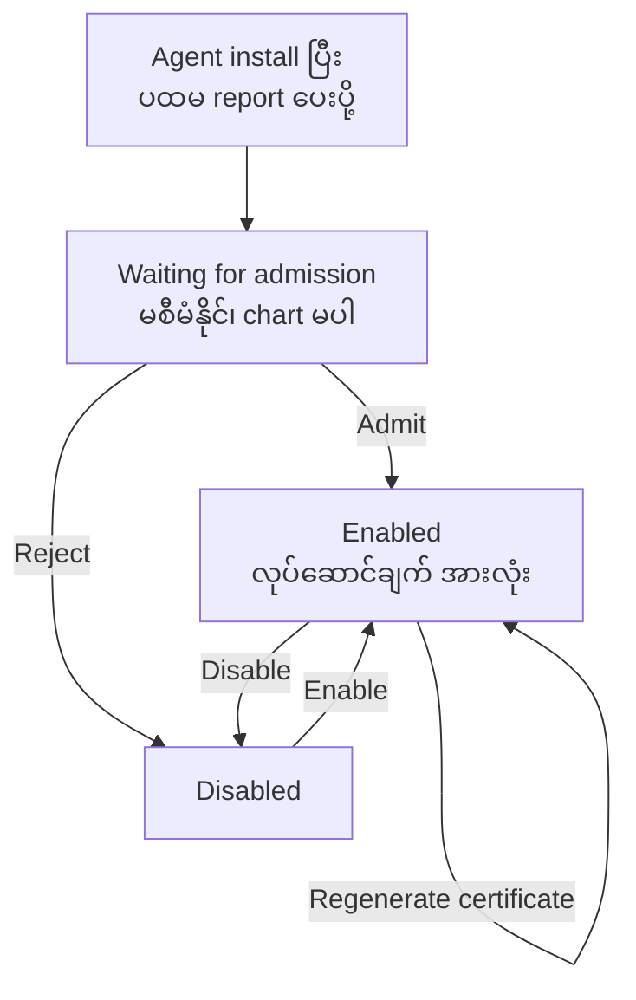
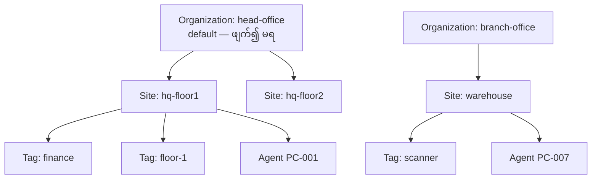

# Module 06 — Enrollment and Organization

Agent တစ်ခုကို endpoint တွင် install လုပ်ပြီးနောက် NATS မှတစ်ဆင့် report များ စတင် ရောက်ရှိလာသည်။
သို့သော် report ရောက်ရှိခြင်းသည် စီမံခန့်ခွဲမှု အခွင့်အာဏာ မဟုတ်ပါ။ OpenUEM တွင် agent တစ်ခုသည်
server သို့ ပထမဆုံး report ပေးပို့သည့် အခိုက်အတန့်မှစ၍ အုပ်ချုပ်သူ တစ်ဦး၏ ဆုံးဖြတ်ချက် မချမချင်း
**Waiting for admission** အခြေအနေတွင် ရပ်တန့်နေသည်။ ထို အခြေအနေတွင် inventory ဒေတာ ရောက်ရှိနေသော်လည်း
software deployment၊ profile နှင့် task များ မပို့နိုင်သေးပါ။

အခန်းဤ အပိုင်း၏ အလုပ်မှာ ထို ဆုံးဖြတ်ချက်ကို ဘယ်အချိန်တွင်၊ မည်သူက ချမည်ကို ရှင်းလင်းခြင်း
ဖြစ်သည်။ enrollment သည် လူတစ်ဦး ဝင်ရောက်ခြင်း မဟုတ်ဘဲ **endpoint တစ်ခုကို စီမံခန့်ခွဲမှု အတွင်း
တရားဝင် လက်ခံခြင်း** ဖြစ်သည်။ လက်ခံပြီးနောက် endpoint ကို မည်သည့် organization၊ မည်သည့် site
အတွင်း ထားမည်၊ မည်သည့် tag ဖြင့် အုပ်စုဖွဲ့မည်၊ မည်သူက မည်သည့် လုပ်ဆောင်ချက်ကို ခွင့်ပြုမည် ဆိုသည့်
မေးခွန်းများ ဆက်လက် ပေါ်ပေါက်လာသည်။ အခန်းဤတွင် ထို မေးခွန်းများကို အစဉ်လိုက် ဖြေဆိုသည်။

## 6.1 Report ရောက်ရှိခြင်းနှင့် စီမံခန့်ခွဲနိုင်ခြင်း ကွာခြားချက်

OpenUEM ၏ တည်ဆောက်ပုံတွင် ဒေတာ လက်ခံခြင်းနှင့် ဒေတာ လက်ခံသူကို အုပ်ချုပ်ခြင်း ကို သီးခြား ခွဲထားသည်။
`openuem-agent-worker` သည် agent report များကို လက်ခံ၍ PostgreSQL ထဲ ရေးသွင်းသည်။ ထို အလုပ်သည်
အလိုအလျောက် ဖြစ်ပေါ်သည်။ သို့သော် ထို endpoint ကို software တင်ခြင်း၊ script ဖြင့် ပြင်ဆင်ခြင်း
စသည့် လုပ်ဆောင်ချက်များ ပေးပို့ခွင့် မရှိသေးပါ။ အုပ်ချုပ်သူက console တွင် လက်ခံကြောင်း အတည်ပြုမှသာ
ထို အခွင့်အရေး ရရှိသည်။

ထို ခွဲခြားမှု၏ အကြောင်းရင်းမှာ လုံခြုံရေး ဖြစ်သည်။ ကွန်ရက်တစ်ခုအတွင်း မည်သူမဆို agent binary ကို
install လုပ်နိုင်ပြီး report ပို့နိုင်သည်။ လက်ခံမှု မရှိဘဲ အလိုအလျောက် စီမံခန့်ခွဲခွင့် ပေးလိုက်ပါက
မမျှော်လင့်သော endpoint တစ်ခုသည် profile နှင့် package များ လက်ခံရရှိမည် ဖြစ်သည်။ ထို အခြေအနေကို
တားဆီးရန် admission အဆင့် ကို ထည့်သွင်းထားသည်။

## 6.2 အခြေအနေ သုံးမျိုး၏ တာဝန်ခွဲဝေမှု

Console တွင် agent တစ်ခုသည် အခြေအနေ သုံးမျိုးအနက် တစ်မျိုးတွင် တည်ရှိသည်။ အခြေအနေ တစ်ခုစီသည်
လုပ်ဆောင်ချက် အစုတစ်ခုကို ခွင့်ပြုသည် သို့မဟုတ် ငြင်းပယ်သည်။

| အခြေအနေ | Report လက်ခံမှု | Inventory မြင်ကွင်း | စီမံခန့်ခွဲမှု လုပ်ဆောင်ချက် | Dashboard နှင့် chart |
|---|---|---|---|---|
| **Waiting for admission** | လက်ခံသည် | မြင်နိုင်သည် | မရှိ | မပါဝင်ပါ |
| **Enabled** | လက်ခံသည် | မြင်နိုင်သည် | အပြည့်အဝ | ပါဝင်သည် |
| **Disabled** | မသတ်မှတ်ထား | မြင်နိုင်သည် | မရှိ | မပါဝင်ပါ |

ဇယားမှ အဓိက အချက်နှစ်ချက် ထွက်ပေါ်လာသည်။ ပထမ အချက်မှာ Waiting for admission အခြေအနေတွင်
report များ ရောက်ရှိပြီးသား ဖြစ်နေခြင်း ဖြစ်သည်။ ထို့ကြောင့် လက်ခံမှု မရှိသေးသော endpoint တစ်ခု၏
inventory ဒေတာ ကို လက်ခံခြင်း မပြုမီ ကြည့်ရှုနိုင်သည်။ ဒုတိယ အချက်မှာ **စီမံခန့်ခွဲမှု** နှင့်
**မြင်တွေ့မှု** ကို ခွဲထားခြင်း ဖြစ်သည်။ Waiting for admission နှင့် Disabled အခြေအနေ နှစ်မျိုးတွင်
endpoint ကို စာရင်း ထဲမှ မဖျက်ပစ်ဘဲ လုပ်ဆောင်ချက် ပို့ခြင်းကိုသာ ရပ်ဆိုင်းထားသည်။

Enabled agent တစ်ခုတွင် ရရှိနိုင်သော လုပ်ဆောင်ချက်များမှာ အောက်ပါအတိုင်း ဖြစ်သည် —

- **Force report** — သတ်မှတ်ထားသော အချိန်ကို မစောင့်ဘဲ ချက်ချင်း report တောင်းခံသည်။
- **Disable** — agent ကို စီမံခန့်ခွဲမှု မှ ဖယ်ထုတ်သည်။
- **Regenerate certificate** — agent ၏ certificate ကို အသစ် ပြန်ထုတ်ပေးသည်။
- **Force restart** — agent service ကို အတင်းပြန်စတင်စေသည်။
- **Show agent log** — SFTP မှတစ်ဆင့် `openuem-log.txt` ကို ဖတ်သည်။
- **Settings** — SFTP ဖွင့်/ပိတ်၊ remote assistance၊ port နှင့် debug mode ကို ချိန်ညှိသည်။

Waiting for admission နှင့် Disabled အခြေအနေ နှစ်မျိုးတွင် ထို လုပ်ဆောင်ချက်များ မရရှိပါ။ ထို အချက်သည်
လက်တွေ့ တွင် အရေးပါသည်။ Helpdesk မှ ဝင်ရောက် စစ်ဆေးသူသည် endpoint တစ်ခုကို မြင်နေရသော်လည်း
log မဖတ်နိုင်၊ restart မလုပ်နိုင် ဖြစ်နေပါက အကြောင်းရင်းမှာ အခြေအနေ ဖြစ်သည်။



**Figure 1 — Agent admission state machine**

ပုံရှင်းလင်းချက် — Figure 1 ကို အပေါ်မှ အောက်သို့ ဖတ်ပါ။ ပထမ အကွက်တွင် agent ကို install လုပ်ပြီး
ပထမ report ပို့သည့် အခြေအနေ ကို ပြထားသည်။ ဒုတိယ အကွက်မှာ Waiting for admission ဖြစ်ပြီး ထို အဆင့်တွင်
dashboard နှင့် chart များ ထဲ မပါဝင်သေးပါ။ ထို အကွက်မှ မြှား နှစ်ခု ထွက်လာသည်။ ဘယ်ဘက် မြှားသည်
Admit လုပ်ဆောင်ချက် ဖြစ်ပြီး Enabled သို့ ရောက်သည်။ ညာဘက် မြှားသည် Reject ဖြစ်ပြီး Disabled သို့
ရောက်သည်။ Enabled နှင့် Disabled အကွက် နှစ်ခု အကြားတွင် Disable နှင့် Enable မြှား နှစ်ခု ရှိသည်။
အောက်ဆုံး မြှားသည် Enabled အကွက်ထဲ ပြန်ဝင်သော မြှား ဖြစ်ပြီး certificate အသစ် ပြန်ထုတ်သည့်
အခါ အခြေအနေ မပြောင်းလဲကြောင်း ပြသည်။ ပုံတွင် admission queue သို့ ပြန်သွားသော မြှား တစ်ခုမျှ
မရှိကြောင်း သတိပြုပါ။

## 6.3 Admission လုပ်ငန်းစဉ်

Agent အသစ် တစ်ခု ပထမ report ပို့သည့် အခါ console ၏ dashboard တွင် လက်ခံရန် စောင့်ဆိုင်းနေသော endpoint
အရေအတွက် ပါဝင်လာသည်။ ထို အရေအတွက် သည် သုည ထက် ကြီးနေပါက အုပ်ချုပ်သူ တစ်ဦးက ဆုံးဖြတ်ချက်
ချရန် လိုအပ်နေကြောင်း အချက်ပြသည်။ လုပ်ငန်းစဉ်မှာ အောက်ပါ အတိုင်း ဖြစ်သည် —

1. Agent သည် NATS သို့ ချိတ်ဆက်၍ certificate ဖြင့် report ပို့သည်။
2. Server သည် report ကို လက်ခံပြီး endpoint အသစ် အဖြစ် မှတ်တမ်းတင်သည်။ အခြေအနေမှာ
   Waiting for admission ဖြစ်သည်။
3. Dashboard တွင် လက်ခံရန် စောင့်ဆိုင်းနေသော အကွက် ပေါ်လာသည်။
4. အုပ်ချုပ်သူသည် agent စာရင်းသို့ ဝင်ပြီး သက်ဆိုင်ရာ endpoint ကို ရွေးချယ်သည်။
5. **Admit** ခလုတ် ကို နှိပ်သည်။ Server သည် `server.cer`/`server.key` အတွဲ ကို ထုတ်ပေးပြီး
   အခြေအနေကို Enabled သို့ ပြောင်းသည်။
6. Agent သည် နောက် report အချိန်တွင် ထို အတွဲကို လက်ခံရရှိပြီး SFTP နှင့် VNC proxy ကို TLS ဖြင့်
   ဖွင့်နိုင်သည်။

Admin → General Settings တွင် **automatic admission** ရွေးချယ်မှု ရှိသည်။ ထို ရွေးချယ်မှု ဖွင့်ထားပါက
ပထမ report ပို့သည့် agent များကို လက်ခံရန် စောင့်ဆိုင်းခြင်း မရှိဘဲ တိုက်ရိုက် Enabled သို့ ရောက်သည်။
ထို ရွေးချယ်မှုသည် စမ်းသပ်ခန်း သို့မဟုတ် ထိန်းချုပ်ထားသော ကွန်ရက် အတွက် အဆင်ပြေသည်။ သို့သော်
လက်ခံမှု အဆင့် ကို ဖြတ်ကျော်လိုက်ခြင်း ဖြစ်သောကြောင့် မည်သည့် endpoint မဆို profile နှင့် package
လက်ခံနိုင်သည့် အခြေအနေ ဖြစ်လာသည်။ Production တွင် ထို ရွေးချယ်မှုကို ပိတ်ထားရန် အကြံပြုသည်။

Admission ကို ငြင်းပယ်လိုပါက ထို endpoint ကို Disabled သို့ ပြောင်းထားနိုင်သည်။ Disabled အခြေအနေတွင်
endpoint သည် စာရင်း ထဲတွင် ကျန်ရှိနေသဖြင့် မည်သူက မည်သည့် စက်မှ လာကြောင်း ပြန်လည် စစ်ဆေးနိုင်သည်။
လုံးဝ ဖယ်ရှားလိုပါက agent ကို endpoint မှ uninstall လုပ်ရသည်။

## 6.4 Admission အချိန်တွင် certificate ထုတ်ပေးခြင်း

Agent တစ်ခုသည် server နှင့် ဆက်သွယ်ရန် certificate နှစ်မျိုး လိုအပ်သည်။ ပထမ အမျိုးအစားမှာ install
မတိုင်မီ ထည့်သွင်းထားသော agent certificate ဖြစ်ပြီး NATS သို့ ချိတ်ဆက်ရန် အသုံးပြုသည်။ ဒုတိယ
အမျိုးအစားမှာ admission အချိန်တွင် server မှ ထုတ်ပေးသော **`server.cer`/`server.key`** အတွဲ ဖြစ်သည်။
ထို အတွဲသည် agent ၏ SFTP server (port 2022) နှင့် VNC proxy (port 1443) အတွက် TLS ကို ကာကွယ်သည်။

ထို ခွဲခြားမှု အရ agent ၏ ကိုယ်ပိုင် identity နှင့် ၎င်း၏ service များ၏ TLS identity ကို သီးခြား
စီမံနိုင်သည်။ Certificate အသစ် ပြန်ထုတ်သည့် အခါ (Regenerate certificate) အတွဲ အဟောင်း ကို revoke
လုပ်ပြီး အသစ် တစ်စုံ ထုတ်ပေးသည်။ ထို လုပ်ဆောင်ချက် ကို အောက်ပါ command ဖြင့် ကြိုတင် ပြင်ဆင်နိုင်သည်။

```bash
sudo openuem-cert-manager client-cert --name "OpenUEM Agent" --dst ./agents \
  --type="agent" --org "$ORGNAME" --country "$COUNTRY" --province "$ORGPROVINCE" \
  --locality "$ORGLOCALITY" --address "$ORGADDRESS" --years-valid 2 \
  --filename "agent" --ocsp "http://$OCSP_SERVER:$OCSP_PORT" \
  --description "Agent certificate" --cacert ./ca/ca.cer --cakey ./ca/ca.key \
  --dburl "$DATABASE_URL"
```

Command တစ်ကြောင်းချင်းစီ၏ အဓိပ္ပာယ်မှာ အောက်ပါအတိုင်း ဖြစ်သည် —

- `--name "OpenUEM Agent"` — certificate ၏ ဖော်ပြချက် အမည်။
- `--dst ./agents` — certificate ဖိုင် သိမ်းမည့် folder။
- `--type="agent"` — ထုတ်ပေးမည့် certificate အမျိုးအစား။
- `--org`, `--country`, `--province`, `--locality`, `--address` — organization ၏ လိပ်စာ အချက်အလက်။
- `--years-valid 2` — သက်တမ်း နှစ် အရေအတွက်။
- `--filename "agent"` — ထွက်လာမည့် ဖိုင် အမည် အခြေခံ။
- `--ocsp` — certificate ကို စစ်ဆေးမည့် OCSP responder ၏ URL။
- `--cacert`, `--cakey` — လက်မှတ်ထိုးရန် CA certificate နှင့် key။
- `--dburl` — certificate မှတ်တမ်း ရေးသွင်းမည့် PostgreSQL URL။

```text
# simulated output — illustrative
[INFO] Generating agent certificate for organization openuem.example
[INFO] Subject: CN=OpenUEM Agent, O=openuem.example
[INFO] Valid for 2 year(s) from issue date
[INFO] OCSP responder: http://ocsp.openuem.example:8000
[INFO] Written: ./agents/agent.cer
[INFO] Written: ./agents/agent.key
[INFO] Certificate recorded in database
```

ထို ဖိုင်များကို endpoint တွင် သက်ဆိုင်ရာ folder သို့ ထည့်သွင်းပြီးနောက် agent service ကို ပြန်စတင်ရသည်။
Debian-based တွင် `sudo systemctl restart openuem-agent` ကို အသုံးပြုသည်။

## 6.5 Report ကြိမ်နှုန်းနှင့် force report

Agent များသည် သတ်မှတ်ထားသော အချိန်တိုင်း report ပို့သည်။ မူလ တန်ဖိုးမှာ **60 မိနစ်** ဖြစ်ပြီး
Admin → General Settings → Agents report frequency တွင် ပြောင်းနိုင်သည်။ ထို တန်ဖိုးသည် တစ်ခုတည်းသော
အချက်အလက် အရင်းအမြစ် ဖြစ်သည်။ Dashboard ကို ကြည့်ရှုသူသည် မည်သည့် ဒေတာ သည် မည်မျှ ဟောင်းနေသည်
ကို ထို တန်ဖိုးဖြင့် တွက်ချက်ရသည်။

Report ကြိမ်နှုန်း ကို လျှော့ချပါက ဒေတာ ပိုမို လတ်ဆတ်လာသည်။ သို့သော် NATS နှင့် PostgreSQL ပေါ်တွင်
ဝန်ပိုလာသည်။ Endpoint အရေအတွက် များသော ပတ်ဝန်းကျင်တွင် ထို ချိန်ညှိမှုကို အလျင်အမြန် မလုပ်ဘဲ
အဆင့်ဆင့် စမ်းသပ်ရန် လိုအပ်သည်။

**Force report** သည် ထို အချိန်ကို မစောင့်ဘဲ report တောင်းခံသည်။ အသုံးဝင်သော အခြေအနေ သုံးမျိုး
ရှိသည်။ ပထမ — software တစ်ခု တင်ပြီးနောက် ရလဒ်ကို ချက်ချင်း စစ်လိုသည့် အခါ။ ဒုတိယ — endpoint
တစ်ခု ကွန်ရက် ပြန်လည် ရောက်ရှိလာပြီး ဟောင်းနေသော ဒေတာကို အသစ်လုပ်လိုသည့် အခါ။ တတိယ —
troubleshooting အတွင်း အခြေအနေ တစ်ခုကို ချက်ချင်း မြင်လိုသည့် အခါ။

Force report သည် ချက်ချင်း အလုပ်မလုပ်နိုင်ပါ။ Server သည် တောင်းခံမှုကို NATS မှတစ်ဆင့်
agent ထံ ပို့သည်။ Agent ကို offline ဖြစ်နေပါက တောင်းခံမှုသည် တန်းစီ စောင့်ဆိုင်းနေနိုင်သည်။ ထို့ကြောင့် force report ကို နှိပ်ပြီး ချက်ချင်း ရလဒ် မတွေ့ပါက အကြောင်းရင်းမှာ
agent ၏ ဆက်သွယ်မှု ဖြစ်နိုင်သည်။

## 6.6 Organization နှင့် site

OpenUEM သည် multi-tenancy ကို ပံ့ပိုးသည်။ **Organization** တစ်ခုစီသည် ကိုယ်ပိုင် agent စာရင်း၊
ကိုယ်ပိုင် user စာရင်း၊ ကိုယ်ပိုင် policy နှင့် ကိုယ်ပိုင် report များ ကို ပိုင်ဆိုင်သည်။ Organization
တစ်ခုကို ဖန်တီးသည့် အခါ အမည် နှင့် ပထမ site အမည် ကို တွဲဖက် ပေးရသည်။ Site မရှိသော organization
တစ်ခု ကို ဖန်တီး၍ မရပါ။

မူလ organization တစ်ခု အမြဲ ရှိပြီး ထို organization ကို ဖျက်၍ မရပါ။ ထို ကန့်သတ်ချက်၏
အကြောင်းရင်းမှာ server configuration နှင့် default assignment များ သည် organization တစ်ခုကို
အခြေခံထားသောကြောင့် ဖြစ်သည်။ Organization အားလုံး ဖျက်ပစ်သွားပါက agent အသစ်များကို မည်သည့်
နေရာတွင် ထားမည်ကို စနစ်က မသိတော့ပါ။

Site သည် organization တစ်ခုအတွင်း တည်နေရာ သို့မဟုတ် ကွန်ရက် အပိုင်းအခြား ကို ကိုယ်စားပြုသည်။
ဥပမာ — ရုံးချုပ် အဆောက်အအုံ တစ်ခုတွင် `hq-floor1` နှင့် `hq-floor2` ဟူသော site နှစ်ခု ရှိနိုင်သည်။
Site သည် report များကို ခွဲခြားကြည့်ရှုရန် အခြေခံ ဖြစ်သည်။ Agent တစ်ခုကို site တစ်ခုတည်းတွင်သာ
သတ်မှတ်နိုင်သည်။



**Figure 2 — Organization, site and tag hierarchy**

ပုံရှင်းလင်းချက် — Figure 2 တွင် အလွှာ သုံးလွှာ ကို ပြထားသည်။ ထိပ်ဆုံး အလွှာမှာ organization ဖြစ်ပြီး
`head-office` သည် default organization ဖြစ်သောကြောင့် ဖျက်၍ မရကြောင်း အမှတ်အသား ပါသည်။ ဒုတိယ
အလွှာမှာ site ဖြစ်သည်။ `head-office` အောက်တွင် `hq-floor1` နှင့် `hq-floor2` ဟူသော site နှစ်ခု
ရှိပြီး `branch-office` အောက်တွင် `warehouse` တစ်ခု ရှိသည်။ တတိယ အလွှာတွင် tag များ ရှိသည်။
Tag သည် site တစ်ခုအတွင်း အုပ်စုဖွဲ့မှု ဖြစ်ပြီး `finance` ကဲ့သို့သော အမည်များ ဖြစ်သည်။ အောက်ဆုံး
အကွက်များမှာ agent များ ဖြစ်ပြီး တစ်ခုစီသည် site တစ်ခုတည်းတွင်သာ တည်ရှိသည်။ ပုံတွင် agent တစ်ခုသည်
organization နှစ်ခုအတွင်း တစ်ပြိုင်နက် မရှိကြောင်း ထင်ရှားစွာ မြင်နိုင်သည်။

## 6.7 Tag, metadata နှင့် note

Tag သည် endpoint များကို အကြောင်းအရာ အလိုက် အုပ်စုဖွဲ့ရန် အသုံးပြုသည်။ Site နှင့် tag ၏
ကွာခြားချက်မှာ site သည် တည်နေရာ ကို ဖော်ပြီး tag သည် လုပ်ငန်း အသုံးပြုမှု ကို ဖော်ပြသည်။
Endpoint တစ်ခုတွင် tag များစွာ တွဲထားနိုင်သည်။ ဥပမာ — `finance`၊ `laptop`၊ `loaner` ဟူသော tag
သုံးခု တွဲထားနိုင်သည်။

Tag များကို dashboard တွင် အရေအတွက် အဖြစ် မြင်ရသည်။ Report များတွင် tag အလိုက် စစ်ထုတ်နိုင်သည်။
ထို့ကြောင့် tag အမည် သတ်မှတ်ပုံကို အဖွဲ့အစည်း အဆင့်တွင် ညှိနှိုင်းထားရန် လိုအပ်သည်။ `Finance`၊
`finance` နှင့် `fin` ဟူသော tag သုံးခု ရောနှောနေပါက report များ မှားယွင်းသော ရလဒ် ပေးမည် ဖြစ်သည်။

Metadata နှင့် note သည် လူဖတ်ရန် အချက်အလက် ဖြစ်သည်။ Endpoint တစ်ခု၏ တာဝန်ခံ၊ ဝယ်ယူသည့်
ရက်စွဲ၊ ပြုပြင်မှု မှတ်တမ်း စသည့် အချက်များကို ထို နေရာတွင် မှတ်ထားနိုင်သည်။ ထို အချက်အလက်များကို
စနစ်က အလိုအလျောက် မစစ်ဆေးပါ။ ထို့ကြောင့် လုပ်ငန်းစဉ် တစ်ခု အဖြစ် သတ်မှတ်ထားမှသာ တန်ဖိုး ရှိသည်။
ဥပမာ — endpoint တစ်ခုကို အခြား ဝန်ထမ်း တစ်ဦးသို့ လွှဲပြောင်းသည့် အခါ note တွင် ရက်စွဲ နှင့်
လက်ခံသူ အမည် ကို မဖြစ်မနေ ဖြည့်ရန် သတ်မှတ်နိုင်သည်။

## 6.8 User အကောင့်များ — certificate နှင့် OpenID Connect

Console သို့ ဝင်ရောက်သူများကို user အကောင့် အဖြစ် သတ်မှတ်သည်။ အတည်ပြုနည်း နှစ်မျိုး ရှိသည်။
ပထမ နည်းလမ်းမှာ **client certificate** ဖြစ်သည်။ ဒုတိယ နည်းလမ်းမှာ **OpenID Connect** ဖြစ်ပြီး
Authelia၊ Authentik၊ Keycloak သို့မဟုတ် Zitadel ကဲ့သို့သော identity provider များ နှင့် ချိတ်ဆက်သည်။
ထို စာရင်းသည် version အလိုက် ပြောင်းလဲနိုင်သည်။

Certificate login တွင် user သည် browser ထဲ ထည့်သွင်းထားသော certificate ဖြင့် ဝင်သည်။ ထို နည်းလမ်းသည်
identity provider အပိုတစ်ခု မလိုအပ်သဖြင့် သေးငယ်သော အဖွဲ့အစည်း အတွက် ရိုးရှင်းသည်။ သို့သော်
certificate သက်တမ်း ကုန်ဆုံးခြင်း၊ ပျောက်ဆုံးခြင်း ကို စီမံရန် လိုအပ်သည်။

OpenID Connect တွင် user သည် အဖွဲ့အစည်း၏ identity provider တွင် အတည်ပြုခံရပြီး OpenUEM သို့
ပြန်လည် ရောက်ရှိလာသည်။ ထို နည်းလမ်း၏ အကျိုးကျေးဇူးမှာ အကောင့် ပိတ်ခြင်း၊ စကားဝှက် မူဝါဒ နှင့်
multi-factor authentication ကို တစ်နေရာတည်းတွင် စီမံနိုင်ခြင်း ဖြစ်သည်။

User အကောင့် အသစ် တစ်ခု၏ လုပ်ငန်းစဉ်တွင် အဆင့် လေးဆင့် ရှိသည် —

| အဆင့် | အခြေအနေ | ဖြစ်ပေါ်နေသည့် အရာ |
|---|---|---|
| 1 | Pending email confirmation | ဖိတ်ကြားချက် email ပို့ပြီး အတည်ပြုချက် စောင့်ဆိုင်းနေသည် |
| 2 | Review request | အတည်ပြုပြီးနောက် အုပ်ချုပ်သူ၏ စစ်ဆေးမှုကို စောင့်နေသည် |
| 3 | Certificate sent | certificate ထုတ်ပေးပြီး user ထံ ပို့ထားသည် |
| 4 | Completed | အကောင့် အပြည့်အစုံ အသုံးပြုနိုင်သည် |

ထို အဆင့်များ တည်ရှိရန် SMTP setting များ လိုအပ်သည်။ SMTP မသတ်မှတ်ထားပါက ဖိတ်ကြားချက် email
မထွက်သဖြင့် အကောင့်သည် ပထမ အဆင့်တွင် ရပ်နေမည် ဖြစ်သည်။ User တစ်ဦး၏ certificate ကို
ပြန်ထုတ်ပေးသည့် အခါ certificate အဟောင်း ကို revoke လုပ်သည်။ ထို အချက်သည် လုံခြုံရေး အရ
အရေးပါသည်။ certificate အဟောင်း ဆက်လက် အလုပ်လုပ်နေပါက ပြန်ထုတ်ခြင်း၏ ရည်ရွယ်ချက် ပျက်ပြယ်သည်။

## 6.9 CSV bulk import

Endpoint များစွာ ရှိသော အဖွဲ့အစည်းတွင် organization နှင့် user များကို တစ်ခုချင်း ဖန်တီးခြင်းသည်
အချိန် ကုန်သည်။ OpenUEM တွင် organization နှင့် user နှစ်မျိုးလုံး အတွက် CSV import ကို ပံ့ပိုးသည်။
User များကို CSV ဖြင့် ထည့်သွင်းပါက အတည်ပြုခြင်း အဆင့် ကို ကျော်သွားသည်။ ထို အချက်သည်
အဆင်ပြေသော်လည်း အန္တရာယ် ရှိသည်။ ဖိုင် တစ်ခုတည်းဖြင့် user အများအပြား ဝင်ရောက်နိုင်ခွင့်
ရရှိသွားနိုင်သည်။

Import မလုပ်မီ အောက်ပါ အချက်များကို စစ်ဆေးရသည် —

| စစ်ဆေးချက် | မအောင်မြင်ပါက ဖြစ်ပေါ်သည့် ရလဒ် |
|---|---|
| Organization အမည် ထပ်နေခြင်း | ဒုတိယ အတန်း ပယ်ချခံရသည် |
| Organization အမည် ရှိပြီးသား ဖြစ်နေခြင်း | ထို အတန်း ပယ်ချခံရသည် |
| Site ကော်လံ အလွတ် ဖြစ်နေခြင်း | Organization ဖန်တီး၍ မရပါ |
| User ၏ organization မတည်ရှိခြင်း | ထို user အတန်း ပယ်ချခံရသည် |
| Site သည် organization ၏ site မဟုတ်ခြင်း | ထို user အတန်း ပယ်ချခံရသည် |
| Email ထပ်နေခြင်း | ဒုတိယ အတန်း ပယ်ချခံရသည် |

Import အစီအစဉ်မှာ အရေးပါသည်။ Organization များကို အရင် ထည့်သွင်းပြီးမှ user များကို ထည့်သွင်းရသည်။
အကြောင်းရင်းမှာ user အတန်း တစ်ခုစီသည် organization တစ်ခုကို ရည်ညွှန်းနေသောကြောင့် ဖြစ်သည်။
လုပ်ငန်းစဉ် မှန်ကန်သော အစီအစဉ်မှာ အောက်ပါအတိုင်း ဖြစ်သည် —

1. လက်ရှိ organization နှင့် site စာရင်းကို console မှ export လုပ်သည်။
2. ထို စာရင်းကို အခြေခံပြီး CSV ဖိုင် ကို ပြင်ဆင်သည်။
3. Site ကော်လံ အလွတ် မဖြစ်ကြောင်း စစ်ဆေးသည်။
4. Organization CSV ကို import လုပ်ပြီး ရလဒ် ကို စစ်သည်။
5. User CSV ကို import လုပ်ပြီး ပယ်ချခံရသော အတန်းများကို ပြင်ဆင်သည်။

## 6.10 အုပ်ချုပ်သူ အခန်းကဏ္ဍ ခွဲခြားခြင်း

Console တွင် လုပ်ဆောင်နိုင်သော လုပ်ဆောင်ချက် အမျိုးအစား ခုနစ်မျိုး ကို ဤသင်ခန်းစာတွင်
capability အဖြစ် သတ်မှတ်သည် — inventory ကြည့်ခြင်း၊ report export လုပ်ခြင်း၊ force report
တောင်းခံခြင်း၊ agent လက်ခံခြင်း၊ organization စီမံခြင်း၊ user စီမံခြင်း နှင့် remote assistance
အသုံးပြုခြင်း။ ထို capability များကို role များ အကြား ခွဲဝေသည်။

အခန်းကဏ္ဍ ခွဲခြားခြင်း၏ ရည်ရွယ်ချက်မှာ **least privilege** ဖြစ်သည်။ လုပ်ငန်း တာဝန်တစ်ခုကို
ထမ်းဆောင်ရန် လိုအပ်သော capability အနည်းဆုံး အစုကိုသာ ပေးရသည်။ Helpdesk ဝန်ထမ်း တစ်ဦးသည်
force report နှင့် inventory ကြည့်ခြင်း သာ လိုအပ်ပါက user စီမံခွင့် ပါသော role ကို ပေးခြင်းသည်
မလိုအပ်သော အာဏာ ဖြစ်သည်။

| Role (သင်ခန်းစာ မော်ဒယ်) | ပါဝင်သော capability |
|---|---|
| read_only | inventory ကြည့်ခြင်း၊ report export |
| operator | အထက်ပါ အချက်များ၊ force report၊ remote assistance |
| administrator | အထက်ပါ အချက်များ၊ agent လက်ခံခြင်း၊ user စီမံခြင်း |
| owner | capability အားလုံး (organization စီမံခြင်း အပါအဝင်) |

ဇယားတွင် ပါသော role အမည်များသည် သင်ခန်းစာ အတွက် ဖွဲ့စည်းထားသော မော်ဒယ် ဖြစ်သည်။ Console ၏
အမှန်တကယ် role အမည်များနှင့် ခွဲဝေပုံမှာ version အလိုက် ပြောင်းလဲနိုင်သည်။ အရေးပါသည့် အချက်မှာ
အမည် မဟုတ်ဘဲ ခွဲဝေမှု၏ သဘောတရား ဖြစ်သည်။

လက်တွေ့ တွင် အောက်ပါ သဘောတရားများကို လိုက်နာရသည် —

- နေ့စဉ် လုပ်ငန်း အတွက် owner အကောင့် ကို မသုံးပါ။
- ပြင်ဆင်မှု တစ်ခု ပြီးဆုံးပါက ယာယီ အာဏာ ကို ပြန်ရုပ်သိမ်းပါ။
- အကောင့် တစ်ခုစီအတွက် သီးခြား အကောင့် အသုံးပြုပါ။ မျှဝေ အကောင့် မထားပါ။
- User ဖန်တီးခြင်းနှင့် certificate ထုတ်ပေးခြင်း ကို တစ်ဦးတည်း မလုပ်ပါ။

## လုပ်ငန်းလည်ပတ်မှု သတိပြုချက်များ

- Automatic admission ကို production တွင် ပိတ်ထားပါ။ လက်ခံမှု အဆင့် သည် မမျှော်လင့်သော endpoint
  တစ်ခုကို တားဆီးသည့် တစ်ခုတည်းသော အကာအကွယ် ဖြစ်သည်။
- Report ကြိမ်နှုန်း 60 မိနစ် ကို တိုးမြှင့်ပါက dashboard ၏ "မကြာသေးမီ ရောက်ရှိသည်" ဆိုသော
  အဓိပ္ပာယ် ပြောင်းလဲသွားသည်။ Dashboard ၏ အချိန် ကို ကြည့်ရှုသူ အားလုံး သိထားရန် လိုအပ်သည်။
- Default organization ကို ဖျက်၍ မရပါ။ အဖွဲ့အစည်း ပြင်ဆင်မှု များတွင် ထို organization ကို
  အခြေခံ အဖြစ် သတ်မှတ်ထားသည်။
- User များကို CSV ဖြင့် ထည့်သွင်းပါက အတည်ပြုခြင်း အဆင့် ကျော်သွားသည်။ ဖိုင် ကို မတင်မီ
  အတန်း အရေအတွက်နှင့် email စာရင်းကို နှစ်ကြိမ် စစ်ဆေးပါ။
- Certificate ပြန်ထုတ်ခြင်းသည် certificate အဟောင်း ကို revoke လုပ်သည်။ ထို လုပ်ဆောင်ချက် ကို
  အချိန်ဇယား နှင့် တွဲဖက် မစီစဉ်ပါက endpoint များ ရုတ်တရက် ဆက်သွယ်မှု ပြတ်တောက်နိုင်သည်။
- Disabled ဟု သတ်မှတ်ခြင်းသည် ဒေတာ ဖျက်ခြင်း မဟုတ်ပါ။ Endpoint ကို အပြီးအပိုင် ဖယ်ရှားလိုပါက
  agent ကို uninstall လုပ်ရသည်။

## ကိုယ်တိုင် စစ်ဆေးရန် မေးခွန်းများ

**1. Waiting for admission အခြေအနေတွင် agent တစ်ခုသည် မည်သည့် လုပ်ဆောင်ချက်ကို လုပ်နိုင်သနည်း။**
Report ပို့ခြင်းကို ဆက်လက် လုပ်ဆောင်နိုင်ပြီး inventory ဒေတာ ရောက်ရှိနေသည်။ သို့သော် software
တင်ခြင်း၊ restart ခြင်း၊ log ဖတ်ခြင်း စသည့် စီမံခန့်ခွဲမှု လုပ်ဆောင်ချက် တစ်ခုမျှ မရရှိပါ။ Chart နှင့်
dashboard အရေအတွက် များတွင်လည်း မပါဝင်ပါ။

**2. Admission အချိန်တွင် ထုတ်ပေးသော certificate သည် မည်သည့် service အတွက် နည်း။**
Agent ၏ SFTP server (port 2022) နှင့် VNC proxy (port 1443) အတွက် TLS ဖြစ်သည်။ ဖိုင် အမည်မှာ
`server.cer` နှင့် `server.key` ဖြစ်သည်။

**3. Report ကြိမ်နှုန်း 60 မိနစ် ဖြစ်နေစဉ် force report ကို အသုံးပြုသင့်သည့် အခြေအနေ သုံးမျိုး
ဖော်ပြပါ။**
Software တင်ပြီးနောက် ရလဒ် ချက်ချင်း စစ်လိုသည့် အခါ၊ ကွန်ရက် ပြန်ရောက်လာသော endpoint ၏
ဒေတာ အသစ်လုပ်လိုသည့် အခါ၊ troubleshooting အတွင်း အခြေအနေ ချက်ချင်း မြင်လိုသည့် အခါ။

**4. User အကောင့် တစ်ခု၏ အဆင့် လေးဆင့် ကို အစဉ်လိုက် ဖော်ပြပါ။**
Pending email confirmation → Review request → Certificate sent → Completed။

**5. Organization တစ်ခုကို ဖျက်၍ မရသည့် အကြောင်းရင်း နှစ်ခု ဖော်ပြပါ။**
မူလ organization သည် default assignment အတွက် အခြေခံ ဖြစ်သည်။ Organization အားလုံး
မရှိတော့ပါက agent အသစ် နှင့် user အသစ် များကို မည်သည့် နေရာတွင် ထားမည် ဆိုသည့်
သတ်မှတ်ချက် မရှိတော့ပါ။

## Technical review notes

- Console menu အမည်များ (dashboard warning အကွက်၊ Admit ခလုတ်၊ General Settings အတွင်း
  တန်ဖိုး အမည်များ) ကို ဖော်ပြထားသော ပုံစံဖြင့် ရေးထားသည်။ ထို အမည်များသည် version အလိုက်
  ပြန်စစ်ရန် လိုသည်။
- Disabled အခြေအနေတွင် report လက်ခံမှု ဆက်လက် ဖြစ်ပေါ်ခြင်း ရှိ/မရှိ ကို သင်ရိုး အချက်အလက်
  တွင် အတိအကျ မပါသဖြင့် ဇယားတွင် "မသတ်မှတ်ထား" ဟု ရေးထားသည်။ version အလိုက်
  ပြန်စစ်ရန် လိုသည်။
- Force report အတွက် တောင်းခံမှု တန်းစီ ဆောင်ရွက်ပုံ ကို NATS အခြေခံ ယေဘုယျ သဘောတရား
  အဖြစ် ရေးထားသည်။ အတိအကျ အလုပ်လုပ်ပုံ ကို version အလိုက် ပြန်စစ်ရန် လိုသည်။
- Automatic admission ရွေးချယ်မှု တည်ရှိကြောင်း သင်ရိုး အချက်အလက် အရ ရေးထားသည်။ ထို
  ရွေးချယ်မှု၏ အတိအကျ အမည်နှင့် တည်နေရာ ကို version အလိုက် ပြန်စစ်ရန် လိုသည်။
- Role ဇယားတွင် ပါသော read_only၊ operator၊ administrator၊ owner ဟူသော အမည်များသည်
  သင်ခန်းစာ အတွက် ဖွဲ့စည်းထားသော မော်ဒယ် ဖြစ်သည်။ Console ၏ အမှန်တကယ် role အမည်များနှင့်
  capability ခွဲဝေပုံ ကို version အလိုက် ပြန်စစ်ရန် လိုသည်။
- Certificate သက်တမ်း ကုန်ဆုံးသည့် အခြေအနေ နှင့် OCSP စစ်ဆေးမှု အပြုအမူ ကို ဤအခန်းတွင်
  အနက်အဓိပ္ပာယ် ဖွင့်မပြထားပါ။ ထို အချက်များကို Module 03 နှင့် Module 09 တွင် ဆက်လက်
  ဖတ်ရှုရန် လိုသည်။
- Support လုပ်သော identity provider စာရင်း (Authelia၊ Authentik၊ Keycloak၊ Zitadel) ကို
  သင်ရိုး အချက်အလက် အတိုင်း ရေးထားသည်။ Version အလိုက် ပြန်စစ်ရန် လိုသည်။
- Command output များသည် သင်ကြားရေး fixture များ ဖြစ်ပြီး မည်သည့် စက်၏ တကယ့် output
  မဟုတ်ပါ။
