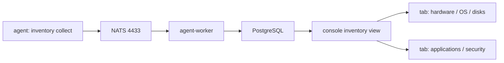
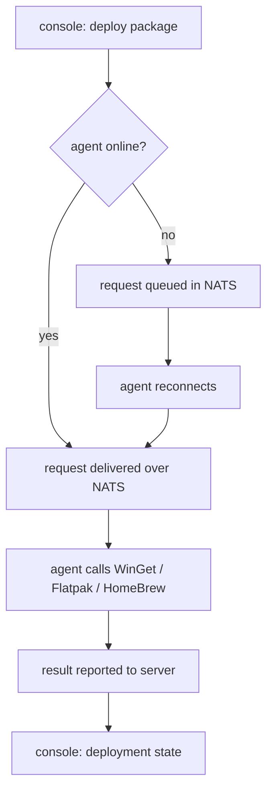
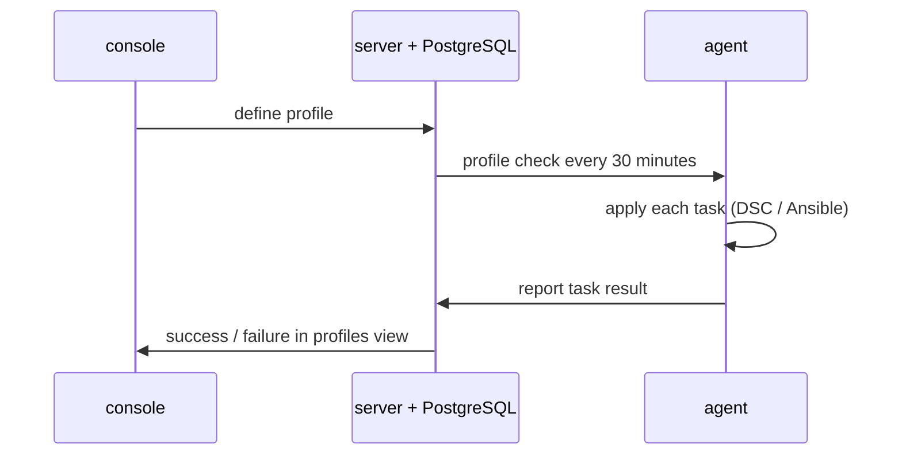

# Module 07 — Device management basics

## 7.1 The cost of an invisible fleet

In an environment with hundreds of endpoints, an administrator faces three
questions every day. The first is which hardware and which software is present
on which machine right now. The second is which package must be installed on,
or removed from, which machine. The third is which machine's state has drifted
away from the state that was defined for it.

If the answers to those three questions are kept in a hand-maintained list, the
data falls out of step with reality within a few weeks. It is not possible to
chase the list every time a single machine changes. OpenUEM hands this work to
the agent. At a fixed interval (60 minutes by default) the agent sends an
inventory report over NATS. The reports are received by `openuem-agent-worker`
and stored in PostgreSQL. The console then splits that data per tab.

What this module teaches is therefore not a set of commands. It is the set of
relationships: which tab holds the answer to which question, which engine
performs which action on which platform, and at what moment a result can be
trusted.

## 7.2 The question each inventory tab answers

The inventory view of the console has ten tabs. Each tab answers one separate
question. When a problem appears in operations, knowing which tab to open first
saves time.

| Tab | Question it answers | Operational use |
|---|---|---|
| overview | What is the general state of this machine | The first place to look during a check |
| hardware | How are the CPU, memory, board and serial | Warranty and asset records |
| operating system | What are the OS and version | Deciding whether an upgrade is needed |
| monitors | Which displays are attached | Managing office fit-out |
| logical disks | Partitions, free space, BitLocker state | Disk-full and encryption checks |
| network adapters | Which interfaces, MAC and IP | Network troubleshooting |
| printers | Which printers are in use | Print server migration |
| shares | Which shares are connected | Data access checks |
| applications | Which software, which version | Licence and security review |
| security | Antivirus, updates, pending patches | Compliance evidence |

Two tabs deserve particular attention. The `logical disks` tab contains the
usable space of each partition together with the BitLocker state. A machine with
a full disk and a machine without encryption can therefore be found in one
place. The `security` tab contains whether antivirus is running, the update
installation state, the updates that are waiting, and the update history. On
Linux endpoints the pending security updates are visible here.

The `applications` tab shows the software list of a single machine. The software
view of the console aggregates it into a single view that can be broken down by
software name, publisher and install count. At that point the question changes
from "what is on this machine" to "which software is spread across how many
machines in the fleet".

**Figure 1 — Data flow from the agent report to the inventory tabs**



Figure walkthrough — Start at the left edge. The agent collects the inventory
facts on its own machine. It sends that data to the NATS broker on port 4433.
NATS only routes the message; it does not store the data. The agent-worker then
reads the report and writes it into PostgreSQL. The console reads from the
database and builds the inventory view. At the right edge you can see the tabs
split into two groups: one for hardware and OS facts, the other for application
and security facts. Knowing at which stage a report is stuck helps later when
you are troubleshooting.

## 7.3 When inventory data can be trusted

The default report interval is 60 minutes and it can be changed under
Admin → General Settings → Agents report frequency. The data you see in the
console is therefore not the state of the current moment. It can be up to 60
minutes behind. If that fact is not known and you conclude "the console shows
it, so it is so", you end up with a wrong diagnosis.

An empty tab can have two causes. Either the machine genuinely has no printer,
or the collection did not succeed. The way to tell them apart is to look at the
agent's last report time. If the report is fresh and the tab is empty, you can
assume there is nothing to report. If the report is old, the data must not be
trusted. On top of that, the agent state must be Enabled. An agent in the
Waiting for admission state does send reports but is not yet in a manageable
state.

## 7.4 Package deployment — the engine for each platform

OpenUEM does not maintain a package catalogue of its own. On each platform it
uses the package manager that is already there. That choice keeps maintenance
light, but it creates three prerequisites.

| Platform | Engine | Catalogue | Prerequisite |
|---|---|---|---|
| Windows | WinGet | Microsoft community repository | Microsoft Store and App Installer must be up to date |
| Linux | Flatpak | Flatpak remotes (for example Flathub) | `flatpak` and one remote must exist |
| macOS | HomeBrew | formula and cask | HomeBrew must be installed by hand |

OpenUEM refreshes these catalogues daily. A new package that appears upstream
therefore does not show up in the console list immediately. It appears after the
next refresh. That fact is basic knowledge before you schedule a deployment.

On Windows the prerequisite needs particular care. On a freshly installed
machine Microsoft Store and App Installer may be out of date. In that state
WinGet may be unavailable or unable to fetch the catalogue. Those endpoints need
Store and App Installer updated before you deploy to them. On macOS, by
contrast, HomeBrew is not installed automatically. The administrator must have
installed it. Without it a macOS deployment request fails for lack of an engine.

**Figure 2 — The path of a package deployment request and the offline queue**



Figure walkthrough — The starting point is the console. An administrator clicks
to deploy a package to a target endpoint. Then a question appears: is the agent
online right now. If it is online, the request goes through NATS immediately. If
it is not, the request waits in the queue inside NATS; it is not lost. When the
agent comes back and connects, it receives the queued request. The agent then
calls the relevant engine: WinGet on Windows, Flatpak on Linux, HomeBrew on
macOS. The result is sent back to the server and shown in the deployment state
of the console. Note that in this path "sent" and "installed" are two different
stages.

## 7.5 Checking each engine on the endpoint yourself

Before deploying from the console it is useful to check engine readiness on the
endpoint. The commands below are the package managers' own commands. With them
you can test readiness by hand.

### Windows — WinGet

```powershell
winget --version
winget source update
winget install --id 7zip.7zip --silent --accept-package-agreements --accept-source-agreements
winget list --id 7zip.7zip
winget uninstall --id 7zip.7zip --silent
```

- `winget --version` — shows whether WinGet is present and which version it is. If the command is not found, App Installer must be updated.
- `winget source update` — refreshes the catalogue at this moment. This is separate from the daily refresh performed by OpenUEM.
- `winget install --id ...` — installs one package. `--silent` suppresses the UI, and `--accept-package-agreements` together with `--accept-source-agreements` prevents prompts on the first run.
- `winget list --id ...` — checks that the install is present. Useful for checking the result inside a script.
- `winget uninstall --id ...` — removes the package. Deployment and uninstall use the same flow.

```text
# simulated output — illustrative
PS C:\> winget --version
v1.x
PS C:\> winget list --id 7zip.7zip
Name     Id          Version   Source
----------------------------------------
7-Zip    7zip.7zip   2x.xx     winget
```

Version and build numbers differ from machine to machine. What matters here is
whether the commands succeed or fail.

### Linux — Flatpak

```bash
flatpak --version
flatpak remote-add --if-not-exists flathub https://flathub.org/repo/flathub.flatpakrepo
flatpak install --noninteractive flathub org.gimp.GIMP
flatpak list --app
flatpak uninstall --noninteractive org.gimp.GIMP
```

- `flatpak --version` — checks whether Flatpak is present.
- `flatpak remote-add --if-not-exists ...` — adds a remote. With `--if-not-exists` it can be run repeatedly.
- `flatpak install --noninteractive ...` — installs without user interaction. This is the form an agent can use.
- `flatpak list --app` — lists the applications.
- `flatpak uninstall --noninteractive ...` — removes the application.

```text
# simulated output — illustrative
$ flatpak list --app
Name    Application ID    Version   Branch   Installation
GIMP    org.gimp.GIMP     2.x       stable   system
```

### macOS — HomeBrew

```bash
brew --version
brew update
brew install wget
brew list --formula
brew uninstall wget
```

- `brew --version` — checks whether HomeBrew is present. On macOS it must have been installed by hand.
- `brew update` — refreshes the formula list.
- `brew install wget` — installs one formula.
- `brew list --formula` — shows the installed formulae.
- `brew uninstall wget` — removes the formula.

```text
# simulated output — illustrative
$ brew list --formula
wget
$ brew --version
Homebrew 4.x
```

## 7.6 Uninstall and queueing for an offline agent

Uninstall is not a separate process. It uses the same path as deployment: the
same engine, the same queue, the same result reporting. The troubleshooting
procedure for "installed" and for "removed" is therefore one single procedure.

The states of a request are read as follows.

1. The request is created from the console.
2. If the agent is online the request arrives over NATS. If it is not, it waits in the queue inside NATS.
3. The agent calls the engine and performs the installation or the removal.
4. The result is sent back to the server. The next inventory report carries the updated application list.

The important point is that "queued" is not the same as "failed". The request of
an offline laptop can sit in the queue for days. There is no need to delete that
request. As soon as the agent comes back and connects it is carried out
automatically. But if you assume such a request is "already done", a gap opens
between the console and the inventory.

## 7.7 Profiles — desired state

A profile is a group of tasks. Each task describes one precise change. The
profile is applied to a group of endpoints (a tag or a site). The agent checks
whether a new profile exists once every 30 minutes. That interval can be changed
in General Settings.

| Task family | Platforms it applies to | Action |
|---|---|---|
| install package | Windows, Linux, macOS | Installation through WinGet, Flatpak or HomeBrew |
| uninstall package | Windows, Linux, macOS | Removal through the same engine |
| registry key | Windows | Setting a registry value |
| local user | all platforms | Managing a local user account |
| local group | all platforms | Managing a local group and its members |
| PowerShell script | Windows | Running a script |
| shell script | Linux, macOS | Running a shell script |
| MSI package | Windows | Installing an `.msi` package |

The way a profile is applied differs per platform. On Windows it uses WinGet
configuration (DSC). On Linux and macOS it uses Ansible. Knowing that difference
helps you decide which log to read when a task fails.

**Figure 3 — The profile application loop and result reporting**



Figure walkthrough — Read from the top downwards. In the first step the
administrator defines a profile from the console. That profile is stored on the
server and in the database. In the second step the agent comes and checks once
every 30 minutes. This step is an action started by the agent; the server does
not call the agent. In the third step the agent applies each task in the
platform's own way. In the fourth step the result is sent back to the server.
Finally the console shows it as success or failure in the profiles view. Note
that the delay in this loop can be up to 30 minutes.

## 7.8 Profile failure signals

The profiles view shows the result for each endpoint and for each task. There
are four groups of failure signals.

- Engine missing — WinGet is not yet ready on Windows, or HomeBrew is absent on macOS.
- Script failure — the PowerShell or shell script finished with a non-zero exit code.
- Target mismatch — the platform of the task does not match the platform of the endpoint. For example, a registry key task sent to a Linux endpoint.
- Timeout — the task did not finish within the defined time.

Do not confuse these signals with the failure of a whole profile. One failed
task does not mean the remaining tasks could not run. The profiles view
therefore has to be opened down to the task level.

## 7.9 Remote assistance, SFTP file browsing and WOL

An Enabled agent offers three remote actions.

- Remote assistance — goes through the VNC proxy. Remote assistance must be enabled in the agent settings. RDP and RustDesk may also be usable, and their details need to be re-checked per version.
- SFTP file browsing — the agent runs an SFTP server on port 2022 (when it is enabled). Browsing the file list from the console and reading the agent log use this path.
- Wake-on-LAN — wakes a powered-off machine with a magic packet.

```text
console  ── 1323 ──▶ console.openuem.example
agent    ── 4433 ──▶ NATS broker
console  ── 2022 ──▶ agent SFTP   (file browsing, agent log)
console  ── 1443 ──▶ agent VNC proxy (remote assistance)
```

There is one limitation. On remote endpoints (endpoints identified by DNS and by
the IP they report) file browsing, remote assistance and WOL are not available.
That limitation has a direct effect on how the organisation is laid out. Machines
that may need remote assistance have to be placed in a single site, or another
method has to be arranged for those machines.

## 7.10 Health indicators

Health indicators exist to decide "which machine to look at first". There are
four commonly used indicators.

| Indicator | Red state | Meaning |
|---|---|---|
| last report | no report within 24 hours | agent or network problem |
| disk free space | very low | applications and updates cannot succeed |
| antivirus | disabled | compliance violation |
| update | pending | patching is needed |

On the dashboard the red section shows agents with no report, pending updates,
machines with antivirus disabled, and agent or application updates. The green
section holds the counts of users, applications and tags. The blue section holds
the state of the components. The dashboard refreshes every five minutes by
default.

## 7.11 Operational cautions

- The catalogue refresh is daily. A new package may not appear immediately.
- On new Windows endpoints, check WinGet readiness first. If Store and App Installer have not been updated, deployments may fail repeatedly.
- On macOS, HomeBrew must be installed by hand. It cannot be distributed through a profile.
- The profile check interval is 30 minutes. Do not expect a change to take effect immediately.
- Uninstall removes the package. Whether user data is kept or deleted depends on the nature of the individual package. Check it in the lab before trying it in production.
- On remote endpoints SFTP, VNC and WOL are not available. Those machines need a separate arrangement.
- Do not send a profile task to a group whose platform does not match. Failure signals pile up and can hide the real problem.

## 7.12 Self-check questions

**Question 1.** In which tab do you find disk-full state and BitLocker state?

Answer — in the `logical disks` tab. It contains the free space of each
partition together with the BitLocker state.

**Question 2.** On a Windows endpoint where WinGet is not yet available, what
do you check first?

Answer — the update state of Microsoft Store and App Installer. On a fresh
Windows installation they may be out of date and WinGet cannot be used.

**Question 3.** What happens to a deployment request for an agent that is
offline?

Answer — it waits in the queue inside NATS. When the agent comes back and
connects, it receives the request and carries it out.

**Question 4.** How often does an agent check a profile, and which engine
applies it?

Answer — it checks once every 30 minutes. On Windows WinGet configuration (DSC)
applies it; on Linux and macOS Ansible applies it.

**Question 5.** Which three actions are not available on a remote endpoint?

Answer — file browsing (SFTP), remote assistance and Wake-on-LAN.

## Technical review notes

- Only the facts supplied by MODULE_SPEC.md §Verified facts have been used. The port numbers (4433 NATS, 2022 SFTP, 1443 VNC proxy, 1323 console) are taken from that section.
- The package manager commands (`winget`, `flatpak`, `brew`) are the tools' own commands. The exact command form emitted by the OpenUEM agent needs to be re-checked per version.
- Every output shown in this document is marked with `# simulated output — illustrative`. Version and build numbers are deliberately left inexact.
- The details of RDP and RustDesk availability need to be re-checked per version. They are described here only as possibilities.
- Local user and local group tasks are listed for all platforms. Their availability on each platform needs to be re-checked per version.
- The profile check interval (30 minutes) and the report interval (60 minutes) can be changed in General Settings. This document is based on the default values.
