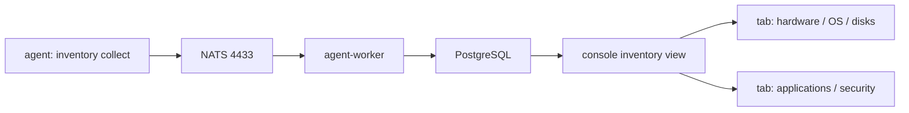
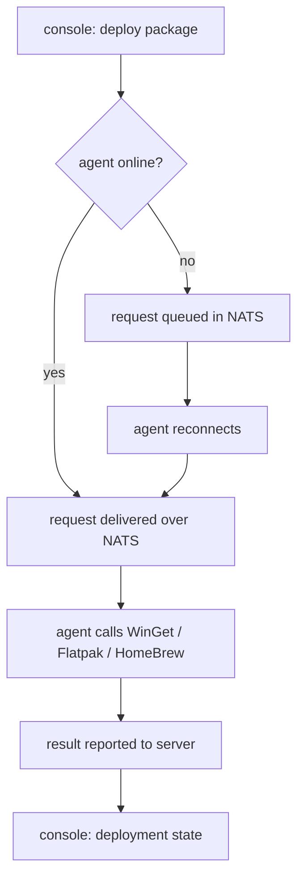
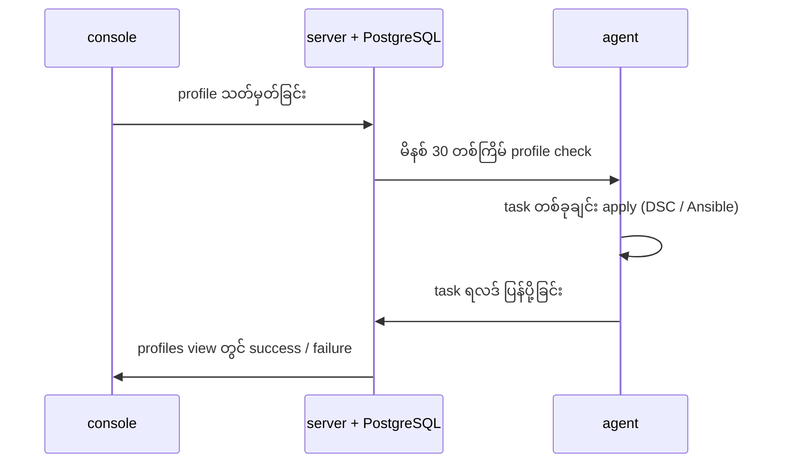

# Module 07 — Device management basics

## 7.1 မမြင်နိုင်သော fleet ၏ ကုန်ကျစရိတ်

Endpoint ရာဂဏန်းရှိသော ပတ်ဝန်းကျင်တွင် administrator သည် မေးခွန်း သုံးမျိုးကို နေ့စဉ် ရင်ဆိုင်ရသည်။ ပထမမေးခွန်းမှာ လက်ရှိ မည်သည့်စက်တွင် မည်သည့် hardware နှင့် software ရှိနေသည် ဆိုသည့် အချက် ဖြစ်သည်။ ဒုတိယမေးခွန်းမှာ မည်သည့် package ကို မည်သည့်စက်တွင် ထည့်သွင်း သို့မဟုတ် ဖယ်ရှားရမည် ဆိုသည့် အချက် ဖြစ်သည်။ တတိယမေးခွန်းမှာ မည်သည့်စက်၏ အခြေအနေသည် သတ်မှတ်ထားသော အနေအထားနှင့် ကွာခြားနေသည် ဆိုသည့် အချက် ဖြစ်သည်။

ဤမေးခွန်း သုံးမျိုးအတွက် အဖြေကို လက်ဖြင့် စာရင်းပြုစုပါက ရက်သတ္တပတ် အနည်းငယ်အတွင်း data သည် အမှန်တကယ် အခြေအနေနှင့် ကွာဟသွားသည်။ စက်တစ်လုံး ပြောင်းလဲသွားတိုင်း စာရင်းကို လိုက်လံ ပြင်ဆင်ရန် မဖြစ်နိုင်ပါ။ OpenUEM သည် ဤအလုပ်ကို agent ထံ လွှဲအပ်သည်။ Agent သည် သတ်မှတ်ထားသော အချိန်တိုင်း (default အားဖြင့် မိနစ် 60) inventory report ကို NATS မှတစ်ဆင့် ပေးပို့သည်။ Report များကို `openuem-agent-worker` က လက်ခံပြီး PostgreSQL တွင် သိမ်းဆည်းသည်။ Console က ထို data ကို tab အလိုက် ခွဲပြသည်။

ထို့ကြောင့် ဤ module တွင် သင်ယူရမည့် အကြောင်းအရာသည် command အစုအဝေး မဟုတ်ပါ။ မည်သည့် tab တွင် မည်သည့်မေးခွန်း၏ အဖြေ ရှိသည်၊ မည်သည့် လုပ်ဆောင်ချက်ကို မည်သည့် platform တွင် မည်သည့် engine က ဆောင်ရွက်သည်၊ မည်သည့် အချိန်တွင် ရလဒ်ကို ယုံကြည်နိုင်သည် ဆိုသည့် ဆက်စပ်မှုများ ဖြစ်သည်။

## 7.2 Inventory tab တစ်ခုစီက ဖြေဆိုသော မေးခွန်း

Console ၏ inventory view တွင် tab ဆယ်ခု ရှိသည်။ Tab တစ်ခုစီသည် သီးခြား မေးခွန်းတစ်ခုကို ဖြေဆိုသည်။ လုပ်ငန်းခွင် ပြဿနာတစ်ခု ပေါ်လာသောအခါ မည်သည့် tab ကို ဦးစွာ ဖွင့်ရမည် ဆိုသည်ကို သိထားခြင်းသည် အချိန်ကို သက်သာစေသည်။

| Tab | ဖြေဆိုသော မေးခွန်း | လုပ်ငန်းခွင် အသုံးချမှု |
|---|---|---|
| overview | ဤစက်၏ အထွေထွေ အခြေအနေ မည်သို့နည်း | စစ်ဆေးမှု၏ ပထမဆုံး နေရာ |
| hardware | CPU, memory, board, serial မည်သို့နည်း | warranty နှင့် asset စာရင်း |
| operating system | OS နှင့် version မည်သို့နည်း | upgrade လိုအပ်မှု ဆုံးဖြတ်ခြင်း |
| monitors | မည်သည့် display ချိတ်ဆက်ထားသည် | ရုံးခန်း ပြင်ဆင်မှု စီမံခြင်း |
| logical disks | partition, လွတ်နေသော နေရာ, BitLocker အခြေအနေ | disk ပြည့်မှု နှင့် encryption စစ်ဆေးမှု |
| network adapters | မည်သည့် interface, MAC နှင့် IP | network ပြဿနာ ရှာဖွေမှု |
| printers | မည်သည့် printer အသုံးပြုနေသည် | print server ပြောင်းရွှေ့မှု |
| shares | မည်သည့် share ချိတ်ဆက်ထားသည် | data access စစ်ဆေးမှု |
| applications | မည်သည့် software မည်သည့် version | licence နှင့် လုံခြုံရေး စစ်ဆေးမှု |
| security | antivirus, update, pending patch | compliance အထောက်အထား |

Tab နှစ်ခုကို အထူး ဂရုပြုရသည်။ `logical disks` tab တွင် partition တစ်ခုစီ၏ အသုံးပြုနိုင်သော နေရာအပြင် BitLocker အခြေအနေ ပါဝင်သည်။ ထို့ကြောင့် disk ပြည့်မှုနှင့် encryption မဖွင့်ထားသော စက်ကို တစ်နေရာတည်းမှ ရှာနိုင်သည်။ `security` tab တွင် antivirus ဖွင့်ထားခြင်း နှင့် update ထည့်သွင်းမှု အခြေအနေ၊ စောင့်ဆိုင်းနေသော update များ နှင့် update history ပါဝင်သည်။ Linux endpoint များတွင် စောင့်ဆိုင်းနေသော security update များကို ဤနေရာတွင် မြင်ရသည်။

`applications` tab သည် စက်တစ်လုံးချင်း၏ software စာရင်းကို ပြသည်။ Console ၏ software view သည် တစ်ခုတည်းသော အနေအထားသို့ စုစည်းပြီး software အမည်၊ publisher နှင့် install အရေအတွက်ဖြင့် ခွဲခြမ်းစိတ်ဖြာနိုင်သည်။ ဤနေရာမှာ မေးခွန်းက "ဤစက်တွင် ဘာ ရှိသည်" မှ "fleet တွင် မည်သည့် software မည်မျှ ပြန့်နှံ့နေသည်" သို့ ပြောင်းသွားသည်။

**Figure 1 — Agent report မှ inventory tab များအထိ data စီးဆင်းမှု**



ပုံရှင်းလင်းချက် — ဘယ်ဘက်စွန်းမှ စပါ။ Agent သည် မိမိ၏ စက်ပေါ်တွင် inventory အချက်အလက်များကို ကောက်ယူသည်။ ထို data ကို NATS broker သို့ port 4433 ဖြင့် ပေးပို့သည်။ NATS သည် လမ်းကြောင်း ဖြန့်ပေးသည့် အလုပ်သာ လုပ်သည်၊ data ကို မသိမ်းဆည်းပါ။ ထို့နောက် agent-worker သည် report ကို ဖတ်ပြီး PostgreSQL ထဲသို့ ရေးသွင်းသည်။ Console သည် database မှ ဖတ်ကာ inventory view ကို တည်ဆောက်သည်။ ညာဘက်စွန်းတွင် tab နှစ်အုပ်စု ခွဲထွက်သွားသည်ကို တွေ့ရသည် — တစ်ခုက hardware နှင့် OS အချက်အလက်၊ အခြားတစ်ခုက application နှင့် security အချက်အလက် ဖြစ်သည်။ မည်သည့် အဆင့်တွင် ရပ်နေသည်ကို သိထားခြင်းသည် နောက်ပိုင်း ပြဿနာ ရှာဖွေရာတွင် အသုံးဝင်သည်။

## 7.3 Inventory data ကို ယုံကြည်နိုင်သည့် အခြေအနေ

Report interval ၏ default သည် မိနစ် 60 ဖြစ်ပြီး Admin → General Settings → Agents report frequency တွင် ပြောင်းနိုင်သည်။ ထို့ကြောင့် console တွင် မြင်ရသော data သည် လက်ရှိ အခိုက်အတန့်၏ အခြေအနေ မဟုတ်ပါ။ မိနစ် 60 အထိ နောက်ကျနိုင်သည်။ ဤအချက်ကို မသိဘဲ "console တွင်ပြပါ" ဟု ကောက်ချက်ချပါက မှားသော ရောဂါရှာဖွေမှု ဖြစ်လာသည်။

Tab တစ်ခု ဗလာဖြစ်နေခြင်းသည် အကြောင်းရင်း နှစ်မျိုး ရှိနိုင်သည်။ စက်တွင် တကယ် printer မရှိခြင်း၊ သို့မဟုတ် collection မအောင်မြင်ခြင်း ဖြစ်သည်။ ခွဲခြားရန် နည်းလမ်းမှာ agent ၏ နောက်ဆုံး report အချိန်ကို ကြည့်ခြင်း ဖြစ်သည်။ Report အသစ်ဖြစ်ပြီး tab ဗလာဖြစ်နေပါက အကြောင်းအရာ မရှိခြင်းဟု ယူဆနိုင်သည်။ Report ဟောင်းနေပါက data ကို မယုံကြည်ရ။ ထို့အပြင် agent state သည် Enabled ဖြစ်ရသည်။ Waiting for admission အခြေအနေရှိ agent သည် report ပေးပို့သော်လည်း စီမံခန့်ခွဲနိုင်သော အနေအထားတွင် မရှိသေးပါ။

## 7.4 Package deployment — platform တစ်ခုစီ၏ engine

OpenUEM သည် package catalogue ကို ကိုယ်တိုင် မထိန်းသိမ်းပါ။ Platform တစ်ခုစီတွင် ရှိပြီးသား package manager ကို အသုံးပြုသည်။ ဤရွေးချယ်မှုသည် ထိန်းသိမ်းရလွယ်ကူသော်လည်း ကြိုတင်လိုအပ်ချက် သုံးမျိုးကို ဖန်တီးသည်။

| Platform | Engine | Catalogue | ကြိုတင် လိုအပ်ချက် |
|---|---|---|---|
| Windows | WinGet | Microsoft community repository | Microsoft Store နှင့် App Installer ကို update လုပ်ထားရန် လိုသည် |
| Linux | Flatpak | Flatpak remote များ (ဥပမာ Flathub) | `flatpak` နှင့် remote တစ်ခု ရှိရန် လိုသည် |
| macOS | HomeBrew | formula နှင့် cask | HomeBrew ကို ကိုယ်တိုင် install လုပ်ထားရန် လိုသည် |

OpenUEM သည် ဤ catalogue များကို နေ့စဉ် refresh လုပ်သည်။ ထို့ကြောင့် package အသစ်တစ်ခု upstream တွင် ပေါ်ပြီးနောက် console ၏ စာရင်းတွင် ချက်ချင်း မပေါ်နိုင်ပါ။ နောက်တစ်ကြိမ် refresh ပြီးမှ ပေါ်လာသည်။ ဤအချက်သည် deployment မစီစဉ်မီ သိထားရမည့် အခြေခံ အချက် ဖြစ်သည်။

Windows တွင် ကြိုတင်လိုအပ်ချက်ကို အထူး သတိထားရသည်။ Windows ကို အသစ် install လုပ်ထားသော စက်တွင် Microsoft Store နှင့် App Installer သည် ခေတ်မမီနိုင်ပါ။ ထိုအခြေအနေတွင် WinGet သည် မရနိုင်ခြင်း သို့မဟုတ် catalogue ကို မရယူနိုင်ခြင်း ဖြစ်နိုင်သည်။ ထို endpoint များကို deployment မလုပ်မီ Store နှင့် App Installer ကို update လုပ်ရန် လိုသည်။ macOS တွင်မူ HomeBrew ကို အလိုအလျောက် မတပ်ဆင်ပေးပါ။ Administrator က ကိုယ်တိုင် install လုပ်ထားရသည်။ မရှိပါက macOS deployment request သည် engine မရှိခြင်းကြောင့် မအောင်မြင်ပါ။

**Figure 2 — Package deployment request ၏ လမ်းကြောင်း နှင့် offline queue**



ပုံရှင်းလင်းချက် — စတင်သည်မှာ console ဖြစ်သည်။ Administrator က package တစ်ခုကို ပစ်မှတ် endpoint သို့ deploy ရန် နှိပ်သည်။ ထို့နောက် မေးခွန်းတစ်ခု ပေါ်လာသည် — agent သည် ယခု အွန်လိုင်း ရှိနေသလား။ အွန်လိုင်း ရှိပါက request သည် NATS မှတစ်ဆင့် ချက်ချင်း ရောက်သွားသည်။ မရှိပါက request သည် NATS တွင် တန်းစီနေသည်၊ ပျောက်မသွားပါ။ Agent ပြန်လာ၍ ချိတ်ဆက်သောအခါ တန်းစီနေသော request ကို လက်ခံသည်။ ထို့နောက် agent သည် သက်ဆိုင်ရာ engine ကို ခေါ်သည် — Windows တွင် WinGet၊ Linux တွင် Flatpak၊ macOS တွင် HomeBrew။ ရလဒ်ကို server သို့ ပြန်ပို့ပြီး console ၏ deployment state တွင် ပြသည်။ ဤလမ်းကြောင်းတွင် "ပို့ပြီး" နှင့် "တပ်ဆင်ပြီး" သည် အဆင့် နှစ်ဆင့် ဖြစ်သည်ကို သတိပြုရသည်။

## 7.5 Engine တစ်ခုစီကို endpoint တွင် ကိုယ်တိုင် စစ်ဆေးခြင်း

Console မှ deployment မ လုပ်မီ endpoint တွင် engine အသင့် ဖြစ်မှုကို စစ်ဆေးခြင်းသည် အသုံးဝင်သည်။ အောက်ပါ command များသည် package manager များ၏ ကိုယ်ပိုင် command များ ဖြစ်သည်။ ၎င်းတို့ဖြင့် readiness ကို လက်ဖြင့် စမ်းနိုင်သည်။

### Windows — WinGet

```powershell
winget --version
winget source update
winget install --id 7zip.7zip --silent --accept-package-agreements --accept-source-agreements
winget list --id 7zip.7zip
winget uninstall --id 7zip.7zip --silent
```

- `winget --version` — WinGet ရှိ မရှိ နှင့် version ကို ပြသည်။ Command မတွေ့ပါက App Installer ကို update လုပ်ရန် လိုသည်။
- `winget source update` — catalogue ကို ယခု အခိုက်အတန့်တွင် refresh လုပ်သည်။ OpenUEM ၏ နေ့စဉ် refresh နှင့် သီးခြား ဖြစ်သည်။
- `winget install --id ...` — package တစ်ခုကို install လုပ်သည်။ `--silent` သည် UI မပြရန်၊ `--accept-package-agreements` နှင့် `--accept-source-agreements` သည် ပထမဆုံး run တွင် မေးခွန်း မပေါ်ရန် ဖြစ်သည်။
- `winget list --id ...` — install ဖြစ်နေခြင်းကို စစ်သည်။ Script အတွင်း ရလဒ် စစ်ရန် အသုံးဝင်သည်။
- `winget uninstall --id ...` — ဖယ်ရှားသည်။ Deployment နှင့် uninstall သည် တူညီသော flow ကို အသုံးပြုသည်။

```text
# simulated output — illustrative
PS C:\> winget --version
v1.x
PS C:\> winget list --id 7zip.7zip
Name     Id          Version   Source
----------------------------------------
7-Zip    7zip.7zip   2x.xx     winget
```

Version နှင့် build နံပါတ်များသည် စက်တစ်လုံးစီတွင် ကွဲပြားသည်။ ဤနေရာတွင် အရေးကြီးသည်မှာ command များ အောင်မြင်ခြင်း သို့မဟုတ် မအောင်မြင်ခြင်း ဖြစ်သည်။

### Linux — Flatpak

```bash
flatpak --version
flatpak remote-add --if-not-exists flathub https://flathub.org/repo/flathub.flatpakrepo
flatpak install --noninteractive flathub org.gimp.GIMP
flatpak list --app
flatpak uninstall --noninteractive org.gimp.GIMP
```

- `flatpak --version` — Flatpak ရှိ မရှိ ကို စစ်သည်။
- `flatpak remote-add --if-not-exists ...` — remote တစ်ခု ထည့်သည်။ `--if-not-exists` ဖြင့် ထပ်ခါတလဲလဲ run နိုင်သည်။
- `flatpak install --noninteractive ...` — user interaction မပါဘဲ install လုပ်သည်။ Agent က အသုံးပြုနိုင်သည့် ပုံစံ ဖြစ်သည်။
- `flatpak list --app` — application များကို စာရင်းပြသည်။
- `flatpak uninstall --noninteractive ...` — ဖယ်ရှားသည်။

```text
# simulated output — illustrative
$ flatpak list --app
Name    Application ID    Version   Branch   Installation
GIMP    org.gimp.GIMP     2.x       stable   system
```

### macOS — HomeBrew

```bash
brew --version
brew update
brew install wget
brew list --formula
brew uninstall wget
```

- `brew --version` — HomeBrew ရှိ မရှိ ကို စစ်သည်။ macOS တွင် ၎င်းကို ကိုယ်တိုင် install လုပ်ထားရသည်။
- `brew update` — formula စာရင်းကို refresh လုပ်သည်။
- `brew install wget` — formula တစ်ခုကို install လုပ်သည်။
- `brew list --formula` — install ဖြစ်နေသော formula များကို ပြသည်။
- `brew uninstall wget` — ဖယ်ရှားသည်။

```text
# simulated output — illustrative
$ brew list --formula
wget
$ brew --version
Homebrew 4.x
```

## 7.6 Uninstall နှင့် offline agent အတွက် တန်းစီခြင်း

Uninstall သည် သီးခြား လုပ်ငန်းစဉ် မဟုတ်ပါ။ Deployment နှင့် တူညီသော လမ်းကြောင်းကို အသုံးပြုသည် — တူညီသော engine၊ တူညီသော queue၊ တူညီသော result reporting။ ထို့ကြောင့် "install လုပ်သည်" နှင့် "ဖယ်ရှားသည်" နှစ်ခုလုံးအတွက် ရောဂါရှာဖွေရေး လုပ်ငန်းစဉ်သည် တစ်ခုတည်း ဖြစ်သည်။

Request တစ်ခု၏ အခြေအနေများကို အောက်ပါအတိုင်း ခွဲခြားဖတ်ရသည်။

1. Request ကို console မှ ဖန်တီးသည်။
2. Agent အွန်လိုင်း ရှိပါက request သည် NATS မှတစ်ဆင့် ရောက်သည်။ မရှိပါက NATS တွင် တန်းစီနေသည်။
3. Agent သည် engine ကို ခေါ်ပြီး တပ်ဆင်မှု သို့မဟုတ် ဖယ်ရှားမှုကို ဆောင်ရွက်သည်။
4. ရလဒ်ကို server သို့ ပြန်ပို့သည်။ နောက်တစ်ကြိမ် inventory report တွင် application စာရင်း အသစ် ပါလာသည်။

အရေးကြီးသော အချက်မှာ "တန်းစီနေသည်" သည် "မအောင်မြင်ပါ" နှင့် မတူခြင်း ဖြစ်သည်။ Offline ဖြစ်နေသော လက်တော့ပ်တစ်လုံး၏ request သည် ရက်ပေါင်းများစွာ တန်းစီနေနိုင်သည်။ ထို request ကို ဖျက်ပစ်ရန် မလိုပါ။ Agent ပြန်လာ၍ ချိတ်ဆက်သည်နှင့် အလိုအလျောက် ဆောင်ရွက်သွားသည်။ သို့သော် ထို request ကို "ပြီးသွားပြီ" ဟု မှတ်ယူပါက inventory နှင့် ကွာဟမှု ဖြစ်လာသည်။

## 7.7 Profile — ဆန္ဒရှိသော အခြေအနေ (desired state)

Profile ဆိုသည်မှာ task အစုတစ်ခု ဖြစ်သည်။ Task တစ်ခုစီသည် တိကျသော ပြောင်းလဲမှုတစ်ခုကို ဖော်ပြသည်။ Profile ကို endpoint အုပ်စု (tag သို့မဟုတ် site) သို့ သက်ရောက်စေသည်။ Agent သည် profile အသစ် ရှိ မရှိကို မိနစ် 30 တစ်ကြိမ် စစ်ဆေးသည်။ ဤ interval ကို General Settings တွင် ပြောင်းနိုင်သည်။

| Task family | သက်ဆိုင်သော platform | လုပ်ဆောင်ချက် |
|---|---|---|
| install package | Windows, Linux, macOS | WinGet, Flatpak သို့မဟုတ် HomeBrew ဖြင့် တပ်ဆင်ခြင်း |
| uninstall package | Windows, Linux, macOS | တူညီသော engine ဖြင့် ဖယ်ရှားခြင်း |
| registry key | Windows | Registry တန်ဖိုး သတ်မှတ်ခြင်း |
| local user | platform အားလုံး | ဒေသတွင်း user အကောင့် စီမံခြင်း |
| local group | platform အားလုံး | ဒေသတွင်း group နှင့် အဖွဲ့ဝင် စီမံခြင်း |
| PowerShell script | Windows | Script run ခြင်း |
| shell script | Linux, macOS | Shell script run ခြင်း |
| MSI package | Windows | `.msi` package တပ်ဆင်ခြင်း |

Apply လုပ်ပုံသည် platform အလိုက် ကွဲပြားသည်။ Windows တွင် WinGet configuration (DSC) ကို အသုံးပြုသည်။ Linux နှင့် macOS တွင် Ansible ကို အသုံးပြုသည်။ ဤကွာခြားမှုကို သိထားခြင်းသည် task တစ်ခု မအောင်မြင်သောအခါ မည်သည့် log ကို ဖတ်ရမည်ကို ဆုံးဖြတ်ရန် ကူညီသည်။

**Figure 3 — Profile application loop နှင့် ရလဒ် ပြန်ပို့ခြင်း**



ပုံရှင်းလင်းချက် — အပေါ်မှ အောက်သို့ ဖတ်ပါ။ ပထမ အဆင့်တွင် administrator က console မှ profile တစ်ခုကို သတ်မှတ်သည်။ ထို profile သည် server နှင့် database တွင် သိမ်းဆည်းသည်။ ဒုတိယ အဆင့်တွင် agent သည် မိနစ် 30 တစ်ကြိမ် လာရောက် စစ်ဆေးသည်။ ဤအဆင့်သည် agent မှ စတင်သော လုပ်ဆောင်ချက် ဖြစ်သည်၊ server က agent ကို မခေါ်ပါ။ တတိယ အဆင့်တွင် agent သည် task တစ်ခုချင်းကို platform ၏ နည်းလမ်းဖြင့် apply လုပ်သည်။ စတုတ္ထ အဆင့်တွင် ရလဒ်ကို server သို့ ပြန်ပို့သည်။ နောက်ဆုံးတွင် console ၏ profiles view တွင် success သို့မဟုတ် failure အဖြစ် မြင်ရသည်။ ဤ loop တွင် အချိန်ကြာချိန်သည် မိနစ် 30 အထိ ဖြစ်နိုင်သည်ကို သတိပြုရသည်။

## 7.8 Profile မအောင်မြင်မှု အချက်ပြများ

Profiles view တွင် endpoint တစ်ခုချင်း၊ task တစ်ခုချင်းအတွက် ရလဒ်ကို မြင်ရသည်။ မအောင်မြင်မှု အချက်ပြ အုပ်စု လေးခု ရှိသည်။

- Engine မရှိခြင်း — Windows တွင် WinGet အသင့် မဖြစ်သေးခြင်း၊ macOS တွင် HomeBrew မရှိခြင်း။
- Script မအောင်မြင်ခြင်း — PowerShell သို့မဟုတ် shell script သည် သုည မဟုတ်သော exit code ဖြင့် ပြီးဆုံးခြင်း။
- Target မတူညီခြင်း — task ၏ platform နှင့် endpoint ၏ platform မကိုက်ညီခြင်း။ ဥပမာ registry key task တစ်ခုကို Linux endpoint သို့ ပေးပို့ခြင်း။
- အချိန်ကုန်ဆုံးခြင်း — task သည် သတ်မှတ်ထားသော အချိန်အတွင်း မပြီးဆုံးခြင်း။

ဤအချက်ပြများကို profile တစ်ခုလုံး မအောင်မြင်ခြင်းနှင့် မရောပါ။ Task တစ်ခု မအောင်မြင်ခြင်းသည် ကျန်သော task များ မလုပ်ဆောင်နိုင်ခြင်းကို မဆိုလိုပါ။ ထို့ကြောင့် profiles view ကို task အဆင့်ထိ ဖွင့်ကြည့်ရသည်။

## 7.9 အဝေးမှ အကူအညီ၊ SFTP ဖိုင်ကြည့်ခြင်း နှင့် WOL

Enabled ဖြစ်သော agent တွင် လုပ်ဆောင်နိုင်သည့် အဝေးမှ လုပ်ငန်း သုံးမျိုး ရှိသည်။

- Remote assistance — VNC proxy မှတစ်ဆင့် ဖြစ်သည်။ Agent settings တွင် remote assistance ကို ဖွင့်ထားရသည်။ RDP နှင့် RustDesk ကို အသုံးပြုနိုင်သော ဖြစ်နိုင်ခြေ ရှိပြီး ၎င်းတို့၏ အသေးစိတ်သည် version အလိုက် ပြန်စစ်ရန် လိုသည်။
- SFTP file browsing — agent သည် SFTP server တစ်ခုကို port 2022 တွင် run သည် (enable လုပ်ထားပါက)။ Console မှ ဖိုင်စာရင်း ကြည့်ခြင်းနှင့် agent log ကို ကြည့်ခြင်းသည် ဤလမ်းကြောင်းကို အသုံးပြုသည်။
- Wake-on-LAN — ပိတ်ထားသော စက်ကို magic packet ဖြင့် နှိုးသည်။

```text
console  ── 1323 ──▶ console.openuem.example
agent    ── 4433 ──▶ NATS broker
console  ── 2022 ──▶ agent SFTP   (file browsing, agent log)
console  ── 1443 ──▶ agent VNC proxy (remote assistance)
```

ကန့်သတ်ချက် တစ်ခု ရှိသည်။ Remote endpoint (DNS နှင့် report လုပ်ထားသော IP ဖြင့် ဖော်ထုတ်ထားသော endpoint) များတွင် ဖိုင်ကြည့်ခြင်း၊ remote assistance နှင့် WOL တို့ကို အသုံးမပြုနိုင်ပါ။ ဤကန့်သတ်ချက်သည် လုပ်ငန်းခွင် ဖွဲ့စည်းပုံအပေါ် တိုက်ရိုက် သက်ရောက်သည်။ အဝေးမှ အကူအညီ လိုအပ်နိုင်သော စက်များကို site တစ်ခုတည်းတွင် ထားရှိခြင်း သို့မဟုတ် ထို စက်များအတွက် အခြား နည်းလမ်း စီစဉ်ခြင်း လိုအပ်သည်။

## 7.10 ကျန်းမာရေး အညွှန်း

Health indicator များသည် "မည်သည့်စက်ကို ဦးစွာ ကြည့်ရမည်" ဆိုသည်ကို ဆုံးဖြတ်ရန် ဖြစ်သည်။ အသုံးများသော အညွှန်း လေးခု ရှိသည်။

| အညွှန်း | အနီရောင် အခြေအနေ | အဓိပ္ပာယ် |
|---|---|---|
| နောက်ဆုံး report | နာရီ 24 အတွင်း report မရှိ | agent သို့မဟုတ် network ပြဿနာ |
| disk လွတ်နေရာ | အလွန် နည်းနေသည် | application နှင့် update မအောင်မြင်နိုင် |
| antivirus | ပိတ်ထားသည် | compliance ချိုးဖောက်မှု |
| update | စောင့်ဆိုင်းနေသည် | patch လိုအပ်မှု |

Dashboard တွင် အနီရောင် အပိုင်းသည် report မရှိသော agent များ၊ စောင့်ဆိုင်းနေသော update များ၊ antivirus ပိတ်ထားသော စက်များ နှင့် agent သို့မဟုတ် application update များကို ပြသည်။ အစိမ်းရောင် အပိုင်းသည် user၊ application နှင့် tag အရေအတွက်များ ဖြစ်သည်။ အပြာရောင် အပိုင်းသည် component များ၏ အခြေအနေ ဖြစ်သည်။ Dashboard သည် default အားဖြင့် ငါးမိနစ် တစ်ကြိမ် refresh လုပ်သည်။

## 7.11 လုပ်ငန်းသုံး သတိပြုချက်

- Catalogue refresh သည် နေ့စဉ် ဖြစ်သည်။ Package အသစ် ချက်ချင်း မပေါ်နိုင်ပါ။
- Windows endpoint အသစ်များတွင် WinGet readiness ကို အရင် စစ်ရသည်။ Store နှင့် App Installer update မလုပ်ရသေးပါက deployment များ ဆက်တိုက် မအောင်မြင်နိုင်ပါ။
- macOS တွင် HomeBrew ကို ကိုယ်တိုင် install လုပ်ထားရသည်။ Profile ဖြင့် ၎င်းကို မဖြန့်နိုင်ပါ။
- Profile check interval သည် မိနစ် 30 ဖြစ်သည်။ ပြောင်းလဲမှုတစ်ခု ချက်ချင်း သက်ရောက်မည်ဟု မမျှော်လင့်ရ။
- Uninstall သည် package ကို ဖယ်ရှားသည်။ User data ကို ထိန်းသိမ်းခြင်း သို့မဟုတ် ဖျက်ခြင်းသည် package တစ်ခုချင်း၏ သဘောတရားအပေါ် မူတည်သည်။ Production တွင် မစမ်းမီ lab တွင် စစ်ရသည်။
- Remote endpoint များတွင် SFTP၊ VNC နှင့် WOL မရနိုင်ပါ။ ထို စက်များအတွက် အစီအစဉ် သီးခြား ရှိရသည်။
- Profile task တစ်ခုကို platform မကိုက်ညီသော အုပ်စုသို့ မပေးပို့ရ။ မအောင်မြင်မှု အချက်ပြ များလာပြီး တကယ့် ပြဿနာကို ဖုံးကွယ်သွားနိုင်သည်။

## 7.12 ကိုယ်တိုင် စစ်ဆေးမေးခွန်း

**မေးခွန်း 1။** Disk ပြည့်နေမှုနှင့် BitLocker အခြေအနေကို မည်သည့် tab တွင် ရှာရသနည်း။

အဖြေ — `logical disks` tab တွင် ဖြစ်သည်။ Partition တစ်ခုစီ၏ လွတ်နေသော နေရာနှင့် BitLocker အခြေအနေ ပါဝင်သည်။

**မေးခွန်း 2။** Windows endpoint တွင် WinGet မရနိုင်သေးပါက မည်သည့် အရာကို ဦးစွာ စစ်ရသနည်း။

အဖြေ — Microsoft Store နှင့် App Installer ၏ update အခြေအနေ ဖြစ်သည်။ Windows အသစ်တွင် ၎င်းတို့ ခေတ်မမီနိုင်ပြီး WinGet ကို အသုံးမပြုနိုင်ပါ။

**မေးခွန်း 3။** Offline ဖြစ်နေသော agent အတွက် deployment request သည် မည်သို့ ဖြစ်သွားသနည်း။

အဖြေ — NATS တွင် တန်းစီနေသည်။ Agent ပြန်လာ၍ ချိတ်ဆက်သောအခါ request ကို လက်ခံပြီး ဆောင်ရွက်သည်။

**မေးခွန်း 4။** Profile တစ်ခုကို agent မည်မျှ ကြာလျှင် စစ်ဆေးသနည်း၊ မည်သည့် engine က apply လုပ်သနည်း။

အဖြေ — မိနစ် 30 တစ်ကြိမ် စစ်ဆေးသည်။ Windows တွင် WinGet configuration (DSC)၊ Linux နှင့် macOS တွင် Ansible က apply လုပ်သည်။

**မေးခွန်း 5။** Remote endpoint တွင် မည်သည့် လုပ်ဆောင်ချက် သုံးမျိုးကို အသုံးမပြုနိုင်သနည်း။

အဖြေ — ဖိုင်ကြည့်ခြင်း (SFTP)၊ remote assistance နှင့် Wake-on-LAN တို့ ဖြစ်သည်။

## Technical review notes

- MODULE_SPEC.md ၏ §Verified facts မှ ပေးထားသော အချက်များကိုသာ အသုံးပြုထားသည်။ Port နံပါတ်များ (4433 NATS၊ 2022 SFTP၊ 1443 VNC proxy၊ 1323 console) သည် ထို အပိုင်းမှ ရယူထားသည်။
- Package manager command များ (`winget`, `flatpak`, `brew`) သည် သက်ဆိုင်ရာ ကိရိယာများ၏ ကိုယ်ပိုင် command များ ဖြစ်သည်။ OpenUEM agent က ထုတ်ပေးသော command ပုံစံ အတိအကျသည် version အလိုက် ပြန်စစ်ရန် လိုသည်။
- ဤစာတမ်းတွင် ပြထားသော output အားလုံးသည် `# simulated output — illustrative` ဖြင့် အမှတ်အသားပြုထားသည်။ Version နှင့် build နံပါတ်များကို တမင်တကာ အတိအကျ မပေးထားပါ။
- RDP နှင့် RustDesk အသုံးပြုနိုင်မှု အသေးစိတ်သည် version အလိုက် ပြန်စစ်ရန် လိုသည်။ ဤစာတမ်းတွင် ဖြစ်နိုင်ခြေ အဖြစ်သာ ဖော်ပြထားသည်။
- Local user နှင့် local group task များကို platform အားလုံးအတွက် ဖော်ပြထားသည်။ Platform တစ်ခုစီတွင် ရရှိနိုင်မှုကို version အလိုက် ပြန်စစ်ရန် လိုသည်။
- Profile check interval (မိနစ် 30) နှင့် report interval (မိနစ် 60) ကို General Settings တွင် ပြောင်းနိုင်သည်။ ဤစာတမ်းတွင် default တန်ဖိုးများကို အခြေခံထားသည်။
