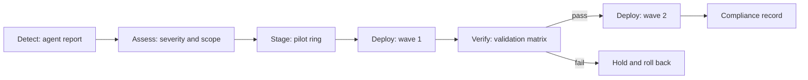
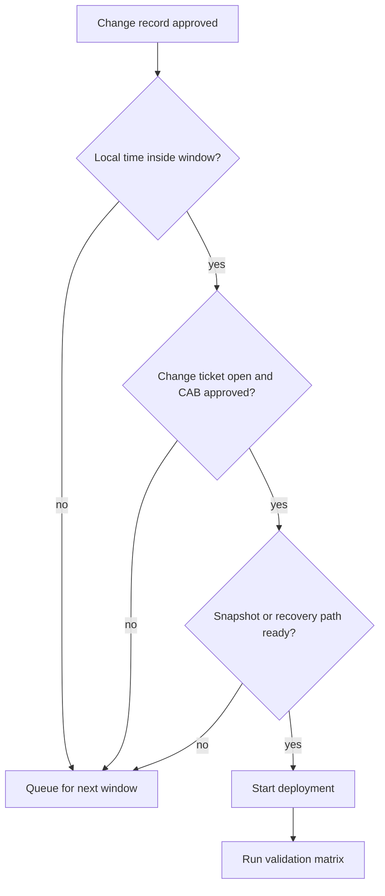

# Module 08 — Patch management and automation

Patch management is the busiest area of endpoint management. Good inventory tells you which software is installed. Patch management tells you which security weaknesses are still open. This module studies, in order: the update state that OpenUEM reports, the patch workflow from detect to verify, maintenance windows and change control, post-deployment verification, the idea of rollback, automation, and compliance measurement.

## The problem — updates you cannot see

In an environment with more than a hundred endpoints the problem is not technical. It is visibility. If you do not know which computers have had critical updates outstanding for weeks, you will not have time to prepare when an emergency arrives. Checking each computer by hand stops being possible as the endpoint count grows. So the first step is to gather the update state into one place. OpenUEM does that work through agent reports.

## Reading Windows update state

The security view in the console shows the update state of Windows endpoints with four facts.

| Fact shown | Question it answers | Operational use |
|---|---|---|
| Antivirus enabled / updated | Is the protection running, and are the definitions current | Checking the anti-malware state |
| Windows update download / install configuration | How download and install are set at the OS level | Checking policy conformance |
| Pending updates | How many updates are not yet installed | Prioritising |
| Update history | Which update was installed at which time | Comparing against the time a problem appeared |

The first two facts are policy questions. They show whether the endpoint is allowed to download updates and allowed to install them. If download is switched off on an endpoint, the pending update count will never go down. So when you look for the cause of a high pending count, read the configuration fact first.

The next two facts are state questions. Pending updates is the list of updates still outstanding right now. Update history is the record of past installations. Reading the two together lets you separate "the updates arrived but could not be installed yet" from "the updates never arrived at all". In the first case what has to be fixed is timing and window. In the second case what has to be fixed is the network, the policy, or the agent's reporting.

The security view's information is based on the last agent report. By default the agent reports once every 60 minutes. So the state you are looking at can be up to 60 minutes stale. If you want to check immediately, use the force report action on an enabled agent. This matters when you are judging the result of a patch rollout. Concluding "not successful yet" before a fresh report has arrived can be wrong.

## Linux pending security updates

For Debian-based (Debian, Ubuntu, Mint) and RPM-based (Fedora, Alma, Rocky, RHEL) endpoints the security view shows pending security updates. Unlike the Windows KB names it does not give a detailed name list; it mainly shows the count of security updates. So on Linux the workflow is "watch the count fall".

The difference between the two platforms is worth understanding.

| Area | Windows | Linux |
|---|---|---|
| Main indicator | Pending updates and update history | Pending security updates |
| Detail of names | Visible by KB name | Visible by count |
| Policy fact | Download / install configuration | Repository state of the package manager |
| Workflow | Install wave by wave | Bulk install after repository sync |

On Linux, recording the change in the update count every day is very useful. If the count does not fall within a week, that points to a repository sync problem or to a patch window that never arrives.

If you want to check by hand at the package-manager level, you can use the commands below. The outputs are illustrative.

```bash
# Debian-based: list the available updates
apt list --upgradable
```

```text
# simulated output — illustrative
Listing... Done
libssl3/stable-security 3.0.11-1~deb12u2 amd64 [upgradable from: 3.0.11-1~deb12u1]
openssl/stable-security 3.0.11-1~deb12u2 amd64 [upgradable from: 3.0.11-1~deb12u1]
```

```bash
# RPM-based: check whether the repository has updates
dnf check-update
```

```text
# simulated output — illustrative
Last metadata expiration check: 0:12:41 ago.
openssl.x86_64        1:3.0.7-27.el9        baseos
tzdata.noarch         2024a-1.el9           baseos
```

Both commands are OS-level checks. The value of OpenUEM is that it performs that check for more than a hundred endpoints at the same time.

## The patch pipeline — from detect to verify

Installing a patch is not one step. It is a workflow of five stages. If you skip one stage, you can no longer find the cause when a problem appears at a later stage.



**Figure 1 — The five stages of the patch pipeline**

Figure walkthrough — Figure 1 shows five stages from left to right. In the first stage, Detect, the agent sends the pending-update list in its latest report. In the second stage, Assess, the list that arrives is split by severity and the count of affected endpoints is calculated. In the third stage, Stage, a pilot ring containing only a few endpoints is chosen and tested first. In the fourth stage, Deploy, wave 1 is installed. In the fifth stage, Verify, the result is checked against the validation matrix. If the check passes, the work continues to wave 2. If it does not pass, that wave is stopped and a decision is made to turn back. Finally the result is stored as a compliance record. Each arrow represents a decision that a person has to confirm.

Each stage has work to perform and facts to record.

| Stage | Action | Record |
|---|---|---|
| Detect | Obtain the pending-update list from the report | Date, report time |
| Assess | Split by severity, calculate the scope of impact | List of affected endpoints |
| Stage | Test first on the pilot ring | Test result |
| Deploy | Install wave by wave | Installation time, success |
| Verify | Check against the validation matrix | Check result, outstanding items |

The Detect stage has one basic fact. The report arrives once every 60 minutes. So if you say "we start patching at 9 a.m. today", you have to force a report at 8:30 and make the list fresh. Otherwise you will decide on yesterday's list.

At the Assess stage you consider not only severity but also the question "can this endpoint take this update". Insufficient disk space, a required reboot, and incompatibility with a line-of-business application can all change the wave assignment.

The Stage stage is the most important. The pilot ring usually contains endpoints with few users that are easy to rebuild. The pilot ring is not permission to experiment; it is permission to limit risk.

At the Deploy stage you verify after each wave. Not doing all waves at once limits the scope of impact if a problem appears.

## Maintenance windows and change control

A maintenance window is an agreement that defines "when we are allowed to make changes". Patching without a window can cause an outage of a line-of-business service. Having a window but no change control means you cannot trace back who did what.

When you define a window you look at four things. First, the time of low business use. Second, enough duration if a reboot is required. Third, the availability of the recovery team. Fourth, the local time difference.

The time difference is where mistakes happen most in practice. If the window is defined in UTC, the endpoint's local time differs by its offset. In a site at +08:00, 18:00 UTC is 02:00 the next day. So defining the window in the site's local time is clearer. But when you record it you must convert to UTC. Recording both is best.



**Figure 2 — The decision sequence of the maintenance-window gate**

Figure walkthrough — Figure 2 shows the three gates that must be passed before deployment starts. The first gate is the time gate. If the endpoint's local time is not inside the defined window, the work moves to the next window. The second gate is the approval gate. If the change ticket is not open, or approval has not been given, the work does not continue. The third gate is the recovery gate. If a snapshot or a reinstall path is not ready, the work stops. Only after all three gates are passed does deployment begin. After deployment the validation matrix is run. In this sequence every "no" path leads to waiting without making a change. A person makes the decision.

## The post-deployment validation matrix

Saying a patch was applied does not mean it was verified. The validation matrix breaks "successful" down into facts that can be measured. The matrix must contain at least the following five checks.

| Check | Criterion for success | Cause it points to when it fails |
|---|---|---|
| Report freshness | Last report within 90 minutes | Agent or NATS connectivity problem |
| Patch applied | The relevant pending update count is zero | Installation never started, or failed |
| Service state | The required services are running | A service broken by the update |
| Disk space | More than 10 GB free | Update files piling up |
| Reboot state | Uptime under 24 hours | Reboot has not happened yet |

Each check catches a different problem. If the report freshness check fails, the results of the remaining checks should not be trusted, because the other facts are based on information from that report. So the matrix is read from top to bottom in order.

The patch-applied check is the main objective. But it alone is not sufficient. If an update is installed and the service no longer comes up, the result is bad. So the service check must be included without exception.

The disk and reboot checks catch follow-on problems early. Insufficient disk space will cause a failure at the next update. A reboot that has not happened yet means some patches are not fully in effect.

The order of running the matrix is this. As soon as a wave finishes, force a report. Wait until the fresh report arrives. Then evaluate the matrix. If the success percentage does not meet the threshold, do not start the next wave. Export the result from the security view as CSV and attach it to the change ticket.

For the record you can store the check results in the form below. This information is illustrative.

```text
# simulated output — illustrative
endpoint,passed,total,failed_checks,rollback
SRV-APP-01,2,5,disk_headroom|patch_applied|service_healthy,yes
WS-ACC-01,5,5,,no
WS-ACC-02,4,5,report_fresh,no
```

## The idea of rollback

OpenUEM has no built-in rollback for OS updates. The console does not keep the previous OS state. So the idea "if it goes wrong we will turn back" must not depend on the tool. It must depend on the process.

There are three recovery paths. First, take a virtual machine snapshot or disk image before the window opens. This method gives a full recovery. But line-of-business data can be lost. Second, split the waves. This is not rollback. It is limiting the scope of impact. Third, remove the package through the package manager. Packages installed with WinGet, Flatpak or HomeBrew can be removed through the same workflow.

Each of these paths has limits. A snapshot is best for OS-level updates. Package removal applies only at the application level. Removing an OS cumulative update is not a simple job. So when you write a rollback plan you must write precisely "which piece of work is turned back by which method". The single word "roll back" is not enough.

The rollback decision is made with a time condition. For example, it is decided in advance that if the service does not come back within 30 minutes of the window, the change is turned back immediately. Deciding that in advance means you do not spend the incident arguing.

## Automating routine work with profiles and tasks

A profile is a desired-state bundle that defines "how the endpoints must be". The agent checks the profile at a fixed interval and runs a task when it finds a difference. By default the agent checks for a new profile once every 30 minutes. This can be changed in General Settings.

The task types are these. Installing and removing packages (WinGet on Windows, Flatpak on Linux, HomeBrew on macOS), registry keys, local users, local groups, PowerShell scripts on Windows, shell scripts on Linux and macOS, and MSI packages on Windows. Windows uses WinGet configuration (DSC). Linux and macOS use Ansible.

There are three basic rules for choosing automation. If you want to maintain a repeating state, use a profile. If you want to do something once on a single endpoint, use a deployment request. If you want to collect state, rely on reports.

The profile check runs every 30 minutes and the report every 60 minutes. So the time to confirm a change is the time spent waiting for the report. This is the basic limit of compliance measurement.

There are points to watch when you use a profile to do patch work. The script must be idempotent. Running it twice must give the same result. The script must not ask interactive prompts. Output must be written to a log file. For agents that are offline the request waits in a queue in NATS. It is executed when the agent comes back.

There is a limit regarding the package catalogue. OpenUEM refreshes those catalogues daily. A new Windows installation may need a Microsoft Store and App Installer update for WinGet. On macOS, HomeBrew has to be installed by hand. If these facts are not in place, the task fails. So check first on the pilot ring.

## Compliance metrics and reporting cadence

Five measures are enough to measure compliance.

| Measure | Meaning | Where it is used |
|---|---|---|
| Critical pending count | Critical updates outstanding across the fleet | Daily monitoring |
| Endpoint compliance percentage | Proportion of endpoints that meet the threshold | Weekly report |
| Fleet patch rate | Proportion of patches installed | Monthly trend |
| Age of the oldest outstanding update | Number of days | Risk assessment |
| Report freshness percentage | Proportion of endpoints reporting within 90 minutes | Confidence in the data |

Do not look at the fleet patch rate alone. If ninety-nine percent of a hundred endpoints are fully patched but five critical updates remain on the one remaining endpoint, the risk is concentrated on that endpoint. So endpoint compliance percentage and the exception list are read together.

The reporting cadence is set per job. Every morning, look at the red section of the dashboard. That section contains agents that have not reported, pending updates, antivirus that has been switched off, and agent and application updates. The dashboard refreshes every 5 minutes by default. Every week, send the exception list to the change board. Every month, produce a trend comparison report.

When you export a report, make use of the filters that come with it. If you export a PDF or CSV from the security view, the current filter and sort order are preserved. So a view of "critical only, single site" can be stored directly as evidence.

## The honest limitation

OpenUEM is not a full patch orchestrator for OS updates. That point must be understood clearly.

What the console shows is update state. It shows whether there are pending updates, the update history, Linux pending security updates, and the download/install configuration. The work of making decisions on the basis of that state is done by a person.

So the process is split into two layers. The first layer is visibility and policy. OpenUEM provides inventory, update state, profile state and reports. The second layer is OS-level installation. That is carried out by the OS's own update tool and process.

If you do not make this distinction, your expectations can be wrong. If you assume "all patching will happen automatically in the console", you are left with no verification. Conversely, if you assume "the console cannot do updates", you lose the value of visibility. The value of OpenUEM is being able to see the update state of more than a hundred endpoints in one place with confidence.

## Self-check questions

**Q1. On an endpoint with a high pending-update count, which fact should be checked first?**
Answer — Check the download/install configuration. If installation is switched off on the endpoint, the updates will never go down. If the configuration is sound, check report freshness.

**Q2. How does the difference between the report and profile check intervals affect compliance?**
Answer — By default the report is every 60 minutes and the profile check every 30 minutes. After a change happens you have to wait for the report to confirm it. So if you want to check immediately, force a report.

**Q3. Does OpenUEM have built-in rollback for OS updates?**
Answer — No. Recovery has to be planned in advance using snapshots, wave splitting and removal through the package manager.

**Q4. Which mechanism should be chosen for a task that has to be repeated?**
Answer — If you want to maintain a state repeatedly across many endpoints, choose a profile. If you want to do something once for a single endpoint, choose a deployment request.

**Q5. If the fleet patch rate is 99 percent, can you say the fleet is secure?**
Answer — No. Critical updates can be concentrated in the remaining 1 percent. The endpoint compliance percentage and the exception list must be read together.

## Technical review notes

- Every fixture in this module is demonstration data. It is not the console's real numbers. Every output block is marked `# simulated output — illustrative`.
- `apt list --upgradable` and `dnf check-update` are OS-level commands and are not commands from the OpenUEM documentation. They need to be rechecked per version.
- The security view's menu name and column names need to be rechecked per version.
- The profile check interval (30 minutes) is described as changeable in General Settings. The exact name of this setting needs to be rechecked per version.
- Driving OS updates through a profile task is an operational pattern. The documentation does not describe a separate task type for OS updates. It needs to be rechecked per version.
- The names of the dashboard's red sections and the refresh interval (5 minutes) need to be rechecked per version.
- A point corrected in this module — the incorrect conclusion "OpenUEM installs OS patches automatically" has been removed and replaced precisely with "reports update state".
