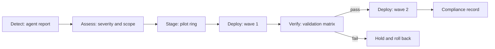
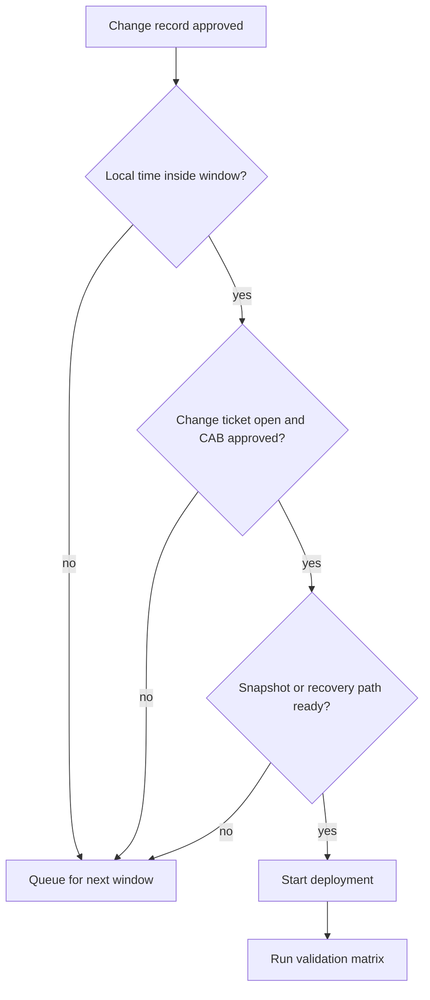

# Module 08 — Patch management and automation

Patch management သည် endpoint management ၏ အလုပ်အများဆုံး ကဏ္ဍဖြစ်သည်။ Inventory ကောင်းမွန်ခြင်းဖြင့် မည်သည့် software များ တပ်ဆင်ထားသည်ကို သိရသည်။ Patch management ဖြင့် မည်သည့် လုံခြုံရေး အားနည်းချက် ကျန်ရှိနေသည်ကို သိရသည်။ ဤ module တွင် OpenUEM က ပြသသော update အခြေအနေ၊ detect မှ verify အထိ patch လုပ်ငန်းစဉ်၊ maintenance window နှင့် change control၊ deployment ပြီးနောက် စစ်ဆေးခြင်း၊ rollback အတွေးအခေါ်၊ automation နှင့် compliance တိုင်းတာခြင်းတို့ကို အဆင့်လိုက် လေ့လာမည်။

## ပြဿနာ — update ကို မမြင်ရခြင်း

Endpoint တစ်ရာကျော်ရှိသော ပတ်ဝန်းကျင်တွင် ပြဿနာသည် နည်းပညာမဟုတ်။ မြင်နိုင်စွမ်း ဖြစ်သည်။ မည်သည့် ကွန်ပျူတာတွင် critical update များ ရက်သတ္တပတ်များစွာ ကျန်ရှိနေသည်ကို မသိပါက အရေးပေါ် အခြေအနေတွင် ပြင်ဆင်ရန် အချိန်မရှိနိုင်ပါ။ တစ်ခုချင်း ကွန်ပျူတာသို့ ဝင်ရောက်စစ်ဆေးခြင်းသည် endpoint အရေအတွက် တိုးလာသည်နှင့်အမျှ မဖြစ်နိုင်တော့ပါ။ ထို့ကြောင့် ပထမအဆင့်မှာ update အခြေအနေကို တစ်နေရာတည်းတွင် စုစည်းပြသရန် ဖြစ်သည်။ OpenUEM သည် ထိုအလုပ်ကို agent report မှတစ်ဆင့် လုပ်ဆောင်သည်။

## Windows update အခြေအနေကို ဖတ်ခြင်း

Console ၏ security view တွင် Windows endpoint များ၏ update အခြေအနေကို အချက်လေးရပ်ဖြင့် ပြသသည်။

| ပြသသော အချက် | ဖြေဆိုပေးသော မေးခွန်း | လုပ်ငန်းအသုံးချမှု |
|---|---|---|
| Antivirus enabled / updated | ကာကွယ်ဆေးသည် အလုပ်လုပ်နေသလား၊ definition သစ်လား | ရောဂါကာကွယ်မှု အခြေအနေ စစ်ဆေးခြင်း |
| Windows update download / install configuration | download နှင့် install ကို OS အဆင့်တွင် မည်သို့ သတ်မှတ်ထားသနည်း | မူဝါဒ ကိုက်ညီမှု စစ်ဆေးခြင်း |
| Pending updates | မတပ်ဆင်ရသေးသော update မည်မျှ ကျန်သနည်း | ဦးစားပေး စီစဉ်ခြင်း |
| Update history | မည်သည့် update ကို မည်သည့်အချိန် တပ်ဆင်ခဲ့သနည်း | ပြဿနာဖြစ်ပေါ်သည့် အချိန်နှင့် နှိုင်းယှဉ်ခြင်း |

ပထမအချက်နှစ်ခုသည် မူဝါဒဆိုင်ရာ မေးခွန်းဖြစ်သည်။ Endpoint သည် update ကို အလိုအလျောက် ဒေါင်းလုဒ်လုပ်ခွင့် ရှိသလား၊ တပ်ဆင်ခွင့် ရှိသလား ဆိုသည်ကို ပြသည်။ Endpoint တစ်ခုတွင် download ပိတ်ထားပါက pending update သည် ဘယ်သောအခါမျှ မလျော့ပါ။ ထို့ကြောင့် pending update အရေအတွက် မြင့်နေခြင်း၏ အကြောင်းရင်းကို ရှာသည့်အခါ configuration အချက်ကို အရင်ဖတ်ရသည်။

နောက်အချက်နှစ်ခုသည် အခြေအနေဆိုင်ရာ မေးခွန်းဖြစ်သည်။ Pending updates သည် လက်ရှိ ကျန်ရှိနေသော update စာရင်းဖြစ်သည်။ Update history သည် ပြီးခဲ့သော တပ်ဆင်မှု မှတ်တမ်းဖြစ်သည်။ ဤနှစ်ခုကို တွဲဖတ်ခြင်းဖြင့် "update များ ရောက်လာသည် မတပ်ဆင်နိုင်သေး" နှင့် "update များ လုံးဝ မရောက်လာခြင်း" ကို ခွဲခြားနိုင်သည်။ ပထမအခြေအနေတွင် ပြုပြင်ရမည့်အရာမှာ အချိန်နှင့် ပြတင်းပေါက် ဖြစ်သည်။ ဒုတိယအခြေအနေတွင် ပြုပြင်ရမည့်အရာမှာ ကွန်ရက်၊ policy သို့မဟုတ် agent ၏ report ဖြစ်သည်။

Security view ၏ အချက်အလက်သည် နောက်ဆုံး agent report အပေါ် အခြေခံသည်။ Default အားဖြင့် agent သည် 60 မိနစ်တစ်ကြိမ် report ပို့သည်။ ထို့ကြောင့် မြင်နေရသော အခြေအနေသည် မိနစ် 60 အထိ နောက်ကျနိုင်သည်။ ချက်ချင်း စစ်ဆေးလိုပါက enabled agent တွင် force report လုပ်ဆောင်ချက်ကို အသုံးပြုရသည်။ ဤအချက်သည် patch rollout တစ်ခု၏ ရလဒ်ကို အကဲဖြတ်သည့်အခါ အရေးကြီးသည်။ Report အသစ် မရောက်သေးဘဲ "မအောင်မြင်သေး" ဟု ကောက်ချက်ချခြင်းသည် မှားနိုင်သည်။

## Linux pending security updates

Debian-based (Debian, Ubuntu, Mint) နှင့် RPM-based (Fedora, Alma, Rocky, RHEL) endpoint များအတွက် security view တွင် pending security updates ကို ပြသသည်။ Windows ၏ KB အမည်များကဲ့သို့ အသေးစိတ် အမည်စာရင်း မဟုတ်ဘဲ လုံခြုံရေးဆိုင်ရာ update အရေအတွက်ကို အဓိက ပြသသည်။ ထို့ကြောင့် Linux တွင် လုပ်ငန်းစဉ်သည် "အရေအတွက် လျော့ကျမှုကို စောင့်ကြည့်ခြင်း" ဖြစ်သည်။

Platform နှစ်ခု၏ ကွာခြားချက်ကို နားလည်ထားရန် လိုအပ်သည်။

| ကဏ္ဍ | Windows | Linux |
|---|---|---|
| အဓိကြသချက် | Pending updates နှင့် update history | Pending security updates |
| အမည်အသေးစိတ် | KB အမည်ဖြင့် မြင်နိုင်သည် | အရေအတွက်အလိုက် မြင်နိုင်သည် |
| မူဝါဒ အချက် | Download / install configuration | Package manager ၏ repository အခြေအနေ |
| လုပ်ငန်းစဉ် | Wave အလိုက် တပ်ဆင်ခြင်း | Repository sync ပြီးနောက် အစုလိုက် တပ်ဆင်ခြင်း |

Linux တွင် update အရေအတွက် ပြောင်းလဲမှုကို နေ့စဉ် မှတ်တမ်းတင်ခြင်းသည် အလွန်အသုံးဝင်သည်။ ရက်သတ္တပတ်တစ်ခုအတွင်း အရေအတွက် မလျော့ပါက repository sync ပြဿနာ သို့မဟုတ် patch window မရောက်ခြင်းကို ညွှန်ပြသည်။

Package manager အဆင့်တွင် လက်ဖြင့် စစ်ဆေးလိုပါက အောက်ပါ command များကို အသုံးပြုနိုင်သည်။ Output များသည် သရုပ်ပြအတွက် ဖြစ်သည်။

```bash
# Debian-based: ရရှိနိုင်သော update များကို စာရင်းပြသည်
apt list --upgradable
```

```text
# simulated output — illustrative
Listing... Done
libssl3/stable-security 3.0.11-1~deb12u2 amd64 [upgradable from: 3.0.11-1~deb12u1]
openssl/stable-security 3.0.11-1~deb12u2 amd64 [upgradable from: 3.0.11-1~deb12u1]
```

```bash
# RPM-based: repository မှ update ရှိမရှိ စစ်ဆေးသည်
dnf check-update
```

```text
# simulated output — illustrative
Last metadata expiration check: 0:12:41 ago.
openssl.x86_64        1:3.0.7-27.el9        baseos
tzdata.noarch         2024a-1.el9           baseos
```

Command နှစ်ခုသည် OS အဆင့် စစ်ဆေးမှုဖြစ်သည်။ OpenUEM ၏ တန်ဖိုးမှာ ထို စစ်ဆေးမှုကို endpoint တစ်ရာကျော်အတွက် တစ်ပြိုင်နက် လုပ်ဆောင်ပေးခြင်း ဖြစ်သည်။

## Patch pipeline — detect မှ verify အထိ

Patch တစ်ခုကို တပ်ဆင်ခြင်းသည် အဆင့်တစ်ခု မဟုတ်။ အဆင့်ငါးခုရှိသော လုပ်ငန်းစဉ်ဖြစ်သည်။ အဆင့်တစ်ခုကို ကျော်လိုက်ပါက နောက်အဆင့်တွင် ပြဿနာ ဖြစ်ပေါ်သည့်အခါ အကြောင်းရင်းကို ရှာရန် မဖြစ်နိုင်တော့ပါ။



**Figure 1 — Patch pipeline ၏ အဆင့်ငါးခု**

ပုံရှင်းလင်းချက် — Figure 1 တွင် ဘယ်ဘက်မှ ညာဘက်သို့ အဆင့်ငါးခု ပြထားသည်။ ပထမအဆင့် Detect တွင် agent သည် နောက်ဆုံး report ဖြင့် pending update စာရင်းကို ပို့သည်။ ဒုတိယအဆင့် Assess တွင် ရရှိလာသော စာရင်းကို severity အလိုက် ခွဲပြီး မည်သည့် endpoint မည်မျှ ပါဝင်သည်ကို တွက်သည်။ တတိယအဆင့် Stage တွင် endpoint အနည်းငယ်သာ ပါဝင်သော pilot ring ကို ရွေးပြီး အရင်စမ်းသပ်သည်။ စတုတ္ထအဆင့် Deploy တွင် wave 1 ကို တပ်ဆင်သည်။ ပဉ္စမအဆင့် Verify တွင် validation matrix ဖြင့် ရလဒ်ကို စစ်ဆေးသည်။ စစ်ဆေးမှု အောင်မြင်ပါက wave 2 သို့ ဆက်သွားသည်။ မအောင်မြင်ပါက ထို wave ကို ရပ်ပြီး နောက်ပြန်လှည့်ရန် ဆုံးဖြတ်သည်။ နောက်ဆုံးတွင် ရလဒ်ကို compliance မှတ်တမ်းအဖြစ် သိမ်းဆည်းသည်။ ဆက်သွယ်မှု တစ်ခုချင်းစီသည် လက်ဖြင့် အတည်ပြုရသော ဆုံးဖြတ်ချက်တစ်ခုကို ကိုယ်စားပြုသည်။

အဆင့်တစ်ခုချင်းစီတွင် လုပ်ဆောင်ရမည့် အလုပ်နှင့် မှတ်တမ်းတင်ရမည့် အချက်များ ရှိသည်။

| အဆင့် | လုပ်ဆောင်ချက် | မှတ်တမ်း |
|---|---|---|
| Detect | Report မှ pending update စာရင်း ရယူခြင်း | ရက်စွဲ၊ report အချိန် |
| Assess | Severity အလိုက် ခွဲခြားခြင်း၊ သက်ရောက်မှု အတိုင်းအတာ တွက်ချက်ခြင်း | ပါဝင်သော endpoint စာရင်း |
| Stage | Pilot ring တွင် အရင်စမ်းသပ်ခြင်း | စမ်းသပ်ရလဒ် |
| Deploy | Wave အလိုက် တပ်ဆင်ခြင်း | တပ်ဆင်ချိန်၊ အောင်မြင်မှု |
| Verify | Validation matrix ဖြင့် စစ်ဆေးခြင်း | စစ်ဆေးရလဒ်၊ ကျန်ရှိမှု |

Detect အဆင့်တွင် အခြေခံအချက်တစ်ခု ရှိသည်။ Report သည် 60 မိနစ်တစ်ကြိမ် ရောက်သည်။ ထို့ကြောင့် "ယနေ့ မနက် 9 နာရီတွင် patch စမည်" ဆိုပါက 8 နာရီ 30 မိနစ်တွင် force report လုပ်ပြီး စာရင်းကို အသစ်ဖြစ်အောင် လုပ်ရသည်။ မဟုတ်ပါက မနေ့က စာရင်းဖြင့် ဆုံးဖြတ်မိမည်။

Assess အဆင့်တွင် severity သာမက "ဤ endpoint သည် ဤ update ကို ခံနိုင်သလား" ဟူသော မေးခွန်းကိုပါ ထည့်သွင်းစဉ်းစားရသည်။ Disk နေရာ မလုံလောက်ခြင်း၊ reboot လိုအပ်ခြင်း၊ လုပ်ငန်းအသုံးချ application နှင့် ကိုက်ညီမှု မရှိခြင်းတို့သည် wave သတ်မှတ်မှုကို ပြောင်းလဲစေနိုင်သည်။

Stage အဆင့်သည် အရေးကြီးဆုံး ဖြစ်သည်။ Pilot ring တွင် များသောအားဖြင့် အသုံးပြုသူ နည်းသော၊ ပြန်လည်တည်ဆောက်ရန် လွယ်သော endpoint များကို ရွေးသည်။ Pilot ring သည် စမ်းသပ်ခွင့် မဟုတ်ဘဲ အန္တရာယ် ကန့်သတ်ခွင့် ဖြစ်သည်။

Deploy အဆင့်တွင် wave တစ်ခုပြီးတိုင်း verify လုပ်သည်။ Wave အားလုံးကို တစ်ပြိုင်နက် မလုပ်ခြင်းသည် ပြဿနာတစ်ခု ဖြစ်ပေါ်ပါက သက်ရောက်မှု အတိုင်းအတာကို ကန့်သတ်ပေးသည်။

## Maintenance window နှင့် change control

Maintenance window သည် "ဘယ်အချိန်တွင် ပြုပြင်ခွင့် ရှိသည်" ကို သတ်မှတ်သော သဘောတူညီချက်ဖြစ်သည်။ Window မရှိဘဲ patch တင်ခြင်းသည် လုပ်ငန်းအသုံးချမှု ရပ်တန့်မှုကို ဖြစ်စေနိုင်သည်။ Window ရှိသော်လည်း change control မရှိပါက မည်သူက ဘာလုပ်ခဲ့သည်ကို ပြန်မခြေရာခံနိုင်ပါ။

Window တစ်ခုကို သတ်မှတ်သည့်အခါ အချက်လေးခုကို ကြည့်ရသည်။ ပထမ၊ လုပ်ငန်း အသုံးပြုမှု နည်းသော အချိန်။ ဒုတိယ၊ reboot လိုအပ်ပါက ကြာချိန် လုံလောက်မှု။ တတိယ၊ ပြန်လည်ထူထောင်ရေး အဖွဲ့ ရရှိနိုင်မှု။ စတုတ္ထ၊ ဒေသအလိုက် အချိန်ကွာခြားမှု။

အချိန်ကွာခြားမှုသည် လက်တွေ့တွင် အမှားအများဆုံး ဖြစ်ပေါ်သော နေရာဖြစ်သည်။ Window ကို UTC ဖြင့် သတ်မှတ်ထားလျှင် endpoint ၏ local time သည် offset အလိုက် ကွာသည်။ +08:00 ရှိသော ဌာနတစ်ခုတွင် 18:00 UTC သည် နောက်တစ်နေ့ 02:00 ဖြစ်သည်။ ထို့ကြောင့် window ကို "ဌာန၏ local time" ဖြင့် သတ်မှတ်ခြင်းသည် ပိုမို ရှင်းလင်းသည်။ သို့သော် မှတ်တမ်းတင်သည့်အခါ UTC သို့ ပြောင်းထားရသည်။ နှစ်မျိုးလုံး မှတ်ထားခြင်းသည် အကောင်းဆုံး ဖြစ်သည်။



**Figure 2 — Maintenance window gate ၏ ဆုံးဖြတ်ချက် အစီအစဉ်**

ပုံရှင်းလင်းချက် — Figure 2 တွင် deployment မစမီ ဖြတ်သန်းရမည့် ဂိတ်သုံးခုကို ပြထားသည်။ ပထမ ဂိတ်သည် အချိန်ဂိတ်ဖြစ်သည်။ Endpoint ၏ local time သည် သတ်မှတ်ထားသော window အတွင်း မရှိပါက အလုပ်သည် နောက် window သို့ ရွှေ့သည်။ ဒုတိယ ဂိတ်သည် အတည်ပြုချက် ဂိတ်ဖြစ်သည်။ Change ticket မဖွင့်ထားပါက သို့မဟုတ် အတည်ပြုချက် မရသေးပါက အလုပ်သည် ဆက်မသွားပါ။ တတိယ ဂိတ်သည် ပြန်လည်ထူထောင်ရေး ဂိတ်ဖြစ်သည်။ Snapshot သို့မဟုတ် ပြန်လည်တပ်ဆင်ရန် လမ်းကြောင်း အသင့် မဖြစ်သေးပါက အလုပ်သည် ရပ်သည်။ ဂိတ်သုံးခုလုံး ဖြတ်ပြီးမှသာ deployment စသည်။ Deployment ပြီးနောက် validation matrix ကို လုပ်သည်။ ဤအစီအစဉ်တွင် "မဖြစ်နိုင်" ဟူသော လမ်းကြောင်းတိုင်းသည် ပြင်ဆင်မှု မလုပ်ဘဲ စောင့်ဆိုင်းခြင်းသို့ ရောက်သည်။ ဆုံးဖြတ်ချက်ကို လူက ချသည်။

## Deployment ပြီးနောက် validation matrix

Patch တင်ပြီးသည်ဟု ဆိုခြင်းသည် စစ်ဆေးပြီးသည်ဟု မဆိုလိုပါ။ Validation matrix သည် "အောင်မြင်သည်" ဆိုသည်ကို တိုင်းတာနိုင်သော အချက်များအဖြစ် ခွဲထုတ်သည်။ Matrix တွင် အနည်းဆုံး အောက်ပါ အချက်ငါးခု ပါဝင်ရသည်။

| စစ်ဆေးချက် | အောင်မြင်သည်ဟု သတ်မှတ်ချက် | မအောင်မြင်ပါက ညွှန်ပြသည့် အကြောင်းရင်း |
|---|---|---|
| Report အသစ်ဖြစ်မှု | နောက်ဆုံး report သည် မိနစ် 90 အတွင်း | Agent သို့မဟုတ် NATS ဆက်သွယ်မှု ပြဿနာ |
| Patch တပ်ဆင်ပြီးမှု | သက်ဆိုင်ရာ pending update သည် သုည | တပ်ဆင်မှု မစခြင်း သို့မဟုတ် မအောင်မြင်ခြင်း |
| Service အခြေအနေ | လိုအပ်သော service များ အလုပ်လုပ်နေခြင်း | Update ကြောင့် service ပျက်ခြင်း |
| Disk နေရာ | လွတ်နေသော နေရာ 10 GB အထက် | Update ဖိုင်များ စုပုံခြင်း |
| Reboot အခြေအနေ | Uptime နာရီ 24 အောက် | Reboot မဖြစ်သေးခြင်း |

စစ်ဆေးချက်တစ်ခုချင်းစီသည် မတူညီသော ပြဿနာကို ဖမ်းသည်။ Report အသစ်ဖြစ်မှု စစ်ဆေးချက်က မအောင်မြင်ပါက ကျန်စစ်ဆေးချက်များ၏ ရလဒ်ကို မယုံသင့်ပါ။ အဘယ်ကြောင့်ဆိုပါက ကျန်အချက်များသည် ထို report မှ အချက်အလက်အပေါ် အခြေခံထားသည်။ ထို့ကြောင့် matrix ကို အပေါ်မှ အောက်သို့ အစဉ်လိုက် ဖတ်ရသည်။

Patch တပ်ဆင်ပြီးမှု စစ်ဆေးချက်သည် အဓိက ရည်မှန်းချက်ဖြစ်သည်။ သို့သော် ၎င်းတစ်ခုတည်း လုံလောက်မှု မရှိပါ။ Update တစ်ခု တပ်ဆင်ပြီးသော်လည်း service မတက်တော့ပါက ရလဒ်သည် ဆိုးရွားသည်။ ထို့ကြောင့် service စစ်ဆေးချက်ကို မဖြစ်မနေ ထည့်ရသည်။

Disk နှင့် reboot စစ်ဆေးချက်များသည် နောက်ဆက်တွဲ ပြဿနာများကို ကြိုတင်ဖမ်းသည်။ Disk နေရာ မလုံလောက်ခြင်းသည် နောက် update တစ်ခုတွင် မအောင်မြင်မှုကို ဖြစ်စေမည်။ Reboot မဖြစ်သေးခြင်းသည် patch အချို့ အလုပ်မလုပ်သေးခြင်းကို ဆိုလိုသည်။

Matrix ကို လုပ်ဆောင်သည့်အစီအစဉ်မှာ ဤသို့ဖြစ်သည်။ Wave တစ်ခု ပြီးသည်နှင့် force report လုပ်သည်။ Report အသစ်ရောက်သည်အထိ စောင့်သည်။ ထို့နောက် matrix ကို အကဲဖြတ်သည်။ အောင်မြင်မှု ရာခိုင်နှုန်း သတ်မှတ်ချက် မပြည့်ပါက နောက် wave ကို မစပါ။ ရလဒ်ကို security view မှ CSV အဖြစ် ထုတ်ယူပြီး change ticket တွင် တွဲထည့်သည်။

မှတ်တမ်းအတွက် စစ်ဆေးချက် ရလဒ်များကို အောက်ပါပုံစံဖြင့် သိမ်းထားနိုင်သည်။ ဤအချက်အလက်သည် သရုပ်ပြအတွက် ဖြစ်သည်။

```text
# simulated output — illustrative
endpoint,passed,total,failed_checks,rollback
SRV-APP-01,2,5,disk_headroom|patch_applied|service_healthy,yes
WS-ACC-01,5,5,,no
WS-ACC-02,4,5,report_fresh,no
```

## Rollback အတွေး

OpenUEM တွင် OS update အတွက် built-in rollback မရှိပါ။ Console သည် ယခင် OS အခြေအနေကို သိမ်းထားခြင်း မရှိပါ။ ထို့ကြောင့် "မှားပါက ပြန်လှည့်မည်" ဆိုသော အတွေးသည် ကိရိယာ အပေါ် မမှီခိုရ။ လုပ်ငန်းစဉ် အပေါ် မှီခိုရသည်။

ပြန်လည်ထူထောင်ရေး လမ်းကြောင်း သုံးခု ရှိသည်။ ပထမ၊ ပြတင်းပေါက် မစမီ virtual machine snapshot သို့မဟုတ် disk image ယူထားခြင်း။ ဤနည်းသည် အပြည့်အဝ ပြန်လည်ရရှိမှု ပေးသည်။ သို့သော် လုပ်ငန်းအသုံးချ ဒေတာများ ဆုံးရှုံးနိုင်သည်။ ဒုတိယ၊ wave ခွဲခြင်း။ ဤနည်းသည် ပြန်လှည့်ခြင်း မဟုတ်ပါ။ သက်ရောက်မှု အတိုင်းအတာကို ကန့်သတ်ခြင်း ဖြစ်သည်။ တတိယ၊ package manager မှ ပြန်ဖျက်ခြင်း။ WinGet၊ Flatpak သို့မဟုတ် HomeBrew ဖြင့် တပ်ဆင်ထားသော package များကို တူညီသော လုပ်ငန်းစဉ်ဖြင့် ဖျက်နိုင်သည်။

ဤလမ်းကြောင်းတစ်ခုချင်းစီတွင် ကန့်သတ်ချက် ရှိသည်။ Snapshot သည် OS အဆင့် update အတွက် အကောင်းဆုံး ဖြစ်သည်။ Package ဖျက်ခြင်းသည် application အဆင့်အတွက်သာ သက်ဆိုင်သည်။ OS ၏ cumulative update ကို ဖျက်ခြင်းသည် ရိုးရှင်းသော အလုပ်မဟုတ်ပါ။ ထို့ကြောင့် rollback အစီအစဉ်ကို ရေးသည့်အခါ "မည်သည့် အလုပ်ကို မည်သည့်နည်းဖြင့် ပြန်လှည့်မည်" ကို တိကျစွာ ရေးရသည်။ "ပြန်လှည့်မည်" ဟူသော စကားလုံးတစ်ခုတည်းဖြင့် မလုံလောက်ပါ။

Rollback ဆုံးဖြတ်ချက်ကို အချိန်သတ်မှတ်ချက်ဖြင့် ချရသည်။ ဥပမာ window အတွင်း မိနစ် 30 အတွင်း service မပြန်တက်ပါက ချက်ချင်း ပြန်လှည့်မည်ဟု ကြိုတင်သတ်မှတ်ထားရသည်။ ထိုသို့ သတ်မှတ်ထားခြင်းသည် အခြေအနေအတွင်း ဆွေးနွေးရန် အချိန်မကုန်စေပါ။

## Profiles နှင့် tasks ဖြင့် ပုံမှန်အလုပ်ကို အလိုအလျောက် လုပ်ဆောင်ခြင်း

Profile သည် "endpoint များ မည်သို့ ဖြစ်နေရမည်" ကို သတ်မှတ်သော desired-state အစုအဖွဲ့ ဖြစ်သည်။ Agent သည် profile ကို အချိန်မှန် စစ်ဆေးပြီး ကွာခြားမှု ရှိပါက task ကို လုပ်ဆောင်သည်။ Default အားဖြင့် agent သည် မိနစ် 30 တစ်ကြိမ် profile အသစ် ရှိမရှိ စစ်ဆေးသည်။ General Settings တွင် ပြောင်းနိုင်သည်။

Task အမျိုးအစားများမှာ ဤသို့ဖြစ်သည်။ Package တပ်ဆင်ခြင်းနှင့် ဖျက်ခြင်း (Windows တွင် WinGet၊ Linux တွင် Flatpak၊ macOS တွင် HomeBrew)၊ registry key၊ local user၊ local group၊ Windows တွင် PowerShell script၊ Linux နှင့် macOS တွင် shell script၊ Windows တွင် MSI package။ Windows သည် WinGet configuration (DSC) ကို အသုံးပြုသည်။ Linux နှင့် macOS သည် Ansible ကို အသုံးပြုသည်။

Automation ရွေးချယ်မှုတွင် အခြေခံစည်းမျဉ်း သုံးခု ရှိသည်။ ထပ်ခါတလဲလဲ ဖြစ်နေသော အခြေအနေကို ထိန်းသိမ်းလိုပါက profile ကို သုံးသည်။ Endpoint တစ်ခုတည်းအတွက် တစ်ကြိမ်တည်း လုပ်ဆောင်လိုပါက deployment တောင်းဆိုချက်ကို သုံးသည်။ အခြေအနေ စုဆောင်းလိုပါက report ကို အားကိုးသည်။

Profile စစ်ဆေးမှုသည် 30 မိနစ်တစ်ကြိမ် ဖြစ်ပြီး report သည် 60 မိနစ်တစ်ကြိမ် ဖြစ်သည်။ ထို့ကြောင့် ပြောင်းလဲမှု တစ်ခုကို အတည်ပြုရန် အချိန်သည် report ကို စောင့်ရသည်။ ဤအချက်သည် compliance တိုင်းတာမှု၏ အခြေခံ ကန့်သတ်ချက် ဖြစ်သည်။

Profile ဖြင့် patch လုပ်ငန်းကို လုပ်ဆောင်သည့်အခါ သတိထားရမည့် အချက်များ ရှိသည်။ Script သည် idempotent ဖြစ်ရသည်။ နှစ်ကြိမ် လုပ်ဆောင်လျှင် ရလဒ် တူရသည်။ Script သည် interactive prompt မေးခွန်း မမေးရ။ Output ကို log ဖိုင်သို့ ရေးရသည်။ Offline ဖြစ်နေသော agent များအတွက် တောင်းဆိုချက်သည် NATS တွင် တန်းစီစောင့်သည်။ Agent ပြန်လာသည့်အခါ လုပ်ဆောင်သည်။

Package catalogue နှင့် ပတ်သက်၍ ကန့်သတ်ချက် ရှိသည်။ OpenUEM သည် ထို catalogue များကို နေ့စဉ် refresh လုပ်သည်။ Windows အသစ်တွင် WinGet အတွက် Microsoft Store နှင့် App Installer update လိုအပ်နိုင်သည်။ macOS တွင် HomeBrew ကို လက်ဖြင့် တပ်ဆင်ထားရသည်။ ဤအချက်များ မပြည့်စုံပါက task သည် မအောင်မြင်ပါ။ ထို့ကြောင့် pilot ring တွင် အရင်စစ်ရသည်။

## Compliance metrics နှင့် reporting cadence

Compliance ကို တိုင်းတာရန် အတိုင်းအတာ ငါးခု လုံလောက်သည်။

| အတိုင်းအတာ | အဓိပ္ပာယ် | အသုံးပြုသည့် နေရာ |
|---|---|---|
| Critical pending အရေအတွက် | Fleet တစ်ခုလုံးတွင် ကျန်ရှိသော critical update | နေ့စဉ် စောင့်ကြည့်မှု |
| Endpoint compliance ရာခိုင်နှုန်း | သတ်မှတ်ချက် ပြည့်သော endpoint အချိုး | အပတ်စဉ် အစီရင်ခံစာ |
| Fleet patch rate | တပ်ဆင်ပြီးသော patch အချိုး | လစဉ် လမ်းကြောင်း |
| ရှေးအကျဆုံး ကျန်ရှိ update ၏ သက်တမ်း | ရက်အရေအတွက် | အန္တရာယ် အကဲဖြတ်ခြင်း |
| Report အသစ်ဖြစ်မှု ရာခိုင်နှုန်း | မိနစ် 90 အတွင်း report ပို့သော endpoint အချိုး | ဒေတာ ယုံကြည်စိတ်ချမှု |

Fleet patch rate တစ်ခုတည်းကို မကြည့်ရ။ Endpoint တစ်ရာတွင် patch 99 ရာခိုင်နှုန်း ပြည့်သော်လည်း ကျန် endpoint တစ်ခုတွင် critical update ငါးခု ကျန်နေပါက အန္တရာယ်သည် ထို endpoint တွင် စုပုံနေသည်။ ထို့ကြောင့် endpoint compliance ရာခိုင်နှုန်းနှင့် exception စာရင်းကို တွဲဖတ်ရသည်။

Reporting cadence ကို အလုပ်အလိုက် သတ်မှတ်ရသည်။ နေ့စဉ် မနက်တွင် dashboard ၏ အနီရောင် အပိုင်းကို ကြည့်သည်။ ထို အပိုင်းတွင် report မပို့သော agent၊ pending update၊ antivirus ပိတ်ထားမှု၊ agent နှင့် application update များ ပါဝင်သည်။ Dashboard သည် default အားဖြင့် 5 မိနစ်တစ်ကြိမ် refresh ဖြစ်သည်။ အပတ်စဉ် တွင် exception စာရင်းကို change board သို့ ပို့သည်။ လစဉ် တွင် လမ်းကြောင်း နှိုင်းယှဉ်ချက် အစီရင်ခံစာ ပြုလုပ်သည်။

အစီရင်ခံစာ ထုတ်ယူသည့်အခါ စစ်ထုတ်ချက် (filter) များ ပါဝင်လာသည်ကို အသုံးချရသည်။ Security view မှ PDF သို့မဟုတ် CSV ထုတ်ယူပါက လက်ရှိ filter နှင့် စီစဉ်မှု အစဉ်သည် ထိန်းသိမ်းထားသည်။ ထို့ကြောင့် "critical သာ၊ site တစ်ခုတည်း" ဟူသော မြင်ကွင်းကို အထောက်အထားအဖြစ် တိုက်ရိုက် သိမ်းနိုင်သည်။

## ရိုးသားသော ကန့်သတ်ချက်

OpenUEM သည် OS update အတွက် အပြည့်အဝ patch orchestrator မဟုတ်ပါ။ ထို အချက်ကို ရှင်းရှင်းလင်းလင်း နားလည်ထားရသည်။

Console က ပြသသည့်အရာမှာ update အခြေအနေ ဖြစ်သည်။ Pending update ရှိမရှိ၊ update history၊ Linux pending security updates နှင့် download/install configuration တို့ကို ပြသည်။ ထို အခြေအနေကို အခြေခံပြီး ဆုံးဖြတ်ချက် ချသည့် အလုပ်ကို လူက လုပ်ရသည်။

ထို့ကြောင့် လုပ်ငန်းစဉ်ကို နှစ်လွှာ ခွဲရသည်။ ပထမ လွှာသည် မြင်နိုင်စွမ်းနှင့် မူဝါဒ ဖြစ်သည်။ OpenUEM က inventory၊ update အခြေအနေ၊ profile အခြေအနေ နှင့် အစီရင်ခံစာကို ပေးသည်။ ဒုတိယ လွှာသည် OS အဆင့် တပ်ဆင်မှု ဖြစ်သည်။ OS ၏ ကိုယ်ပိုင် update ကိရိယာနှင့် လုပ်ငန်းစဉ်က ဆောင်ရွက်သည်။

ဤ ခွဲခြားမှုကို မလုပ်ပါက မျှော်လင့်ချက် မှားနိုင်သည်။ "Console တွင် patch အားလုံး အလိုအလျောက် ဖြစ်သွားမည်" ဟု ယူဆပါက စစ်ဆေးမှု မလုပ်ဘဲ ကျန်ရစ်သည်။ ဆန့်ကျင်ဘက်အားဖြင့် "Console သည် update ကို မလုပ်နိုင်" ဟု ယူဆပါက မြင်နိုင်စွမ်း တန်ဖိုးကို လက်လွတ်သည်။ OpenUEM ၏ တန်ဖိုးမှာ endpoint တစ်ရာကျော်၏ update အခြေအနေကို တစ်နေရာတည်းတွင် ယုံကြည်စိတ်ချစွာ မြင်နိုင်ခြင်း ဖြစ်သည်။

## ကိုယ်တိုင် စစ်ဆေးမေးခွန်းများ

**မေး ၁။ Pending update အရေအတွက် မြင့်နေသည့် endpoint တစ်ခုတွင် ပထမဆုံး ဘယ်အချက်ကို စစ်ရမည်နည်း။**
ဖြေ — Download/install configuration ကို စစ်ရသည်။ Endpoint တွင် တပ်ဆင်ခွင့် ပိတ်ထားပါက update များ ဘယ်သောအခါမျှ မလျော့ပါ။ Configuration ကောင်းမွန်ပါက report အသစ်ဖြစ်မှုကို စစ်ရသည်။

**မေး ၂။ Report နှင့် profile စစ်ဆေးမှု ကြားချိန် ကွာခြားချက်က compliance အပေါ် မည်သို့ သက်ရောက်သနည်း။**
ဖြေ — Default အားဖြင့် report သည် 60 မိနစ်တစ်ကြိမ်၊ profile စစ်ဆေးမှုသည် 30 မိနစ်တစ်ကြိမ် ဖြစ်သည်။ ပြောင်းလဲမှု တစ်ခု ဖြစ်ပေါ်ပြီးနောက် အတည်ပြုရန် report ကို စောင့်ရသည်။ ထို့ကြောင့် ချက်ချင်း စစ်လိုပါက force report လုပ်ရသည်။

**မေး ၃။ OpenUEM တွင် OS update အတွက် built-in rollback ရှိသလား။**
ဖြေ — မရှိပါ။ ပြန်လည်ထူထောင်ရေးကို snapshot၊ wave ခွဲခြင်းနှင့် package manager မှ ဖျက်ခြင်းတို့ဖြင့် ကြိုတင်စီစဉ်ရသည်။

**မေး ၄။ ထပ်ခါတလဲလဲ လုပ်ရသော အလုပ်တစ်ခုအတွက် မည်သည့် ယန္တရားကို ရွေးရမည်နည်း။**
ဖြေ — Endpoint အများအပေါ် ထပ်ခါတလဲလဲ ထိန်းသိမ်းလိုပါက profile ကို ရွေးရသည်။ တစ်ခုတည်းသော endpoint အတွက် တစ်ကြိမ်တည်း လုပ်ဆောင်လိုပါက deployment တောင်းဆိုချက်ကို ရွေးရသည်။

**မေး ၅။ Fleet patch rate 99 ရာခိုင်နှုန်း ဖြစ်နေပါက လုံခြုံသည်ဟု ဆိုနိုင်သလား။**
ဖြေ — မဆိုနိုင်ပါ။ ကျန် 1 ရာခိုင်နှုန်းတွင် critical update များ စုပုံနေနိုင်သည်။ Endpoint compliance ရာခိုင်နှုန်းနှင့် exception စာရင်းကို တွဲကြည့်ရသည်။

## Technical review notes

- ဤ module ၏ fixture အားလုံးသည် သရုပ်ပြ ဒေတာဖြစ်သည်။ Console ၏ အမှန်တကယ် ကိန်းဂဏန်းများ မဟုတ်ပါ။ Output block တိုင်းတွင် `# simulated output — illustrative` ဟု မှတ်ထားသည်။
- `apt list --upgradable` နှင့် `dnf check-update` သည် OS အဆင့် command များဖြစ်ပြီး OpenUEM documentation ၏ command များ မဟုတ်ပါ။ Version အလိုက် ပြန်စစ်ရန် လိုသည်။
- Security view ၏ menu အမည်နှင့် ကော်လံ အမည်များသည် version အလိုက် ပြန်စစ်ရန် လိုသည်။
- Profile စစ်ဆေးမှု ကြားချိန် (30 မိနစ်) ကို General Settings တွင် ပြောင်းနိုင်သည်ဟု ဖော်ပြထားသည်။ ဤဆက်တင်၏ တိကျသော အမည်ကို version အလိုက် ပြန်စစ်ရန် လိုသည်။
- Profile task ဖြင့် OS update ကို မောင်းနှင်ခြင်းသည် လုပ်ငန်းအသုံးချ ပုံစံ (operational pattern) ဖြစ်သည်။ Documentation တွင် OS update အတွက် သီးခြား task အမျိုးအစား မဖော်ပြထားပါ။ Version အလိုက် ပြန်စစ်ရန် လိုသည်။
- Dashboard ၏ အနီရောင် အပိုင်း အမည်များနှင့် refresh ကြားချိန် (5 မိနစ်) သည် version အလိုက် ပြန်စစ်ရန် လိုသည်။
- ဤ module တွင် ပြင်ဆင်ခဲ့သော အချက် — "OpenUEM သည် OS patch ကို အလိုအလျောက် တပ်ဆင်ပေးသည်" ဟူသော မှားယွင်းသည့် ကောက်ချက်ကို ဖယ်ရှားပြီး "update အခြေအနေြသခြင်း" ဟု တိကျစွာ ပြင်ဆင်ထားသည်။
