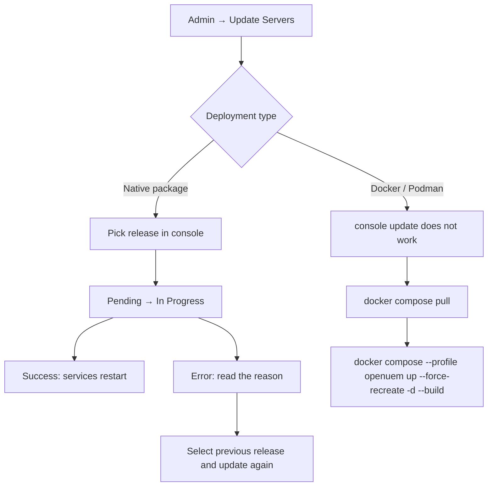
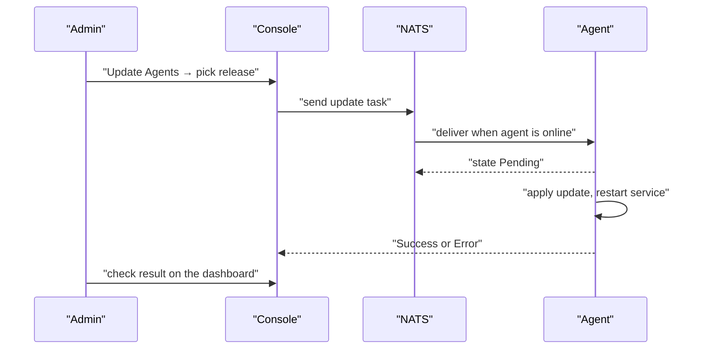

# Module 11 — Server and Agent Upgrades

## Treat upgrades as routine work

OpenUEM ships releases on a regular cadence. Skipping upgrades means missing
security fixes, and the wider the version gap between server and agents grows,
the more likely a compatibility problem becomes.

There are two halves to an upgrade:

- **Server components** — console, NATS, workers, OCSP responder
- **Agents** — the agent installed on each endpoint

The normal order is server first, then agents. A newer server keeps working
with older agents; the reverse direction is where problems appear.

## Server upgrades from the console

In the console go to **Admin → Update Servers**. This section is available in
the Global config only. The console checks whether a new release exists and the
table lists each server with the components installed on it.

The workflow is:

1. select the servers to upgrade (or use Select All)
2. choose the version in the **Select a release** dropdown
3. click **Update**
4. choose to install as soon as possible or at a specific date and time

Task states are:

| State | Meaning |
|---|---|
| Pending | request delivered, server has not started |
| In Progress | the update is running on the server |
| Success | update finished and services restarted |
| Error | the update failed; a description is shown |

Services restart during the update, so the console connection can drop for a
while. Leave the browser open and wait; reconnect when the services are back.

**Figure 1 — Choosing a server upgrade path**



Figure walkthrough — First the administrator opens Update Servers. Second, the
deployment type decides the path. With native packages the console can drive
the upgrade: the task moves from Pending to In Progress, and on success the
services restart. If it fails, read the error and roll back by selecting the
previous release. With Docker the console feature does not work at all, so the
two compose commands replace it.

## Upgrading a Docker deployment

The documentation is explicit: when you use Docker, the console's Update
Servers feature **does not work**. Upgrade from the command line instead.

```bash
docker compose pull
```

This pulls the newer images referenced by the compose file. Data volumes are
untouched.

```bash
docker compose --profile openuem up --force-recreate -d --build
```

`--profile openuem` selects the OpenUEM service group. `--force-recreate`
destroys and recreates the containers. `-d` runs in the background and
`--build` rebuilds images when needed.

Take a database dump before upgrading.

```bash
docker compose exec openuem-db pg_dump -U openuem -d openuem -Fc > openuem-pre-upgrade.dump
```

`pg_dump` runs inside the container and the result is written to a file on the
host. That dump is your rollback baseline.

## Agent upgrades from the console

Agent upgrades live in **Admin → Update Agents**, which is available in an
organization's config.

The console checks for a new release **every 6 hours** and every time the
service starts. When a release exists it shows a notice.

The workflow is:

1. select agents with the checkboxes (or Select All)
2. choose the version in **Select a release**
3. click **Update**
4. choose to install immediately or at a scheduled time

After the request is sent the state is **Pending**. On failure an error and a
description appear; on success the task is reported as successful.

To roll back, select the **previous release** in the dropdown and run the
update again — the documentation describes exactly this path.

The dashboard separates two counts:

- **Outdated agents** — agents not running the highest version found in your fleet
- **Agents that can be upgraded** — agents not on the latest release for their channel

**Figure 2 — Console-driven agent upgrade**



Figure walkthrough — First the administrator picks a release. Second, the
console publishes the task through NATS; if the agent is offline the message
waits in NATS until it connects. Third, the agent applies the update and
restarts its service. Fourth, the result travels back to the console and the
administrator confirms it on the dashboard.

## Pre-upgrade checklist

| Item | Why it matters |
|---|---|
| Database dump | restore point if the upgrade misbehaves |
| Certificate folder backup | without the CA key agents cannot re-establish trust |
| Read the release notes | breaking changes and minimum versions |
| Maintenance window | announce the service interruption |
| Pilot group | exercise the upgrade on a few agents first |
| Free disk space | images and dumps need room |
| Record current versions | you need the target for a rollback |

## Post-upgrade verification

```bash
systemctl is-active openuem-console openuem-nats-service openuem-agent-worker
```

All three services should report `active`. Use this on native installs and
`docker compose ps` on container deployments.

```bash
openuem-console --version
```

This prints the console version. If the binary has no `--version` flag, read
the version shown at the bottom of the console login page — verify per version.

The checks are:

1. every service is active
2. the console login works
3. agents are still reporting (visible on the dashboard)
4. upgrade tasks reached Success
5. certificates are valid and OCSP responds

## Operational cautions

- Never upgrade every agent at once. Work in waves and inspect the first wave
  before continuing.
- Announce the maintenance window to users in advance.
- On Docker, `--force-recreate` destroys containers, so confirm that `.env`
  still holds every required value.
- If agent versions remain mixed after the upgrade, re-check the outdated list.
- Before rolling back, confirm the old release still matches the current
  database schema; a newer version may have migrated it.

## Self-check questions

**1. Why can't you use Update Servers with Docker?**
The documentation states that the feature does not work for Docker. Use
`docker compose pull` and
`docker compose --profile openuem up --force-recreate -d --build` instead.

**2. An agent upgrade task sits in Pending. What could be wrong?**
The agent may be offline or unable to reach NATS. The task waits in NATS until
the agent connects. Check the agent's report interval and NATS port 4433.

**3. What must be backed up before an upgrade?**
The PostgreSQL database and the certificate folder, especially the CA key.
Without the CA key the trust chain for every agent breaks.

**4. How do you downgrade an agent?**
Select the previous release in Update Agents and run the update again, as the
documentation describes.

## Technical review notes

- Update Servers and Update Agents behaviour, the 6-hour check, the Docker
  warning and the rollback path come from openuem.eu/docs (Administration →
  Update Servers / Update Agents).
- Console menu labels and dashboard wording change between versions — verify
  per version.
- `openuem-console --version` may not exist in every release; fall back to the
  version shown in the console UI.
- The agent-side `openuem-agent-updater` service differs per distribution and
  needs separate verification.
