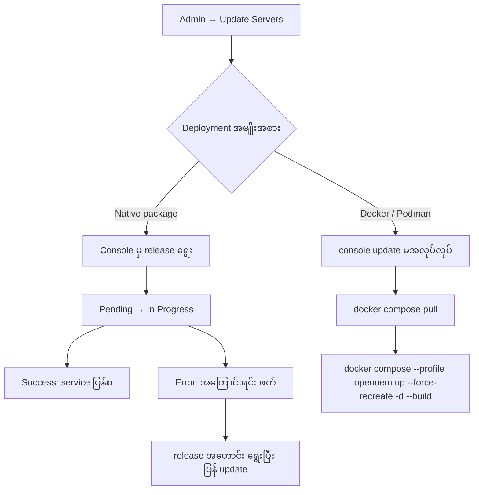
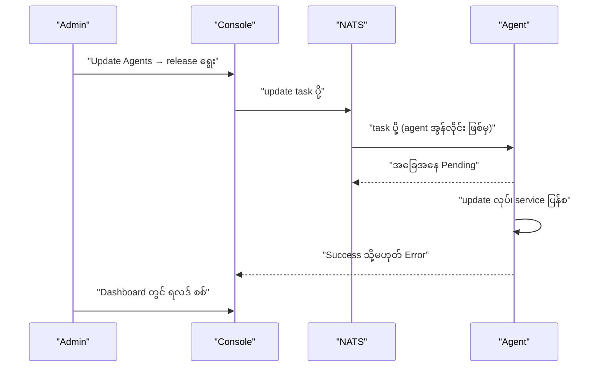

# Module 11 — Server နှင့် Agent Upgrade

## Upgrade ကို ပုံမှန် လုပ်ငန်းစဉ် အဖြစ် သတ်မှတ်ခြင်း

OpenUEM သည် အပတ်စဉ် သို့မဟုတ် လစဉ် release များ ထွက်သည်။ Upgrade မလုပ်ဘဲ
ထားပါက လုံခြုံရေး ပြင်ဆင်ချက်များ မရရှိနိုင်သလို agent နှင့် server ၏
version ကွာဟမှု ကြီးလာသည်နှင့်အမျှ compatibility ပြဿနာ ဖြစ်နိုင်သည်။

Upgrade တွင် အစိတ်အပိုင်း နှစ်မျိုး ရှိသည်။

- **Server component များ** — console၊ NATS၊ worker များ၊ OCSP responder
- **Agent များ** — endpoint တစ်ခုစီပေါ်ရှိ agent

Server ကို အရင် upgrade လုပ်ပြီး နောက်မှ agent များကို upgrade လုပ်ခြင်းသည်
ပုံမှန် အစဉ် ဖြစ်သည်။ Server အသစ်သည် agent အဟောင်းနှင့် ဆက်လက်
အလုပ်လုပ်နိုင်သော်လည်း ဆန့်ကျင်ဘက် အစဉ်တွင် ပြဿနာ ဖြစ်နိုင်သည်။

## Server upgrade — console မှ လုပ်ခြင်း

Console တွင် **Admin → Update Servers** သို့ သွားရသည်။ ဤအပိုင်းသည်
Global config တွင်သာ ရနိုင်သည်။ Console က release အသစ် ရှိ/မရှိ စစ်ဆေးပြီး
ဇယားတွင် server တစ်ခုချင်းစီနှင့် ၎င်းတို့တွင် install ထားသော component များကို
ပြသည်။

လုပ်ငန်းစဉ်မှာ —

1. upgrade လုပ်လိုသော server ကို ရွေးသည် (သို့မဟုတ် Select All)
2. **Select a release** dropdown မှ version ကို ရွေးသည်
3. **Update** ကို နှိပ်သည်
4. ချက်ချင်း (as soon as possible) သို့မဟုတ် သတ်မှတ်ရက်/အချိန်တွင်
   လုပ်မည်ကို ရွေးသည်

တာဝန်တစ်ခု၏ အခြေအနေများမှာ —

| အခြေအနေ | အဓိပ္ပာယ် |
|---|---|
| Pending | တာဝန် ပို့ပြီး၊ server က မစရသေး |
| In Progress | server ပေါ်တွင် update လုပ်နေသည် |
| Success | update ပြီးစီး၊ service များ ပြန်စတင်ပြီး |
| Error | update မအောင်မြင်၊ အကြောင်းရင်း ဖော်ပြချက် ပါသည် |

Update စဉ်အတွင်း service များ ပြန်စတင်သဖြင့် console နှင့် ချိတ်ဆက်မှု
ခဏ ပြတ်နိုင်သည်။ ထို အချိန်တွင် browser ကို မပိတ်ဘဲ စောင့်ရသည်။
Update ပြီးပါက ပြန်လည် ချိတ်ဆက်နိုင်သည်။

**Figure 1 — Server upgrade လမ်းကြောင်း ရွေးချယ်မှု**



ပုံရှင်းလင်းချက် — ပထမ၊ စီမံခန့်ခွဲသူက Update Servers သို့ ဝင်သည်။
ဒုတိယ၊ deployment အမျိုးအစားကို စစ်သည်။ Native package ဖြစ်ပါက console မှ
release ရွေးပြီး update လုပ်နိုင်သည်။ တာဝန်သည် Pending မှ In Progress သို့
ပြောင်းပြီး အောင်မြင်ပါက service များ ပြန်စသည်။ မအောင်မြင်ပါက error
ဖော်ပြချက်ကို ဖတ်ပြီး release အဟောင်းကို ရွေးကာ ပြန် update လုပ်ခြင်းဖြင့်
rollback လုပ်သည်။ Docker ဖြစ်ပါက console ၏ update လုပ်ဆောင်ချက်သည်
အလုပ်မလုပ်သဖြင့် `docker compose pull` နှင့် `--force-recreate` ဖြင့်
ပြန်လည် ဖန်တီးရသည်။

## Docker deployment တွင် upgrade လုပ်ခြင်း

Documentation တွင် တိကျစွာ သတိပေးထားသည် — Docker အသုံးပြုပါက console ၏
Update Servers လုပ်ဆောင်ချက်သည် **အလုပ်မလုပ်**ပါ။ ထို အခြေအနေတွင်
command line မှ upgrade လုပ်ရသည်။

```bash
docker compose pull
```

ဤ command သည် compose ဖိုင် တွင် သတ်မှတ်ထားသော image များ၏ version အသစ်ကို
ဆွဲသည်။ ဒေတာ volume များကို မထိခိုက်ပါ။

```bash
docker compose --profile openuem up --force-recreate -d --build
```

`--profile openuem` သည် OpenUEM service အုပ်စုကို ရွေးသည်။
`--force-recreate` သည် container များကို ဖျက်ပြီး အသစ် ဖန်တီးသည်။
`-d` သည် background တွင် run သည်။ `--build` သည် လိုအပ်ပါက image ကို
ပြန်တည်ဆောက်သည်။

Upgrade မတိုင်မီ database dump ယူထားရသည်။

```bash
docker compose exec openuem-db pg_dump -U openuem -d openuem -Fc > openuem-pre-upgrade.dump
```

`pg_dump` ကို container အတွင်းမှ run ပြီး ရလဒ်ကို host ၏ ဖိုင်အဖြစ်
သိမ်းသည်။ ဤ dump သည် rollback လုပ်ရာတွင် အခြေခံ ဖြစ်သည်။

## Agent upgrade — console မှ အစုလိုက် လုပ်ခြင်း

Agent များ၏ upgrade ကို **Admin → Update Agents** တွင် လုပ်သည်။
ဤအပိုင်းသည် organization ၏ config တွင်သာ ရနိုင်သည်။

Console သည် release အသစ်ကို **၆ နာရီတစ်ကြိမ်** နှင့် service စတင်သည့်
အချိန်တိုင်း စစ်ဆေးသည်။ Release အသစ် ရှိပါက စာတိုဖြင့် အသိပေးသည်။

လုပ်ငန်းစဉ်မှာ —

1. upgrade လုပ်လိုသော agent များကို checkbox ဖြင့် ရွေး (သို့မဟုတ် Select All)
2. **Select a release** မှ version ရွေး
3. **Update** နှိပ်
4. ချက်ချင်း သို့မဟုတ် သတ်မှတ်အချိန်တွင် လုပ်မည်ကို ရွေး

တာဝန်ပို့ပြီးနောက် အခြေအနေသည် **Pending** ဖြစ်သည်။ မအောင်မြင်ပါက error
နှင့် ဖော်ပြချက် ပေါ်သည်။ အောင်မြင်ပါက task success ဟု ပြသည်။

Rollback လုပ်လိုပါက dropdown မှ **release အဟောင်း** ကို ရွေးပြီး ထပ်
update လုပ်သည်။ Documentation တွင် ဤနည်းလမ်းကို တိုက်ရိုက် ဖော်ပြထားသည်။

Dashboard တွင် agent နှစ်မျိုးကို ခွဲပြသည်။

- **Outdated agents** — မိမိ၏ agent များထဲမှ အနိမ့်ဆုံး version မဟုတ်သော agent များ
- **Agents that can be upgraded** — release channel အလိုက် နောက်ဆုံး version မဟုတ်သော agent များ

**Figure 2 — Console မှ agent upgrade လုပ်ငန်းစဉ်**



ပုံရှင်းလင်းချက် — ပထမ၊ စီမံခန့်ခွဲသူက release ကို ရွေးသည်။ ဒုတိယ၊
console က task ကို NATS မှတစ်ဆင့် agent သို့ ပို့သည်။ Agent အွန်လိုင်း
မဖြစ်ပါက task သည် NATS တွင် စောင့်ပြီး ချိတ်ဆက်သည့်အခါ ပို့သည်။
တတိယ၊ agent က update လုပ်ပြီး service ပြန်စသည်။ စတုတ္ထ၊ ရလဒ်ကို
console သို့ ပြန်ပို့ပြီး စီမံခန့်ခွဲသူက dashboard တွင် စစ်သည်။

## Upgrade မတိုင်မီ စစ်ဆေးရန် စာရင်း

| အချက် | ဘာကြောင့် |
|---|---|
| Database dump | ပြဿနာ ဖြစ်ပါက ပြန်လည် ရယူရန် |
| Certificate folder backup | CA key မရှိပါက agent များ ပြန်မချိတ်နိုင် |
| Release notes ဖတ်ခြင်း | breaking change နှင့် လိုအပ်သော version ကို သိရန် |
| Maintenance window | service ပြတ်ချိန် ကို ကြိုတင် အသိပေး |
| Pilot group | agent အနည်းငယ်တွင် ဦးစွာ စမ်းသပ် |
| Disk နေရာ | image နှင့် dump အတွက် |
| လက်ရှိ version မှတ်တမ်း | rollback လုပ်ရန် version ကို သိရန် |

## Upgrade ပြီးနောက် စစ်ဆေးရန်

```bash
systemctl is-active openuem-console openuem-nats-service openuem-agent-worker
```

Service သုံးခုလုံး `active` ပြန်သင့်သည်။ Native install တွင် ဤ command ကို
သုံးပြီး container တွင် `docker compose ps` ကို သုံးသည်။

```bash
openuem-console --version
```

Console ၏ version ကို ပြသည်။ Binary တွင် `--version` flag မရှိပါက
console ၏ login page အောက်ခြေတွင် ပြထားသော version ကို ကြည့်နိုင်သည် —
version အလိုက် ပြန်စစ်ရန် လိုသည်။

စစ်ဆေးရမည့် အချက်များမှာ —

1. service အားလုံး active ဖြစ်ခြင်း
2. console သို့ login ဝင်နိုင်ခြင်း
3. agent များ report ပို့နေခြင်း (Dashboard တွင် မြင်နိုင်သည်)
4. upgrade task များ Success ဖြစ်ခြင်း
5. certificate သက်တမ်းနှင့် OCSP ကောင်းမွန်ခြင်း

## လုပ်ငန်းခွင်တွင် သတိပြုရန်

- Agent များကို တစ်ပြိုင်နက် အားလုံး upgrade မလုပ်ရ။ အုပ်စုအလိုက်
  (wave) လုပ်ပြီး ပထမ အုပ်စု၏ ရလဒ်ကို စစ်ပြီးမှ ဆက်လုပ်ရသည်။
- Maintenance window ကို အသုံးပြုသူများထံ ကြိုတင် အသိပေးရသည်။
- Docker တွင် `--force-recreate` သည် container များကို ဖျက်သဖြင့်
  environment variable များ `.env` မှ ပြန်ဖတ်ကြောင်း သေချာရသည်။
- Upgrade ပြီးနောက် agent version များ မတူညီဘဲ ကျန်နေပါက dashboard ၏
  outdated စာရင်းကို ပြန်စစ်ရသည်။
- Rollback လုပ်ပါက database schema အဟောင်းနှင့် ကိုက်ညီမှုကို
  ကြိုတင်စစ်ရသည်။ Version အသစ်တွင် schema ပြောင်းထားနိုင်သည်။

## ကိုယ်တိုင်စစ်ဆေးရန် မေးခွန်းများ

**၁။ Docker deployment တွင် console ၏ Update Servers ကို ဘာကြောင့်
မသုံးနိုင်သနည်း။**
Documentation တွင် Docker အတွက် ထို လုပ်ဆောင်ချက် အလုပ်မလုပ်ကြောင်း
သတိပေးထားသည်။ ထို အခြေအနေတွင် `docker compose pull` နှင့်
`docker compose --profile openuem up --force-recreate -d --build` ကို
သုံးရသည်။

**၂။ Agent upgrade task တစ်ခုသည် Pending တွင် ရှိနေသည်။ ဘာဖြစ်နိုင်သနည်း။**
Agent သည် အွန်လိုင်း မဖြစ်နိုင်၊ သို့မဟုတ် NATS သို့ မချိတ်ဆက်နိုင်ခြင်း
ဖြစ်နိုင်သည်။ Task သည် NATS တွင် စောင့်ပြီး agent ချိတ်ဆက်သည့်အခါ
ပို့သည်။ Agent ၏ report အချိန်နှင့် NATS port (4433) ကို စစ်ရသည်။

**၃။ Upgrade မတိုင်မီ ဘာကို မဖြစ်မနေ backup လုပ်ရသနည်း။**
PostgreSQL database နှင့် certificate folder (အထူးသဖြင့် CA key) ဖြစ်သည်။
CA key မရှိပါက agent များ၏ ယုံကြည်မှု ကွင်းဆက် ပြတ်သွားနိုင်သည်။

**၄။ Agent version ကို ဘယ်လို ပြန်လျှော့နိုင်သနည်း။**
Update Agents တွင် dropdown မှ release အဟောင်းကို ရွေးပြီး ထပ် update
လုပ်သည်။ Documentation တွင် ဤနည်းလမ်းကို ဖော်ပြထားသည်။

## Technical review notes

- Update Servers နှင့် Update Agents ၏ အဆင့်များ၊ ၆ နာရီ စစ်ဆေးမှု၊
  Docker သတိပေးချက်နှင့် rollback နည်းလမ်းကို openuem.eu/docs
  (Administration → Update Servers / Update Agents) မှ ရယူထားသည်။
- Console menu အမည်များနှင့် dashboard စာသားများသည် version အလိုက်
  ပြောင်းနိုင်သည် — version အလိုက် ပြန်စစ်ရန် လိုသည်။
- `openuem-console --version` flag သည် version အလိုက် မရှိနိုင်ပါ။
  ထို အခြေအနေတွင် console UI တွင် ပြထားသော version ကို သုံးရသည်။
- Agent ၏ openuem-agent-updater service အသေးစိတ်သည် distribution အလိုက်
  ကွာခြားနိုင်သည် — သီးခြား စစ်ဆေးရန် လိုသည်။
