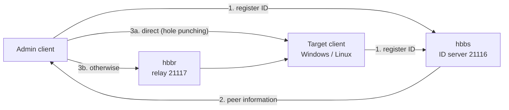
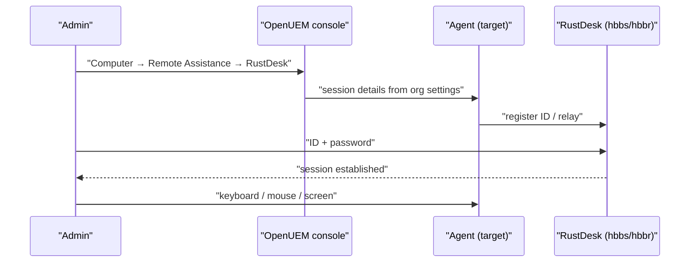

# Module 12 — Remote Desktop with RustDesk

## Three remote assistance paths

OpenUEM supports three ways to reach an endpoint remotely. The choice depends
on the endpoint's operating system and display server.

| Method | Suitable endpoints | Requirement |
|---|---|---|
| VNC | Windows, Linux (X11) | TightVNC/UltraVNC/TigerVNC on Windows, x11vnc on Linux |
| RDP | Linux (Wayland + Gnome) | Gnome Remote Desktop |
| RustDesk | Windows, Linux, macOS | RustDesk client plus a reachable server |

RustDesk is the only path that covers all three platforms, which makes it the
common choice in a mixed fleet.

## How RustDesk works

RustDesk is peer-to-peer. Both sides run a client. Before a session starts, the
ID server helps the two peers find each other. If a direct connection is not
possible, the relay server forwards the traffic.

- **hbbs** — the ID/rendezvous server. It registers client IDs and introduces
  peers. It generates the key pair on first run.
- **hbbr** — the relay server. It forwards traffic when NAT prevents a direct
  connection.
- **Public key** — the `id_ed25519.pub` file. Clients use it to trust the
  server and to encrypt the connection.

**Figure 1 — RustDesk connection path**



Figure walkthrough — First, both clients connect to hbbs and register their
IDs. Second, hbbs returns the peer information each side needs. Third, the
clients attempt a direct connection using TCP hole punching. If the network
prevents that, traffic is forwarded through the relay (hbbr), which costs more
bandwidth.

## Running the RustDesk server with Docker

The simplest way to run RustDesk Server OSS is the official compose file.

```bash
wget rustdesk.com/oss.yml -O compose.yml
sudo docker compose up -d
```

The first command downloads the official compose file; the second starts the
hbbs and hbbr containers.

To start the two containers manually:

```bash
sudo docker run --name hbbs -v ./data:/root -td --net=host --restart unless-stopped rustdesk/rustdesk-server hbbs
```

```bash
sudo docker run --name hbbr -v ./data:/root -td --net=host --restart unless-stopped rustdesk/rustdesk-server hbbr
```

`-v ./data:/root` persists data (including the key) on the host. `--net=host`
lets the containers use the ports directly. `--restart unless-stopped` brings
them back after a reboot.

Read the key with:

```bash
cat ./data/id_ed25519.pub
```

This key goes into the clients and into OpenUEM's RustDesk settings.

## Ports and firewall

| Port | Protocol | Purpose |
|---|---|---|
| 21114 | TCP | web console (Pro version only) |
| 21115 | TCP | NAT type test |
| 21116 | TCP and UDP | ID registration and heartbeat (UDP), TCP hole punching |
| 21117 | TCP | relay service (hbbr) |
| 21118 | TCP | web client |
| 21119 | TCP | web client |

Open them with UFW on Ubuntu:

```bash
sudo ufw allow 21114:21119/tcp
sudo ufw allow 21116/udp
sudo ufw enable
```

The first rule opens the TCP range; the second opens UDP for 21116. Port 21116
must be open for both protocols.

> If you do not use the web client, keep 21118 and 21119 closed. Those ports
> trust the `X-Real-IP` header without validating it, so exposing them directly
> allows IP spoofing.

## Installing the clients

**Windows** — install the official RustDesk installer (MSI/EXE). For silent
rollouts use the standard MSI flags. RustDesk runs as a service, so a session
is possible even when nobody is logged in.

**Linux (Debian/Ubuntu)** — download the official `.deb` and install it.

```bash
sudo apt install ./rustdesk-<version>-x86_64.deb
```

Replace `<version>` with the downloaded version. Package names and versions
change between releases — verify per version.

**macOS** — install the official `.dmg` and grant Screen Recording and
Accessibility permissions.

## Pointing a client at a self-hosted server

In the RustDesk client open Menu (⋮) → **Network** and set:

- **ID Server** — the hbbs host or IP (required)
- **Key** — the contents of `id_ed25519.pub` (required)
- **Relay Server** — usually unnecessary; set hbbr only when you want to pin it
- **API Server** — Pro accounts and web console features only

The ID Server accepts `hbbs.example.com` or `hbbs.example.com:21116`.

## OpenUEM's RustDesk integration

From version 0.10.0 OpenUEM can distribute basic RustDesk settings. An
organization's settings include a **RustDesk** tab with:

- the self-hosted relay server host or IP
- the self-hosted ID server host or IP
- the public key contents (usually `/var/lib/rustdesk-server/id_ed25519.pub`)
- whether to use a permanent password — when enabled, a random password is
  generated for each connection

Once configured, open a computer in the Computers view and click
**Remote Assistance → RustDesk**. The agent prepares the session details.

**Figure 2 — Starting a RustDesk session from OpenUEM**



Figure walkthrough — First, the administrator chooses RustDesk in the console.
Second, the console uses the organization's ID server, relay and key settings
and sends the session details to the agent. Third, the agent registers with the
RustDesk server. Fourth, the administrator connects with the ID and password.
Fifth, once connected, keyboard, mouse and screen are controlled remotely.

## Security and operational cautions

- Prefer a self-hosted server over public RustDesk servers so you control the
  data path.
- Never share a permanent password; OpenUEM's random per-session password is
  safer.
- Keep 21118/21119 closed unless you run the web client, and expose them only
  through a reverse proxy.
- Remote endpoints outside the LAN may require the relay, which consumes more
  bandwidth.
- Review connection logs after every session.
- On macOS, a session shows no screen until Screen Recording and Accessibility
  are granted.

## Self-check questions

**1. What is the difference between the ID server and the relay server?**
hbbs registers client IDs and introduces peers; hbbr forwards traffic when a
direct connection is impossible.

**2. Which protocols must port 21116 allow?**
Both TCP and UDP: UDP for ID registration and heartbeat, TCP for hole punching.

**3. Where does the client key come from?**
From `id_ed25519.pub`, generated by hbbs on first run — under the `./data`
volume when running in Docker.

**4. Where do you configure RustDesk for OpenUEM?**
In the organization settings' RustDesk tab: ID server, relay server, public key
and the permanent-password option.

## Technical review notes

- The three remote assistance methods, the RustDesk integration (0.10.0+) and
  its settings come from openuem.eu/docs (Console → Computers → Remote
  Assistance).
- Ports, key file location and Docker commands come from rustdesk.com/docs
  (Self-host → RustDesk Server OSS).
- Client installer names and versions change between releases — verify per
  version.
- OpenUEM's RustDesk integration details (tab name, number of fields) may
  change between versions.
- macOS permission names differ between macOS versions.
