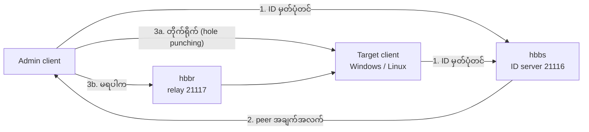
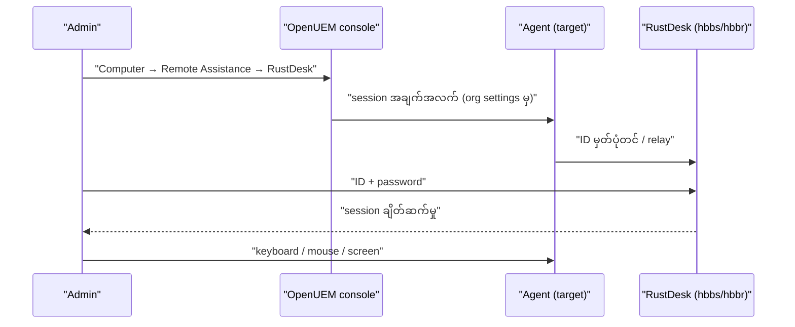

# Module 12 — RustDesk ဖြင့် Remote Desktop

## Remote assistance လမ်းကြောင်း သုံးမျိုး

OpenUEM သည် endpoint တစ်ခုသို့ အဝေးမှ ဝင်ရန် နည်းလမ်း သုံးမျိုးကို
ပံ့ပိုးသည်။ ရွေးချယ်မှုသည် endpoint ၏ operating system နှင့် display
server အပေါ် မူတည်သည်။

| နည်းလမ်း | သင့်လျော်သော endpoint | လိုအပ်ချက် |
|---|---|---|
| VNC | Windows၊ Linux (X11) | Windows တွင် TightVNC/UltraVNC/TigerVNC၊ Linux တွင် x11vnc |
| RDP | Linux (Wayland + Gnome) | Gnome Remote Desktop |
| RustDesk | Windows၊ Linux၊ macOS | RustDesk client နှင့် ချိတ်ဆက်နိုင်သော server |

RustDesk သည် platform သုံးမျိုးလုံးအတွက် တစ်ခုတည်းသော နည်းလမ်းဖြစ်သဖြင့်
ရောနှောထားသော fleet တွင် အသုံးအများဆုံး ဖြစ်သည်။

## RustDesk ၏ လုပ်ဆောင်ပုံ

RustDesk သည် peer-to-peer နည်းပညာ ဖြစ်သည်။ နှစ်ဖက်စလုံးတွင် client
run နေရသည်။ ချိတ်ဆက်မှု မစမီ ID server က နှစ်ဖက်ကို တွေ့ဆုံစေသည်။
တိုက်ရိုက် ချိတ်ဆက်မှု မရပါက relay server က data ကို ဖြတ်သန်း ပို့သည်။

- **hbbs** — ID/rendezvous server။ Client များ၏ ID ကို မှတ်ပုံတင်ပြီး
  တစ်ဖက်နှင့်တစ်ဖက် တွေ့ဆုံစေသည်။ ပထမ run တွင် key အတွဲကို ဖန်တီးသည်။
- **hbbr** — relay server။ NAT ကြောင့် တိုက်ရိုက် မချိတ်နိုင်ပါက
  traffic ကို ဖြတ်ပို့သည်။
- **Public key** — `id_ed25519.pub` ဖိုင်။ Client များက ဤ key ဖြင့်
  server ကို ယုံကြည်ပြီး ချိတ်ဆက်မှုကို encrypt လုပ်သည်။

**Figure 1 — RustDesk ချိတ်ဆက်မှု လမ်းကြောင်း**



ပုံရှင်းလင်းချက် — ပထမ၊ client နှစ်ခုလုံး hbbs သို့ ဆက်သွယ်ပြီး မိမိ ID ကို
မှတ်ပုံတင်သည်။ ဒုတိယ၊ hbbs က တစ်ဖက်၏ လိပ်စာ အချက်အလက်ကို ပေးသည်။
တတိယ၊ client နှစ်ခုသည် တိုက်ရိုက် ချိတ်ဆက်ရန် ကြိုးစားသည် (TCP hole
punching)။ ကွန်ရက် အခြေအနေကြောင့် တိုက်ရိုက် မရပါက relay (hbbr) မှတစ်ဆင့်
data ကို ဖြတ်ပို့သည်။ Relay ဖြစ်ပါက bandwidth ပိုကုန်သည်။

## RustDesk Server ကို Docker ဖြင့် တည်ဆောက်ခြင်း

RustDesk Server OSS ကို Docker ဖြင့် တည်ဆောက်ရန် အလွယ်ဆုံး နည်းလမ်းမှာ
တရားဝင် compose ဖိုင်ကို အသုံးပြုခြင်း ဖြစ်သည်။

```bash
wget rustdesk.com/oss.yml -O compose.yml
sudo docker compose up -d
```

ပထမ command က တရားဝင် compose ဖိုင်ကို ဆွဲယူသည်။ ဒုတိယက hbbs နှင့် hbbr
container နှစ်ခုကို စတင်သည်။

Container နှစ်ခုကို လက်ဖြင့် စတင်လိုပါက —

```bash
sudo docker run --name hbbs -v ./data:/root -td --net=host --restart unless-stopped rustdesk/rustdesk-server hbbs
```

```bash
sudo docker run --name hbbr -v ./data:/root -td --net=host --restart unless-stopped rustdesk/rustdesk-server hbbr
```

`-v ./data:/root` သည် ဒေတာ (key အပါအဝင်) ကို host တွင် သိမ်းသည်။
`--net=host` သည် port များကို တိုက်ရိုက် အသုံးပြုရန် ဖြစ်သည်။
`--restart unless-stopped` သည် server ပြန်တက်သည့်အခါ container ကို
အလိုအလျောက် ပြန်စေသည်။

Key ကို ဖတ်ရန် —

```bash
cat ./data/id_ed25519.pub
```

ဤ key ကို client များနှင့် OpenUEM ၏ RustDesk settings တွင် ထည့်ရသည်။

## Port များနှင့် Firewall

| Port | Protocol | တာဝန် |
|---|---|---|
| 21114 | TCP | web console (Pro version သာ) |
| 21115 | TCP | NAT type စမ်းသပ်မှု |
| 21116 | TCP နှင့် UDP | ID မှတ်ပုံတင်ခြင်း၊ heartbeat (UDP) နှင့် hole punching (TCP) |
| 21117 | TCP | relay service (hbbr) |
| 21118 | TCP | web client |
| 21119 | TCP | web client |

Ubuntu တွင် UFW ဖြင့် ဖွင့်ရန် —

```bash
sudo ufw allow 21114:21119/tcp
sudo ufw allow 21116/udp
sudo ufw enable
```

ပထမ command သည် TCP port ခြောက်ခုကို ဖွင့်သည်။ ဒုတိယက 21116 ၏ UDP ကို
ဖွင့်သည်။ 21116 ကို TCP နှင့် UDP နှစ်မျိုးလုံး ဖွင့်ရန် လိုအပ်သည်။

> Web client မသုံးပါက 21118 နှင့် 21119 ကို ပိတ်ထားရသည်။
> ထို port များသည် `X-Real-IP` header ကို မစစ်ဆေးသဖြင့် တိုက်ရိုက်
> ဖွင့်ထားပါက IP အတု ပြုလုပ်နိုင်သည်။

## Client များ install လုပ်ခြင်း

**Windows** — RustDesk ၏ တရားဝင် installer (MSI/EXE) ကို install လုပ်သည်။
Silent install လိုအပ်ပါက MSI ၏ standard flag များကို သုံးနိုင်သည်။
Install ပြီးနောက် RustDesk service အဖြစ် run သဖြင့် login မလုပ်ထားသော
အချိန်တွင်လည်း ချိတ်ဆက်နိုင်သည်။

**Linux (Debian/Ubuntu)** — တရားဝင် `.deb` package ကို ဆွဲယူပြီး install
လုပ်သည်။

```bash
sudo apt install ./rustdesk-<version>-x86_64.deb
```

`<version>` နေရာတွင် ဆွဲယူထားသော version ကို ထည့်ရသည်။ Package အမည်နှင့်
version သည် release အလိုက် ပြောင်းနိုင်သည် — version အလိုက် ပြန်စစ်ရန်
လိုသည်။

**macOS** — တရားဝင် `.dmg` ကို install ပြီး Screen Recording နှင့်
Accessibility permission များကို ပေးရသည်။

## Client ကို self-hosted server သို့ ချိတ်ခြင်း

RustDesk client တွင် Menu (⋮) → **Network** သို့ သွားပြီး အောက်ပါတန်ဖိုးများ
ထည့်သည်။

- **ID Server** — hbbs ၏ host သို့မဟုတ် IP (မဖြစ်မနေ)
- **Key** — `id_ed25519.pub` ၏ အကြောင်းအရာ (မဖြစ်မနေ)
- **Relay Server** — များသောအားဖြင့် မလိုအပ်ပါ။ သတ်မှတ်လိုပါက hbbr ကို ထည့်သည်။
- **API Server** — Pro account နှင့် web console အတွက်သာ

ID Server ကို `hbbs.example.com` သို့မဟုတ် `hbbs.example.com:21116` ပုံစံဖြင့်
ရေးနိုင်သည်။

## OpenUEM ၏ RustDesk Integration

OpenUEM version 0.10.0 မှစ၍ RustDesk ၏ အခြေခံ setting များကို OpenUEM မှ
ဖြန့်ဖြူးနိုင်သည်။ Organization ၏ settings တွင် **RustDesk** tab ရှိသည်။
ထို တွင် အောက်ပါတန်ဖိုးများ ထည့်သည်။

- Self-hosted relay server ၏ host သို့မဟုတ် IP
- Self-hosted ID server ၏ host သို့မဟုတ် IP
- Public key ၏ အကြောင်းအရာ (များသောအားဖြင့် `/var/lib/rustdesk-server/id_ed25519.pub`)
- Permanent password သုံး/မသုံး — သုံးပါက ချိတ်ဆက်မှုတိုင်း ကျပန်း password
  အသစ် ဖြစ်သည်

ထို setting များ ပြီးပါက Computers view တွင် endpoint တစ်ခုကို ရွေးပြီး
**Remote Assistance → RustDesk** ကို နှိပ်သည်။ Agent က ချိတ်ဆက်မှု
အချက်အလက်ကို ပြင်ဆင်ပေးသည်။

**Figure 2 — OpenUEM မှ RustDesk session စတင်ခြင်း**



ပုံရှင်းလင်းချက် — ပထမ၊ စီမံခန့်ခွဲသူက console မှ RustDesk ကို ရွေးသည်။
ဒုတိယ၊ console က organization settings မှ ID server၊ relay နှင့် key ကို
အသုံးပြုပြီး agent ထံ session အချက်အလက် ပို့သည်။ တတိယ၊ agent က RustDesk
server သို့ မှတ်ပုံတင်သည်။ စတုတ္ထ၊ စီမံခန့်ခွဲသူက ID နှင့် password ဖြင့်
ချိတ်ဆက်သည်။ ပဉ္စမ၊ ချိတ်ဆက်မှု ရပြီးနောက် keyboard၊ mouse နှင့် screen
ကို အဝေးမှ ထိန်းချုပ်နိုင်သည်။

## လုံခြုံရေး နှင့် လုပ်ငန်းခွင် သတိပြုချက်

- Public RustDesk server များကို မသုံးဘဲ self-hosted server ကို သုံးခြင်းဖြင့်
  ဒေတာ လမ်းကြောင်းကို မိမိ ထိန်းချုပ်နိုင်သည်။
- Permanent password ကို မျှဝေမထားရ။ OpenUEM ၏ ကျပန်း password ရွေးချယ်မှုက
  ပိုလုံခြုံသည်။
- 21118/21119 ကို မလိုအပ်ပါက ပိတ်ထားရသည်။ ဖွင့်ထားပါက reverse proxy
  မှတစ်ဆင့်သာ ဝင်စေရသည်။
- Remote endpoint (LAN အပြင်ဘက်) များတွင် relay လိုအပ်နိုင်ပြီး
  bandwidth ပိုကုန်သည်။
- Session ပြီးတိုင်း ချိတ်ဆက်မှု မှတ်တမ်းကို စစ်ဆေးရသည်။
- macOS တွင် Screen Recording နှင့် Accessibility permission မရှိပါက
  မျက်နှာပြင် မမြင်ရပါ။

## ကိုယ်တိုင်စစ်ဆေးရန် မေးခွန်းများ

**၁။ RustDesk တွင် ID server နှင့် relay server ၏ တာဝန် ကွာခြားချက်က ဘာလဲ။**
ID server (hbbs) သည် client များ၏ ID ကို မှတ်ပုံတင်ပြီး တစ်ဖက်နှင့်တစ်ဖက်
တွေ့ဆုံစေသည်။ Relay server (hbbr) သည် တိုက်ရိုက် ချိတ်ဆက်မှု မရသည့်အခါ
data ကို ဖြတ်ပို့သည်။

**၂။ Port 21116 ကို protocol ဘယ်နှစ်မျိုးဖြင့် ဖွင့်ရသနည်း။**
TCP နှင့် UDP နှစ်မျိုးလုံး ဖွင့်ရသည်။ UDP သည် ID မှတ်ပုံတင်ခြင်းနှင့်
heartbeat အတွက်၊ TCP သည် hole punching အတွက် ဖြစ်သည်။

**၃။ Client သို့ ထည့်ရမည့် key ကို ဘယ်မှ ရသနည်း။**
hbbs ပထမ run တွင် ဖန်တီးသော `id_ed25519.pub` ဖိုင်မှ ရသည်။
Docker တွင် `./data` volume အောက်တွင် ရှိသည်။

**၄။ OpenUEM မှ RustDesk ကို ဘယ်နေရာတွင် ပြင်ဆင်သနည်း။**
Organization settings ၏ RustDesk tab တွင် ID server၊ relay server၊ public key
နှင့် permanent password ရွေးချယ်မှုကို သတ်မှတ်သည်။

## Technical review notes

- Remote assistance နည်းလမ်း သုံးမျိုး၊ RustDesk integration (0.10.0+) နှင့်
  setting များကို openuem.eu/docs (Console → Computers → Remote Assistance)
  မှ ရယူထားသည်။
- Port များ၊ key ဖိုင် တည်နေရာနှင့် Docker command များကို
  rustdesk.com/docs (Self-host → RustDesk Server OSS) မှ ရယူထားသည်။
- Client installer အမည်နှင့် version သည် release အလိုက် ပြောင်းနိုင်သည် —
  version အလိုက် ပြန်စစ်ရန် လိုသည်။
- OpenUEM ၏ RustDesk integration အသေးစိတ် (tab အမည်၊ field အရေအတွက်) သည်
  version အလိုက် ပြောင်းနိုင်သည်။
- macOS permission အမည်များသည် macOS version အလိုက် ကွာခြားနိုင်သည်။
